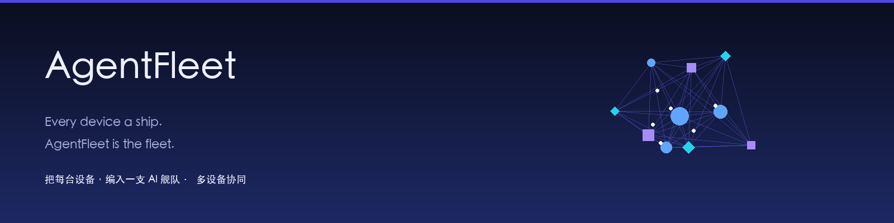

# AgentFleet · Cross-Device AI Orchestration — Every device a ship. AgentFleet is the fleet.

[](docs/images/banner.png)

AgentFleet is a **self-hosted cross-device AI orchestration layer**. It doesn't build new agents — it coordinates the AI agents **you've already installed** (Claude Code, Codex, Cursor, Aider, Gemini, Qwen, Grok and 10+ more) into one fleet, so you can run multiple coding agents across machines, watch them work on a live neural graph, and keep tamper-evident shared memory. Unlike multi-agent frameworks that rebuild agents from scratch, AgentFleet sits **above** what you already run.

> ⚡ **30-second start**
> ```bash
> npm install
> npm run dev:backend     # coordinator :4173
> npm run dev:frontend    # dashboard :5173 (demo mode even with zero devices)
> ```

[中文说明](README.zh-CN.md) · English

## ✨ Features

| Capability | Description |
|---|---|
| **Cross-device orchestration** | Auto-detect 13+ AI agent platforms per device via a data-driven adapter catalog; unified task protocol (submit / stream / cancel) |
| **Dynamic neural graph** | d3-force topology: 4 node types (device / agent / task / message flow) + 4 link types (call / return / stream / belongs), with pulse / flow / focus animations |
| **Blockchain-style memory ledger** | Append-only hash chain (`prev_hash` ring) + Merkle tree + distributed ledger + consensus (longest chain + deterministic tie-break) — tamper-evident team memory |
| **Smart routing gateway** | Built-in modelgateway workspace with an OpenAI-compatible endpoint; role-based routing (role → device + agent + model), failover and token ledger |
| **Excel batch deployment** | Upload an Excel sheet (device IP / account / password / SSH port); the target OS picks npm / pipx / brew / winget / PowerShell automatically, then verifies each install |
| **One-click uninstall** | Generate OS-aware uninstall scripts (npm / pipx / brew / winget) and verify the commands are really gone — still behind human confirmation |
| **Deploy-then-use** | A deployment target can carry a deviceId + platform models; on success the device+agent is bound to the routing gateway model |
| **Platform model failover** | Configure a primary + fallback model per device agent; auto-switch on failure, degrade to local when all fail, with manual switch/reset |
| **Per-device team mode** | Bind each device to a different team (A = software team, B = content team); `target.mode='team'` routes only to that team's devices |
| **Asset distribution** | Unified Asset model for rules / knowledge / skills, delivered to one device or a whole batch |
| **Expert teams & loops** | Assign expert teams (role routing) to single/cross-device agent teams; orchestrate single/batch/cross-device loops |
| **Primary AI agent** | Set a primary AI agent per device or in batch — auto-routing prefers it |
| **Free-source rating** | Live chat probes against Kilo / OpenCode, rated 优/中/差; keep only 优 and 中 |
| **Auto check-in** | Startup check-in + scheduled auto check-in + audit for free sources that award credits via check-in |
| **Model Nexus** | Inspired by EchoBird: batch configure paid Providers, mask API keys, persist them in the local ignored directory, and reuse them across the whole fleet |
| **Onboarding guide** | First-run guide explains the device fleet → modelgateway → Provider → deploy-then-use → failover workflow |
| **WeChat assistant** | Enterprise WeChat (official API) + personal WeChat (interface reserved) as a chat-based task entry |

## ⚡ Performance

Cross-device scheduling is benchmarked and reproducible — the numbers below are the reference point for "cross-device capability". Full report: [`docs/24-benchmark报告.md`](docs/24-benchmark报告.md).

| Metric | Value |
|---|---|
| Scheduler throughput (200 tasks) | **303 tasks/s** (4 devices × 2 agents) |
| Scheduler throughput (1000 tasks) | **377 tasks/s** |
| Real multi-device throughput | **96 tasks/s** (2 devices × 2 agents, real ws link) |
| Claim throttling | peak concurrency = theoretical peak (no over-dispatch) |
| Failover | **lost = 0** |
| Disconnect migration | running → queued, auto re-dispatch (no lost task) |

```bash
npm run benchmark --workspace backend           # scheduler core (mock devices)
npm run benchmark:multi --workspace backend     # real multi-device (1 backend + N device processes)
```

## 🧩 Supported agent platforms and responsibility boundaries

AgentFleet can **deploy / uninstall / discover / route multiple agent platforms**, but local CLI execution and modelgateway execution are two different paths:

- **Install / uninstall**: 13 platforms are mapped to OS-aware npm / pipx / brew / winget / manual-verify scripts, with post-install or post-uninstall verification.
- **Discover / report**: the per-device daemon detects installed platforms and reports them as workers inside that device fleet.
- **Deploy-then-use**: a deployment target can carry `deviceId + platform models`; after a successful deployment AgentFleet binds the device+agent platform to built-in modelgateway models and runs tasks through the gateway first.
- **Local CLI direct execution**: `grok` is the currently stable direct adapter; the other platforms have discovery and dispatch scaffolding, but their headless flags, login state and output formats must be verified per platform before they are marked stable.

| Platform | Install / uninstall | Discover | Gateway model execution | Local CLI direct execution |
|---|---|---|---|---|
| Codex | npm | ✅ | ✅ | ✅ cli-text（待实机验证） |
| Claude Code | npm | ✅ | ✅ | ✅ cli-stream（待实机验证） |
| DSH Desktop | manual verify | ✅ | ✅ | scaffold |
| Grok | manual verify | ✅ | ✅ | ✅ stable |
| Cursor | macOS brew / Windows winget | ✅ | ✅ | scaffold |
| Aider | pipx | ✅ | ✅ | ✅ cli-text（单轮） |
| Gemini CLI | npm | ✅ | ✅ | ✅ cli-text（待实机验证） |
| Cody | npm | ✅ | ✅ | scaffold |
| Qwen Code | npm | ✅ | ✅ | scaffold |
| Doubao MarsCode | npm | ✅ | ✅ | scaffold |
| Kimi CLI | npm | ✅ | ✅ | scaffold |
| OpenCode | npm | ✅ | ✅ | scaffold |
| Windsurf | macOS brew / Windows winget | ✅ | ✅ | scaffold |

See the full matrix in [`docs/17-Agent平台安装卸载与调用矩阵.md`](docs/17-Agent平台安装卸载与调用矩阵.md).

## 🏗️ Architecture

```
┌─────────────────────────────────────────────────────────────┐
│  Entry:  Web Dashboard (neural graph)  ·  WeChat assistant   │
├─────────────────────────────────────────────────────────────┤
│  Backend (coordinator):  device registry · task scheduler    │
│                          role routing · asset · deploy       │
│                          teams · loops · memory ledger       │
├─────────────────────────────────────────────────────────────┤
│  Built-in modelgateway:  OpenAI-compatible API · Provider pool│
├─────────────────────────────────────────────────────────────┤
│  Transport:  LAN first (mDNS + direct) + cloud relay fallback│
├─────────────────────────────────────────────────────────────┤
│  Device agents:  daemon + adapter catalog (13+ platforms)    │
│                  memory ledger replica (catch-up sync)       │
└─────────────────────────────────────────────────────────────┘
```

Monorepo workspaces:

```
agent-fleet/
├── shared/         # protocol (single source of truth)
├── backend/        # coordinator + relay + memory ledger + routing + deploy
├── frontend/       # adaptive dashboard (dynamic neural graph)
├── device-agent/   # per-device daemon + adapters + asset receiver
├── wechat/         # WeChat gateway (enterprise + personal)
├── memory/         # blockchain-style memory ledger core (hash chain + Merkle)
├── modelgateway/   # built-in model router (OpenAI-compatible + Provider pool)
└── docs/           # 18 design / architecture documents
```

## 🚀 Quick Start

**Prerequisites**: Node.js v24 (e.g. `nvm use 24`). On some systems `better-sqlite3` is built against a specific Node version — make sure `node -v` prints v24.

```bash
npm install

# coordinator :4173
npm run dev:backend

# dashboard :5173 (opens in demo mode even with zero devices)
npm run dev:frontend

# per-device daemon (set COORDINATOR_URL=ws://127.0.0.1:4173 if mDNS is blocked)
npm run dev:agent

# built-in model routing gateway :18765 (or start it from the Deploy page)
npm run dev:gateway

# cloud relay :4174 · WeChat gateway :4175
npm run dev:relay
npm run dev:wechat

# full build + tests
npm run build
npm run test --workspace memory
```

**Demo mode**: with no devices connected, the dashboard automatically plays a live cross-device simulation — tasks flow through `queued → running → completed`, stream particles animate, device load updates, and a phone node toggles online/offline.

## 📚 Documentation

See [`docs/`](docs/) for 18 documents: reverse-engineering of Grok's orchestration, PRD, architecture, UI design, the blockchain memory ledger design, routing-gateway fusion, free-source integration, platform model binding, management UI, EchoBird-inspired Model Nexus notes, and the agent platform capability matrix.

## 🔒 Safety

- Deployment passwords are **never persisted** (in-memory only, cleared after use).
- Deploy / uninstall / asset-deliver / loop-start all require an explicit **human confirmation gate** before any outbound action.

## 🧪 Verification

```bash
# Backend unit + integration tests (per-device teams, uninstall, free-source fallback)
npm run test --workspace backend

# Probe real free sources (Kilo / OpenCode + local modelgateway)
npm run probe:free --workspace backend
```

## 📄 License

[MIT](LICENSE)
