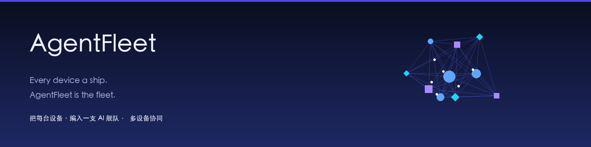

# AgentFleet · 跨设备智能体协同 —— 把每台设备，变成一支 AI 蜂群

[](docs/images/banner.png)

AgentFleet 是一个**可自托管的跨设备智能体协同层**。它不造新 agent，而是把你每台设备上**已安装**的 AI agent（Codex / Claude Code / Cursor / Aider / Gemini / Qwen / Grok 等 13+ 平台）统一调度，让你能在一台电脑上同时运行多个 AI 编程助手、跨设备像指挥一支蜂群一样协同，用动态神经图实时看见它们工作，并拥有防篡改的共享记忆。不同于那些从零再造 agent 的多智能体框架，AgentFleet 架设在你已有的 agent 之上。

> ⚡ **30 秒上手**
> ```bash
> npm install
> npm run dev:backend     # 协调服务 :4173
> npm run dev:frontend    # 看板 :5173（零设备也自动进入演示模式）
> ```

[English](README.md) · 中文

## ✨ 功能特性

| 能力 | 说明 |
|---|---|
| **跨设备调度** | 数据驱动的适配器目录自动探测 13+ 种 AI agent 平台；统一任务协议（下发 / 流式 / 取消） |
| **动态神经图** | d3-force 拓扑：4 类节点（设备 / agent / 任务 / 消息流）+ 4 类连线（调用 / 返回 / 流式 / 归属），脉冲 / 流动 / 聚焦动画 |
| **区块链式记忆账本** | 追加式哈希链（`prev_hash` 环环相扣）+ Merkle 树 + 分布式账本 + 共识（最长链 + 确定性裁决）——防篡改的团队记忆 |
| **智能路由网关** | 内置 modelgateway 工作区，提供 OpenAI 兼容接口；角色路由（角色 → 设备 + agent + 模型）+ 故障转移 + token 台账 |
| **Excel 批量部署** | 上传 Excel（设备 IP / 账号 / 密码 / SSH 端口），按目标 OS 自动选择 npm / pipx / brew / winget / PowerShell 安装方式并验证 |
| **一键卸载** | 按 OS × 平台生成卸载脚本（npm / pipx / brew / winget），卸载后验证命令确实不存在，同样需人工确认 |
| **部署即用** | 部署时可指定 deviceId + 平台模型，成功即把「设备 + agent」绑定到路由网关模型 |
| **平台模型故障切换** | 为设备 agent 配置主模型 + 兜底；主模型故障自动切换兜底、全失败降级本地，支持手动切换/恢复 |
| **按设备团队模式** | 每台设备可绑定不同团队（A=软件开发团队、B=内容专家团队），任务 `target.mode='team'` 只在该团队设备上路由 |
| **资产分发** | 规则 / 资料库 / skills 统一 Asset 模型，批量或单设备下发 |
| **专家团队 & Loop** | 为单 / 跨设备分配专家团队（角色路由），编排单 / 批量 / 跨设备 loop |
| **主 AI agent** | 单 / 批量设备设置主 agent，auto 路由优先使用 |
| **免费源评级探测** | 直连 Kilo / OpenCode 做真实 chat 探测，按优/中/差评级，只保留优与中 |
| **自动签到** | 对需要签到领取积分的免费源提供启动后签到 + 定时自动签到 + 审计 |
| **Model Nexus** | 借鉴 EchoBird：付费 Provider 批量配置、脱敏回显、本机忽略目录持久化，供所有设备蜂群复用 |
| **新手引导** | 首次进入看板自动解释「设备蜂群 → modelgateway → Provider → 部署即用 → 故障切换」主流程 |
| **微信助理** | 企业微信（官方 API）+ 个人微信（接口预留）聊天式下发任务 |

## 🧩 支持的 agent 平台与能力边界

AgentFleet 可以**一键部署 / 卸载 / 发现 / 路由多个 agent 平台**，但「本地 CLI 真接调用」与「经 modelgateway 执行模型」是两条不同路径：

- **安装 / 卸载**：13 个平台按 OS 自动生成 npm / pipx / brew / winget / manual verify 脚本，并做安装后或卸载后验证。
- **发现 / 上报**：设备守护自动探测已安装平台，作为每台设备蜂群里的工蜂上报。
- **部署即用**：部署目标可携带 `deviceId + platform models`，成功后自动把「设备 + agent 平台」绑定到内置 modelgateway 模型，任务优先经网关执行。
- **本地 CLI 真接**：当前稳定真接的是 `grok`；其他平台已具备发现与派发骨架，但 headless 参数、登录态和输出格式需逐平台实测后再标为稳定。

| 平台 | 安装/卸载 | 发现上报 | 网关模型执行 | 本地 CLI 真接 |
|---|---|---|---|---|
| Codex | npm | ✅ | ✅ | 骨架 |
| Claude Code | npm | ✅ | ✅ | 骨架 |
| DSH Desktop | 手动验证 | ✅ | ✅ | 骨架 |
| Grok | 手动验证 | ✅ | ✅ | ✅ 稳定 |
| Cursor | macOS brew / Windows winget | ✅ | ✅ | 骨架 |
| Aider | pipx | ✅ | ✅ | 骨架 |
| Gemini CLI | npm | ✅ | ✅ | 骨架 |
| Cody | npm | ✅ | ✅ | 骨架 |
| Qwen Code | npm | ✅ | ✅ | 骨架 |
| 豆包 MarsCode | npm | ✅ | ✅ | 骨架 |
| Kimi CLI | npm | ✅ | ✅ | 骨架 |
| OpenCode | npm | ✅ | ✅ | 骨架 |
| Windsurf | macOS brew / Windows winget | ✅ | ✅ | 骨架 |

完整能力矩阵见 [`docs/17-Agent平台安装卸载与调用矩阵.md`](docs/17-Agent平台安装卸载与调用矩阵.md)。

## 🏗️ 架构

```
┌─────────────────────────────────────────────────────────────┐
│  入口：Web 看板（动态神经图） · 微信助理                     │
├─────────────────────────────────────────────────────────────┤
│  后端（协调器）：设备注册表 · 任务调度 · 角色路由 · 资产     │
│                 部署 · 团队 · Loop · 记忆账本                │
├─────────────────────────────────────────────────────────────┤
│  内置 modelgateway：OpenAI 兼容接口 · Provider 池 · 免费源   │
├─────────────────────────────────────────────────────────────┤
│  传输：局域网优先（mDNS + 直连）+ 云端中继兜底               │
├─────────────────────────────────────────────────────────────┤
│  设备端：守护进程 + 适配器目录（13+ 平台）+ 记忆账本副本     │
└─────────────────────────────────────────────────────────────┘
```

Monorepo 工作区：

```
agent-fleet/
├── shared/         # 协议（单一事实源）
├── backend/        # 协调器 + 中继 + 记忆账本 + 路由 + 部署
├── frontend/       # 自适应看板（动态神经图）
├── device-agent/   # 设备守护 + 适配器 + 资产接收
├── wechat/         # 微信网关（企业 + 个人）
├── memory/         # 区块链式记忆账本核心（哈希链 + Merkle）
├── modelgateway/   # 内置模型路由网关（OpenAI 兼容 + Provider 池）
└── docs/           # 18 份设计 / 架构文档
```

## 🚀 快速开始

**前置**：Node.js v24（如 `nvm use 24`）。部分系统 `better-sqlite3` 按特定 Node 版本编译，请确认 `node -v` 输出 v24。

```bash
npm install

# 协调服务 :4173
npm run dev:backend

# 看板 :5173（零设备也自动进入演示模式）
npm run dev:frontend

# 设备守护（mDNS 受限时设 COORDINATOR_URL=ws://127.0.0.1:4173）
npm run dev:agent

# 内置模型路由网关 :18765（也可在部署页一键启动）
npm run dev:gateway

# 云端中继 :4174 · 微信网关 :4175
npm run dev:relay
npm run dev:wechat

# 全量构建 + 测试
npm run build
npm run test --workspace memory
```

**演示模式**：无设备接入时，看板自动播放一场跨设备协同演示——任务走完 `排队 → 运行 → 完成` 全生命周期，流式光点流动，设备负载联动，手机节点周期上下线。

## 📚 文档

见 [`docs/`](docs/)：grok 协同逆向研究、PRD、架构设计、UI 设计、区块链记忆账本设计、路由网关融合设计、免费源接入实测、平台模型绑定、管理界面、EchoBird 借鉴与 agent 平台能力矩阵等 18 份文档。

## 🔒 安全

- 部署密码**绝不落库**（仅内存，执行后清除）。
- 部署 / 卸载 / 资产下发 / loop 启动均需**人工确认开关**后才执行对外动作。

## 🧪 验证

```bash
# 后端单测 + 集成测试（含多设备团队、卸载、免费源兜底）
npm run test --workspace backend

# 真实探测免费源（Kilo / OpenCode + 本地 modelgateway）
npm run probe:free --workspace backend
```

## 📄 License

[MIT](LICENSE)
