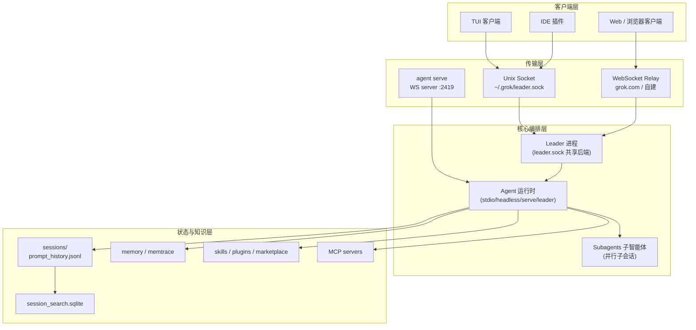
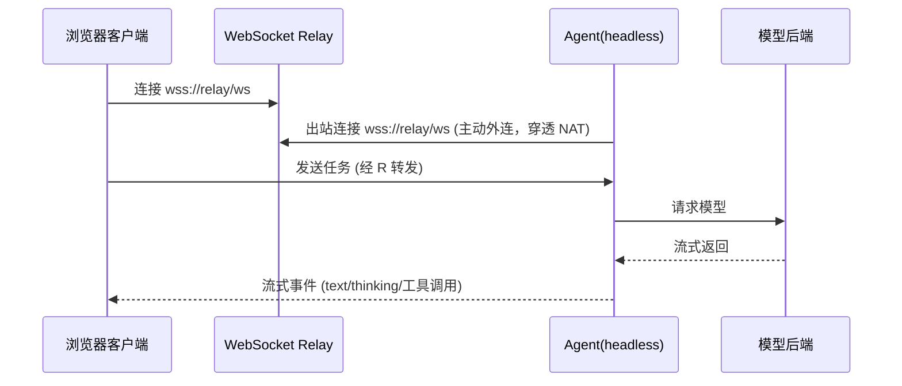

# 00 · 逆向研究：Grok Bot 技术文档图谱

> 目标：理解 Grok CLI（xAI 终端编码 Agent）的**多智能体协同架构**，提炼「跨设备统一调度」可复用的范式，作为 AgentFleet 系统的设计依据。
> 方法：`rea-agents` 工具链（Ghidra / Hopper / jadx，已作为 grok 的 MCP server 配置）+ grok 公开命令面 / 文档 / 运行时行为探测。**不复制其闭源代码，只提炼架构范式。**

---

## 1. 研究对象概览

| 项 | 值 |
|---|---|
| 名称 | Grok CLI（"Grok Build"） |
| 版本 | 1.0.62 (1474f9cbdd91) |
| 厂商 | xAI |
| 形态 | 单文件 Rust 二进制（Mach-O arm64），`~/.grok/bin/grok` |
| 定位 | 终端/IDE 内编码 Agent（对标 Codex / Claude Code） |
| 数据目录 | `~/.grok/`（config.toml、sessions、memtrace、skills、auth.json、leader.sock） |

## 2. 核心架构（技术文档图谱）

### 2.1 进程模型：Leader / Client / Worker 三层

grok 不是「一个进程一个会话」，而是引入了一个**共享后端进程**：

- **Leader 进程**：常驻的共享后端，通过 `~/.grok/leader.sock`（Unix domain socket）被多个 client 复用。`--leader` 让任意 client 连入既有 leader；`--no-leader` 反之。
- **Client**：TUI / IDE 插件 / 无头脚本，都只是「前端」，复用同一 leader 的模型连接与状态。
- **Worker**：`cursor-worker` 子命令把**本机注册为可被云端 Agent 认领的私有 worker**（`[cursor_worker]` 配置：`auto_start` / `name` / `worker_dirs` / `max_agents` 并发认领上限）。

```
┌─────────────┐   ┌─────────────┐   ┌─────────────┐
│  TUI Client │   │ IDE Client  │   │ Headless    │
└──────┬──────┘   └──────┬──────┘   └──────┬──────┘
       └────────┬────────┴────────┬────────┘
                │  leader.sock (Unix socket)
          ┌─────▼─────┐
          │  Leader   │─── 共享后端：模型连接 / 会话状态 / 子智能体
          └─────┬─────┘
                │  --grok-ws-url (WebSocket relay, 按需)
          ┌─────▼──────────┐
          │  grok.com relay │─── 云端中继（跨机器 / 浏览器）
          └────────────────┘
```

### 2.2 四种 Agent 运行模式（关键）

| 模式 | 命令 | 作用 | 对我们的意义 |
|---|---|---|---|
| `stdio` | `grok agent stdio` | 供 IDE / 应用通过 stdin/stdout 集成 | 适配器最通用的接入方式 |
| `headless` | `grok agent headless --grok-ws-url <relay>` | 通过 **WebSocket 中继**跑无头 agent | **跨设备 / 浏览器调用的现成范式** |
| `serve` | `grok agent serve --bind 127.0.0.1:2419 --secret <token>` | 本机自起 **WS server**，带 token 认证，`--remote` 支持代理 | 设备对外暴露 agent 能力 |
| `leader` | `grok agent leader` | 常驻共享后端 | 多客户端复用单后端 |

**核心洞察**：grok 已经用「`leader.sock`（本机）+ `--grok-ws-url`（云端中继）+ `agent serve`（自起 WS server）+ `cursor-worker`（worker 注册/认领）」四件套实现了**从单机到跨机器的 agent 协同雏形**。我们只需把这套「socket/中继/worker 注册/认领」模式**泛化到多台设备、多个异构 agent 平台**。

### 2.3 WebSocket 中继（`--grok-ws-url` / `--grok-ws-origin`）

README 官方说明（逆向确认）：agent **主动外连** relay（`wss://your-relay.example.com/ws`），浏览器/web 客户端连同一个 relay —— 用于构建「浏览器无法 spawn 本地进程」的 Web UI。`--relay-on-demand` 表示 leader 按需才连 relay，不常驻。

→ 这正是「局域网优先 + 云端兜底」中「云端兜底」的标准做法：**agent 出站连中继，天然穿透 NAT/防火墙。**

### 2.4 子智能体（Subagents）

- 子智能体 = **并行的子会话**，各自独立上下文窗口，可继承父会话历史。
- 支持角色/人格：`[subagents.roles.researcher]`、`[subagents.personas.concise]`。
- 支持按类型路由模型：`[subagents.models].<agent>`（优先级最高）。
- 任务工具三件套：`task`（spawn_subagent）/ `kill_task` / `get_task_output`。
- 同 workspace 的子智能体**复用父会话的 LSP 运行时**，不重复起服务池（资源优化）。

### 2.5 会话与记忆

- 会话目录：`~/.grok/sessions/<url-encoded-cwd>/<uuid>/` + `prompt_history.jsonl`。
- 全文检索：`session_search.sqlite`。
- 跨会话记忆：`grok memory` 命令 + `~/.grok/memtrace/<ts>.jsonl`（时间戳记忆痕迹）。
- 会话恢复：`grok sessions list/search/restore`、`--resume` / `--continue` / `--fork-session`。

### 2.6 技能 / MCP / 插件

- 技能市场：`[marketplace.sources]`（xAI 官方市场，git 源）+ `~/.grok/skills/`。
- MCP：`grok mcp` 子命令 + `[mcp_servers]` 配置（本机已把 `rea` 配为 MCP server，注入 Ghidra/Hopper/jadx 路径）。
- 插件：`grok plugin`，`--plugin-dir` 可临时注入（Agent SDK 用它做 per-connection 注入）。

### 2.7 权限与工具控制

- 工具过滤：`--tools` / `--disallowed-tools`（白名单/黑名单，支持 `Agent` / `Agent(type)` 限制子智能体孵化）。
- 权限规则：`--allow` / `--deny`（正则匹配命令、路径、URL）。
- 沙箱：`GROK_SANDBOX`（文件系统/网络访问策略）。
- 在 leader 的 daemon 路由上，设置了工具限制时「其他机器无法开新会话」——**跨设备调度必须正视的权限边界**。

## 3. 技术文档图谱（Mermaid）

### 3.1 组件分层图



### 3.2 跨机器调用时序（Web UI → 远程 agent）



## 4. 对我们的启示

### 4.1 可复用范式（直接借鉴）

1. **统一 agent 协议 + 多传输承载**：同一种 agent 逻辑，用 stdio / WS server / WS relay 三种方式暴露。
2. **leader + socket 共享后端**：单机多客户端复用同一后端，避免重复起模型连接。
3. **agent 出站连中继**：解决 NAT/防火墙，是「云端兜底」的标准解法。
4. **worker 注册 + 认领（claim）+ 并发上限**：`cursor-worker` 的「本机注册为 worker、云端按需认领、max_agents 限流」是**跨设备调度器**的核心机制原型。
5. **子智能体 = 并行子会话**：独立上下文 + 可继承历史 + 按类型路由模型 + 角色/人格。
6. **会话/记忆/检索三层持久化**：uuid 目录 + jsonl 历史 + sqlite 全文检索 + memtrace 记忆。

### 4.2 局限（我们要超越的点）

| 局限 | AgentFleet 的解法 |
|---|---|
| 只调度「grok 自己」一种 agent | 统一 **Adapter 适配器层**，调度 Codex / Claude Code / DSH / Grok 等异构平台 |
| `leader.sock` 是**本机** Unix socket | 泛化为**局域网 mDNS 发现 + 云端中继兜底**的设备网格 |
| cursor-worker 绑定 Cursor 生态 | 做成**开放设备注册表**，任意设备可注册、任意入口可认领 |
| 单机会话/记忆 | 引入**设备维度**的会话路由与分布式记忆 |
| 无统一可视化 | **动态神经图看板**：实时呈现「设备→agent→任务」的调用拓扑 |

## 5. rea 工具链（逆向手段记录）

- `rea` = `rea-agents` v6.7.0（`io.github.morluto/rea`），"Reverse engineer anything from terminal or agent"。
- 已接桥：Ghidra 12.1.4（`/opt/homebrew/Cellar/ghidra/...`）、Hopper Disassembler、jadx（Android）、mitmproxy、lldb tracer、electron-active-hook、原生 UI hook。
- 已在 grok 的 `[mcp_servers.rea]` 配好，env 注入 `GHIDRA_INSTALL_DIR` / `HOPPER_LAUNCHER_PATH` / `REA_JADX_MCP_JAR`。
- 本研究中用于：二进制元信息确认（Mach-O arm64）、命令面枚举（`--help` 全量子命令）、运行时行为探测（`leader list` / `sessions` / 配置发现 `inspect`）、数据目录结构测绘（sessions/memtrace 格式）。

---

*本文档为 AgentFleet 项目的设计输入，后续 PRD / 架构设计均以此为准。*
