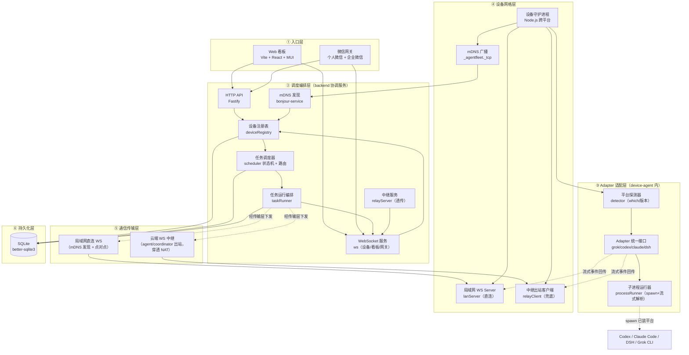
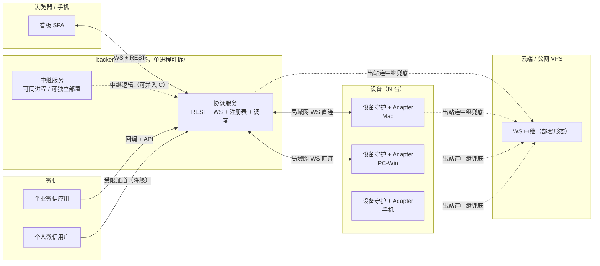
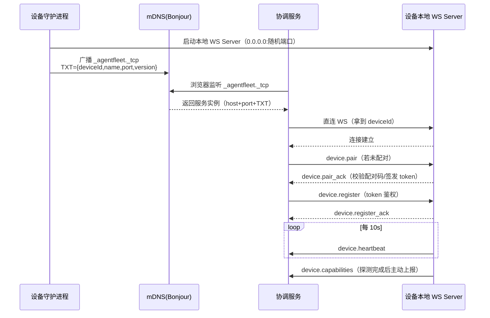
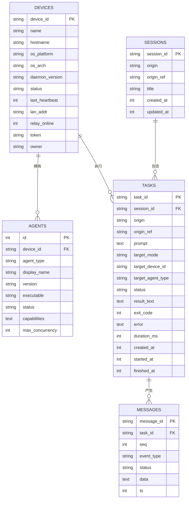
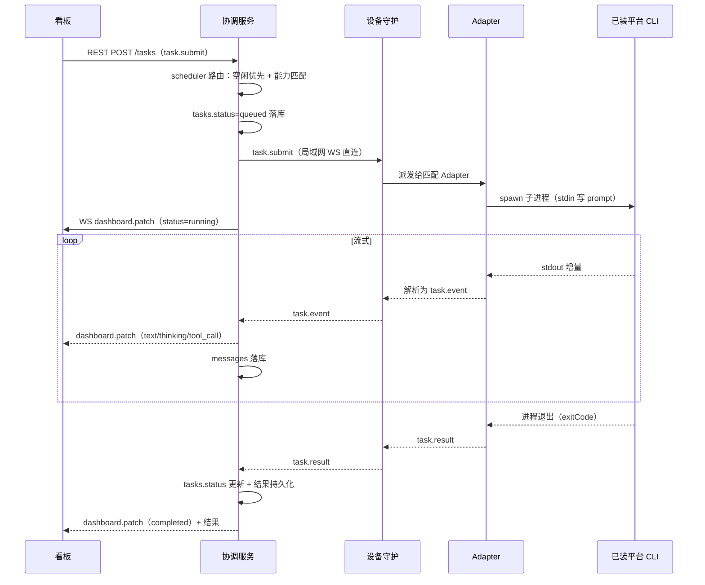
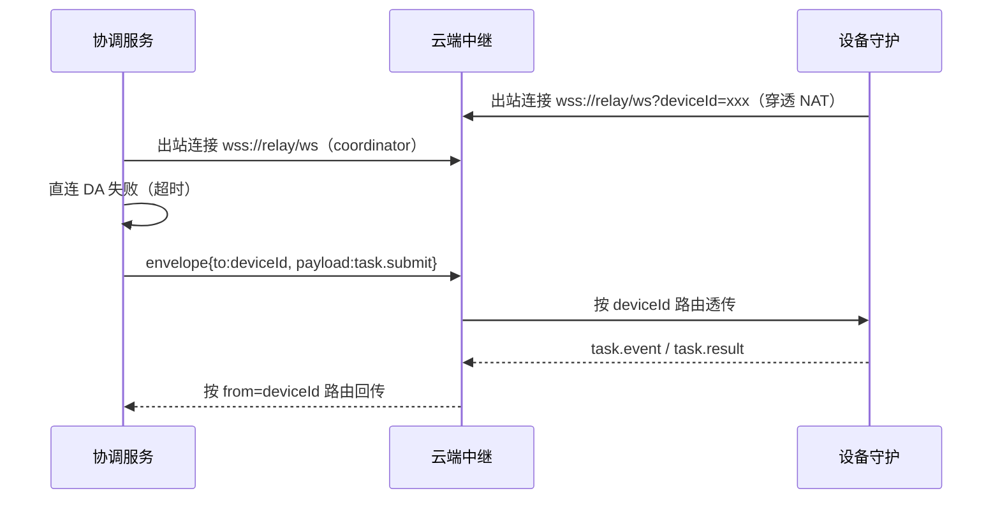
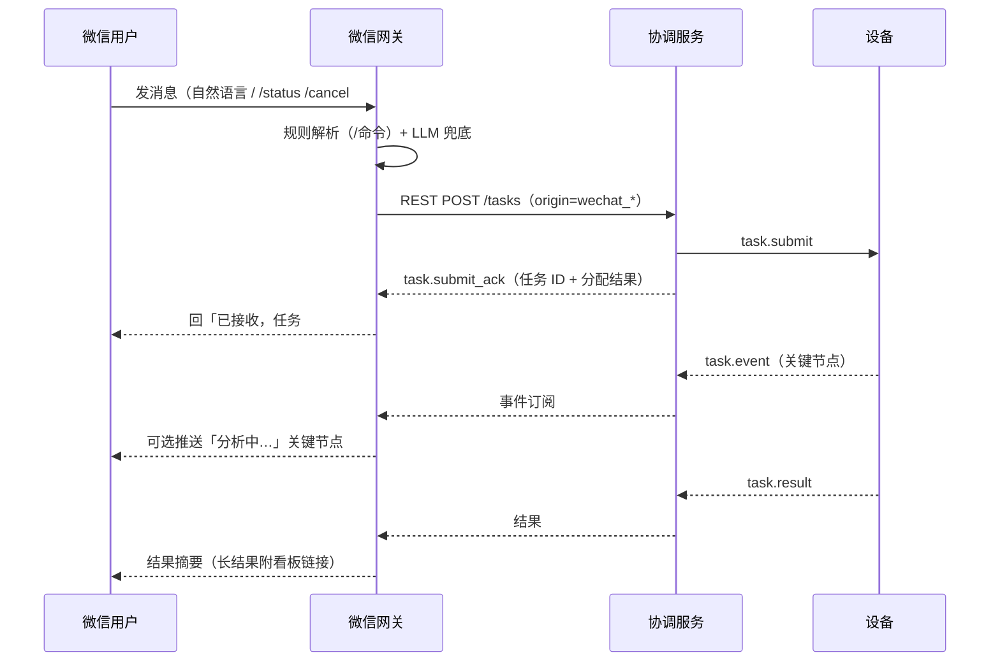
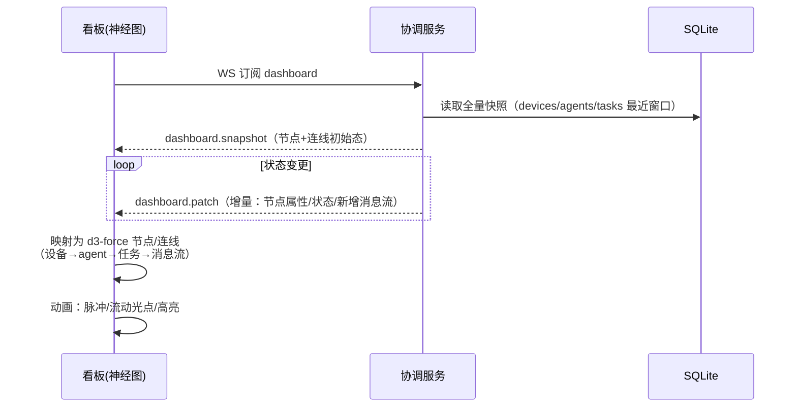
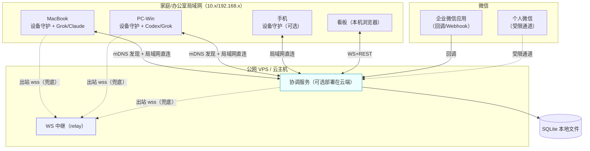

# 02 · 架构设计 — AgentFleet 跨设备超级智能体协同系统

> 版本 v0.1 · 架构师：高见远 · 状态：待评审
> 输入基线：`01-PRD.md`（P0 8 项 + P1 + 9 模块 + Q1-Q10）、`04-UI设计文档.md`（神经图 §4 / 断点 §5 / 配色 §2）、`00-逆向研究-grok技术文档图谱.md`（leader+socket+中继+worker 注册认领）

---

## 1. 系统总体架构

### 1.1 分层架构图



### 1.2 组件图（进程边界）



---

## 2. 核心组件职责

| 组件 | 归属 | 职责 | 关键点 |
|---|---|---|---|
| **协调服务 Coordinator** | backend | 设备注册表 + 任务调度 + 状态持久化 + 面向所有入口的 API/WS 出口 | 唯一权威状态源；局域网可达时直连设备，不可达时走中继 |
| **设备守护进程 Device Agent** | device-agent | 本机注册、心跳、能力探测、mDNS 广播、接收任务、驱动 Adapter | 常驻；被协调服务发现或主动出站连中继 |
| **Adapter 适配层** | device-agent | 把异构平台（Codex/Claude Code/DSH/Grok）统一为 stdin/stdout + 流式事件模型 | 每平台一 Adapter；新增平台只加 Adapter 不动调度核心（G1） |
| **平台探测器 Detector** | device-agent | 运行时探测已装平台、版本、可执行路径、可用性 | `which`/PATH/约定目录探测；探测结果即能力上报 |
| **任务调度器 Scheduler** | backend | 任务队列、路由、认领/限流（`max_agents`）、断线重排 | 借鉴 grok worker 注册/认领范式（M3） |
| **中继服务 Relay** | backend/cloud | 纯 WebSocket 透传，按设备 ID 路由消息，不解析业务、不落盘 | 仅透传加密载荷；agent/coordinator 均出站连接穿透 NAT（Q2/Q5/Q9） |
| **微信网关 WeChat Gateway** | wechat | 个人+企业微信消息收发、消息↔任务解析、结果回推 | 企业微信官方 API；个人微信受限通道+降级（Q1） |
| **Web 看板** | frontend | 神经图 + 设备/任务列表 + 详情 + 设置 | 动态神经图用 d3-force（M6） |
| **共享协议 shared** | shared | 信封/事件/状态/任务/设备 类型与枚举，四处复用 | 单一事实源，避免协议漂移 |

---

## 3. 统一任务协议（字段级定义）

> 所有通信消息使用统一**信封（Envelope）**承载，业务内容放 `payload`。共享协议见 `shared/src/`。

### 3.1 消息信封

```ts
interface Envelope<T = unknown> {
  v: 1;                          // 协议版本
  type: MessageType;             // 消息类型（见 §3.6）
  id: string;                    // 消息唯一 ID（uuid）
  ts: number;                    // 发送时间戳（epoch ms）
  from: string;                  // 发送方 ID：'coordinator' | deviceId | 'wechat' | 'dashboard'
  to: string;                    // 接收方 ID：'coordinator' | deviceId | 'wechat' | 'dashboard'
  payload: T;                    // 业务载荷
}
```

### 3.2 任务下发 `task.submit`

```ts
interface TaskSubmit {
  taskId: string;                          // 任务唯一 ID（协调服务生成）
  sessionId: string;                       // 会话 ID（一次交互/一组相关任务）
  origin: 'dashboard' | 'wechat_personal' | 'wechat_work';  // 发起入口
  originRef: string;                       // 发起方引用（看板用户 / 微信 fromUser）
  prompt: string;                          // 用户指令原文
  target: {
    mode: 'auto' | 'device' | 'agent';     // 自动路由 / 指定设备 / 指定平台
    deviceId?: string;                     // mode=device 时必填
    agentType?: 'codex' | 'claude' | 'dsh' | 'grok';  // mode=agent 时必填
    requireCapability?: string;            // 可选能力约束（如 'coding'）
  };
  options: {
    maxTurns?: number;                     // 最大轮次，默认 50
    timeoutMs?: number;                    // 超时，默认 600000
    cwd?: string;                          // 工作目录（可选）
    env?: Record<string, string>;          // 环境变量注入
    allowList?: string[];                  // 工具白名单（P2 生效）
    denyList?: string[];                   // 工具黑名单（P2 生效）
  };
  createdAt: number;
}
```

### 3.3 流式事件 `task.event`

```ts
interface TaskEvent {
  taskId: string;
  seq: number;                             // 单调递增序号，用于排序/丢包检测
  eventType: 'text' | 'thinking' | 'tool_call' | 'tool_result' | 'system' | 'status';
  status?: TaskStatus;                     // eventType=status 时携带
  data: {
    text?: string;                         // text/thinking 的增量文本
    toolName?: string;                     // tool_call
    toolInput?: Record<string, unknown>;   // tool_call
    toolOutput?: string;                   // tool_result
    message?: string;                      // system 事件说明
    delta?: string;                        // 通用增量（与 text 互斥语义）
  };
  ts: number;
}
```

### 3.4 任务取消 `task.cancel` / 结果 `task.result`

```ts
interface TaskCancel {
  taskId: string;
  reason: 'user_cancel' | 'timeout' | 'device_offline' | 'system';
}

interface TaskResult {
  taskId: string;
  status: 'completed' | 'failed' | 'interrupted';   // interrupted=断线中断（P0-8）
  result: {
    text: string;                          // 最终输出文本
    exitCode: number;                      // 0=正常
    tokensIn?: number;
    tokensOut?: number;
    durationMs: number;
  };
  logs: string[];                          // 关键日志（截断）
  finishedAt: number;
}
```

### 3.5 设备协议

```ts
interface DeviceRegister {                 // device.register
  deviceId: string;                        // 首次生成并持久化
  name: string;
  hostname: string;
  os: { platform: string; arch: string; release: string };
  version: string;                         // 守护进程版本
  token: string;                           // 配对后签发，后续鉴权
}

interface DeviceHeartbeat {                // device.heartbeat（间隔 10s）
  deviceId: string;
  load: { cpu: number; mem: number };      // 0~1
  busyAgents: number;
  ts: number;
}

interface DeviceCapabilities {             // device.capabilities
  deviceId: string;
  agents: AgentInfo[];
  ts: number;
}

interface AgentInfo {
  agentType: 'codex' | 'claude' | 'dsh' | 'grok';
  displayName: string;
  version: string;
  executable: string;                      // 绝对路径
  status: 'available' | 'busy' | 'error';
  detectMethod: 'path' | 'which' | 'default_dir';
  capabilities: string[];                  // ['coding','shell',...]
  maxConcurrency: number;                  // 默认 1
}
```

### 3.6 消息类型 / 状态枚举（与 `shared` 一致）

```ts
type MessageType =
  // 设备 ↔ 协调
  | 'device.register' | 'device.register_ack' | 'device.heartbeat'
  | 'device.capabilities' | 'device.pair' | 'device.pair_ack'
  // 任务下发
  | 'task.submit' | 'task.submit_ack' | 'task.event' | 'task.cancel'
  | 'task.result' | 'task.reroute'
  // 看板订阅
  | 'dashboard.snapshot' | 'dashboard.patch'
  // 微信
  | 'wechat.message' | 'wechat.reply';

type TaskStatus =
  | 'queued' | 'running' | 'completed' | 'failed' | 'cancelled' | 'interrupted';

type DeviceStatus = 'online' | 'busy' | 'offline';
```

---

## 4. mDNS 发现流程



**降级判定**：协调服务对某设备 `deviceId` 直连失败（TCP 拒绝 / 超时 / 心跳超时 > 30s）→ 若该设备已出站连上中继，则经中继路由下发；否则标记 `offline`。

---

## 5. 数据模型

### 5.1 ER 关系图



### 5.2 字段说明（关键列）

| 表 | 关键字段 | 说明 |
|---|---|---|
| `devices` | `device_id` | 唯一设备 ID，首次启动生成并持久化到本机 |
| `devices` | `token` | 配对成功后签发的长期 token，后续注册/心跳鉴权 |
| `devices` | `relay_online` | 0/1，标记该设备当前是否经中继在线（直连不可达时） |
| `agents` | `capabilities` | JSON 数组，能力标签（coding/shell/...），供路由匹配 |
| `tasks` | `target_mode` | auto/device/agent，记录路由意图 |
| `tasks` | `status` | queued/running/completed/failed/cancelled/interrupted |
| `messages` | `data` | JSON，存 §3.3 的事件载荷（增量/工具调用），用于时间线回放 |
| `sessions` | `title` | 首条 prompt 截断，用于会话列表展示 |

> 存储决策：本地 SQLite（Q9 默认「本地持久化」）；中继不落业务数据。所有时间戳存 epoch ms（number），前端渲染时转本地时区。

---

## 6. 关键时序图

### 6.1 局域网下发任务（主路径）



### 6.2 中继兜底（跨网段 / NAT）



### 6.3 微信下发任务



### 6.4 神经图数据流



---

## 7. 部署拓扑图



> MVP 部署建议：协调服务与中继可跑在同一台常开主机（本地 NAS/VPS）上；设备守护跑在每台需要贡献能力的设备上；看板由协调服务托管静态资源（同源，免跨域）。

---

## 8. 技术选型表 + 依赖包清单

### 8.1 技术选型

| 层 | 技术 | 理由 |
|---|---|---|
| 前端框架 | Vite 6 + React 18 + TypeScript | 既定默认；快启动、HMR 适合看板迭代 |
| UI | MUI v6 + Tailwind CSS v3 | MUI 提供表格/抽屉/表单组件；Tailwind 做布局与神经图定制样式 |
| 神经图 | d3-force v3 | 力导向图原生能力（斥力/弹簧/缩放/拖拽），无重型图库依赖 |
| 前端状态 | zustand + react-router v6 | 轻量全局态（WS 事件流入）+ 路由 |
| 后端 | Node.js 20 + TypeScript + Fastify | 高并发 WS/HTTP 混合；TypeScript 与前端共享类型心智一致 |
| WebSocket | `ws` | 成熟稳定，服务端+客户端通用 |
| mDNS | `bonjour-service` | 纯 JS 实现 mDNS/Bonjour 广播与浏览，跨平台 |
| 持久化 | `better-sqlite3` | 单文件、同步 API 简单可靠、无需独立 DB 进程 |
| 设备守护 | Node.js 20 + TypeScript | 与后端同栈，降低心智成本；`child_process.spawn` 驱动平台 CLI |
| 微信网关 | Fastify + 企微官方加密库 | 企微回调签名/加解密（AES）；个人微信走适配器接口预留 |
| 进程编排 | `child_process.spawn` + readline 流式解析 | 统一 stdin/stdout 事件模型（对齐 grok `stdio` 模式） |

### 8.2 依赖包清单（按 workspace）

| workspace | 包 | 用途 |
|---|---|---|
| `shared` | `typescript` | 仅类型+常量，编译为 d.ts |
| `frontend` | `react` `react-dom` `react-router-dom` `@mui/material` `@emotion/react` `@emotion/styled` `@mui/icons-material` `d3-force` `zustand` `tailwindcss` `vite` `@vitejs/plugin-react` `typescript` | 看板 |
| `backend` | `fastify` `@fastify/websocket` `ws` `bonjour-service` `better-sqlite3` `uuid` `dotenv` `typescript` `tsx` | 协调服务 + 中继 |
| `device-agent` | `ws` `bonjour-service` `uuid` `dotenv` `typescript` `tsx` | 守护 + Adapter |
| `wechat` | `fastify` `@fastify/websocket` `axios` `@wecom/crypto` `uuid` `dotenv` `typescript` `tsx` | 微信网关 |

---

## 9. 安全设计

| 层面 | 机制 | 说明 |
|---|---|---|
| 设备身份 | 首次**配对码**（6 位随机，短 TTL）+ 长期 **token** | 首次直连校验配对码 → 签发 token → 后续注册/心跳携带 token（Q5 默认） |
| 传输加密 | 局域网直连 WS 默认明文，可开 `TLS`（自签证书，P1 可选）；中继通道 **WSS（TLS）** | 公网中继必须 TLS |
| 中继不落地 | 中继仅按 `to` 字段路由，**不解析、不存储业务载荷** | 可选端到端加密（设备↔协调用共享密钥加密 payload），中继只见密文（Q9） |
| 入口鉴权 | 看板本地同源（MVP 单用户）；微信网关校验企微签名 + 白名单用户 | Q7 默认单用户，`owner` 字段预留多用户 |
| 危险操作 | P0 不拦截；P2 引入 allow/deny 工具过滤 + 危险操作前确认 | Q6 默认 |
| 密钥管理 | `.env`（relay secret / 企微 corp secret / token），不提交 git | — |

---

## 10. 待明确事项（对应 PRD Q1-Q10）

| # | 问题 | 架构决策（建议默认） | 是否需用户确认 |
|---|---|---|---|
| Q1 | 个人微信接入方式 | 企业微信优先（官方 API 稳）；个人微信仅做 `personalGateway` 接口预留 + 降级策略（未接时提示改用企微/看板），**不默认接 hook/网页协议** | ✅ 需康确认 |
| Q2 | 中继自建 vs 第三方 | 默认**自建轻量 WS 中继**（backend 内 `relayServer`，可独立部署），仅透传不存内容 | 可确认部署位置 |
| Q3 | 同平台多设备调度优先级 | 默认「**空闲优先 + 能力匹配优先**」，可手动指定 device/agent | 无需确认（PRD 已给） |
| Q4 | 执行中设备关机/断网 | 默认 `interrupted` 标记 + 看板/微信告警；P1 做重排到其他设备 | 无需确认 |
| Q5 | 设备信任模型 | 首次配对码 + 长期 token；中继仅透传加密载荷 | 无需确认 |
| Q6 | 危险操作确认 | 默认 P0 不拦截，P2 做工具过滤 + 确认 | 无需确认 |
| Q7 | MVP 是否单用户 | 默认单用户，模型预留 `owner` 字段 | 无需确认 |
| Q8 | 微信任务解析 | 默认「**规则优先（/命令）+ LLM 兜底（接口预留）**」 | 需确认 LLM 兜底是否本期接入 |
| Q9 | 存储位置 | 默认本地 SQLite，中继不存内容 | 无需确认 |
| Q10 | 移动端 H5 响应式 | 默认响应式但桌面优先（断点见 UI §5） | 无需确认 |

> **架构层面需用户确认的 3 点**：① 个人微信通道的合规接入方式（Q1）；② 中继部署位置（本机/VPS）与公网可达性（Q2）；③ 微信任务解析是否本期接 LLM 兜底（Q8）。

---

*本文档与《03-开发文档图谱.md》配套，工程实现以 03 的任务分解与共享知识为准。*
