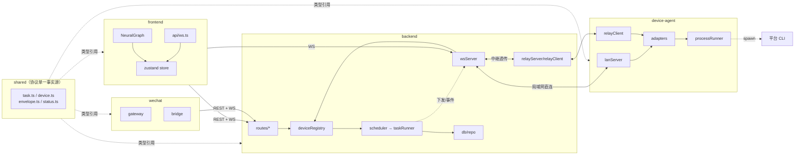
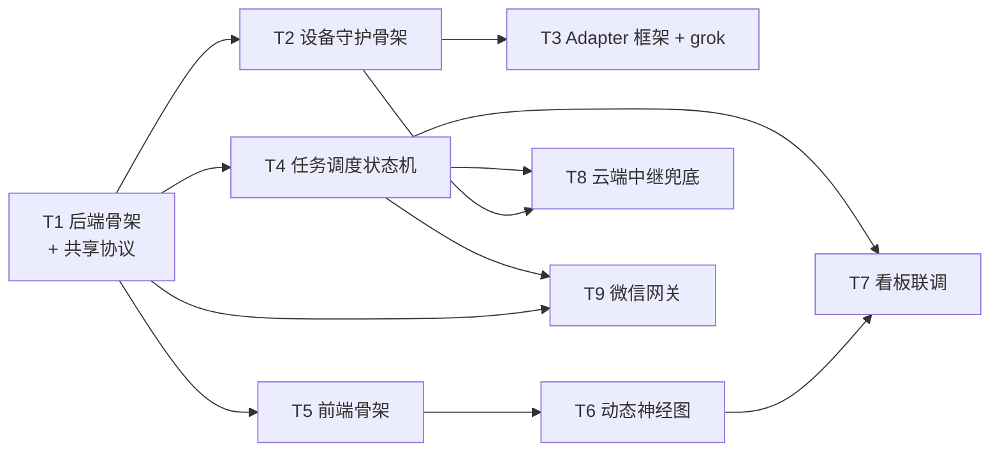

# 03 · 开发文档图谱 — AgentMesh 跨设备超级智能体协同系统

> 版本 v0.1 · 架构师：高见远 · 配套 `02-架构设计.md`
> 本文档是工程师（software-engineer）的实现依据：目录结构 + 模块职责 + 数据流依赖 + 有序任务分解（T1-T9）+ 共享知识。

---

## 1. 完整目录结构（精确到文件）

```
agent-mesh/
├── package.json                      # npm workspaces 根（scripts: dev/build/relay）
├── README.md
├── .gitignore
├── .env.example                      # 端口/relay 地址/企微 corp 等示例
├── docs/
│   ├── 00-逆向研究-grok技术文档图谱.md
│   ├── 01-PRD.md
│   ├── 02-架构设计.md
│   ├── 03-开发文档图谱.md            # 本文件
│   └── 04-UI设计文档.md
│
├── shared/                           # ① 共享协议（源码级共享，不单独 build）
│   ├── package.json                  # name: @agentmesh/shared
│   ├── tsconfig.json
│   └── src/
│       ├── index.ts                  # 统一导出
│       ├── envelope.ts               # 消息信封 Envelope
│       ├── messageTypes.ts           # MessageType 枚举（§3.6 of 02）
│       ├── status.ts                 # TaskStatus / DeviceStatus 枚举
│       ├── task.ts                   # TaskSubmit/TaskEvent/TaskCancel/TaskResult
│       ├── device.ts                 # DeviceRegister/Heartbeat/Capabilities/AgentInfo
│       └── constants.ts              # 服务名 _agentmesh._tcp、心跳间隔、默认端口
│
├── backend/                          # ② 协调服务 + 中继
│   ├── package.json
│   ├── tsconfig.json
│   └── src/
│       ├── index.ts                  # 启动：HTTP + WS + mDNS + 中继（按需）
│       ├── relayEntry.ts             # 中继独立进程入口（npm run relay）
│       ├── config.ts                 # 端口/中继地址/DB 路径
│       ├── db/
│       │   ├── database.ts           # better-sqlite3 初始化 + 建表
│       │   ├── schema.sql            # 建表 DDL（devices/agents/tasks/messages/sessions）
│       │   └── repo/
│       │       ├── devices.ts        # 设备 CRUD + 心跳更新
│       │       ├── agents.ts         # 能力上报 upsert
│       │       ├── tasks.ts          # 任务 CRUD + 状态流转
│       │       ├── messages.ts       # 事件追加 + 按 taskId 查询
│       │       └── sessions.ts       # 会话创建/标题更新
│       ├── services/
│       │   ├── deviceRegistry.ts     # 在线注册表 + 心跳超时 + relay 状态
│       │   ├── scheduler.ts          # 路由（auto/device/agent）+ 队列 + max_agents
│       │   ├── taskRunner.ts         # 任务生命周期编排 + 超时 + 断线标记
│       │   └── relayClient.ts        # 协调服务出站连中继
│       ├── transport/
│       │   ├── wsServer.ts           # WS 服务：设备/看板/网关三类连接管理
│       │   ├── lanDiscovery.ts       # bonjour 浏览器 + 直连
│       │   └── relayServer.ts        # 中继服务：按 deviceId 透传路由
│       ├── routes/
│       │   ├── devices.ts            # GET/POST/DELETE /api/devices
│       │   ├── tasks.ts              # POST /api/tasks（下发）/ GET 列表/详情 / 取消
│       │   └── system.ts             # 健康检查 / 连接状态 / 配对码
│       └── security/
│           ├── pairing.ts            # 配对码生成/校验
│           └── auth.ts               # token 签发/校验
│
├── device-agent/                     # ③ 设备守护 + Adapter
│   ├── package.json
│   ├── tsconfig.json
│   └── src/
│       ├── index.ts                  # 守护入口：串起 discovery/lan/relay/registry
│       ├── config.ts                 # 设备名/端口/中继地址/持久化目录
│       ├── discovery.ts              # mDNS 广播 _agentmesh._tcp
│       ├── lanServer.ts              # 本地 WS Server（接收协调服务直连）
│       ├── relayClient.ts            # 出站连中继兜底
│       ├── registry.ts               # 本机 deviceId/token 持久化
│       ├── heartbeat.ts              # 10s 心跳 + 负载采集
│       ├── adapters/
│       │   ├── adapter.ts            # Adapter 接口 + 统一事件模型定义
│       │   ├── detector.ts           # 平台探测（which/目录/npm全局/app扫描 + 版本）
│       │   ├── platformCatalog.ts    # 平台目录表（数据驱动，13 平台探测配置）
│       │   ├── catalogAdapter.ts     # 通用 Adapter（从目录表生成，探测 + 占位）
│       │   └── grokAdapter.ts        # grok 真接（agent headless/stdio）
│       └── runner/
│           └── processRunner.ts      # spawn 子进程 + readline 流式 stdout 解析
│
├── frontend/                         # ④ Web 看板
│   ├── package.json
│   ├── vite.config.ts                # resolve.alias → @agentmesh/shared
│   ├── tsconfig.json                 # paths → ../shared/src
│   ├── tailwind.config.ts            # 语义色 Token（§2 of 04）
│   ├── postcss.config.js
│   ├── index.html
│   └── src/
│       ├── main.tsx
│       ├── App.tsx
│       ├── router.tsx                # 5 路由（神经图/设备/任务/设置 + 详情页）
│       ├── theme.ts                  # MUI 主题 + 语义色映射
│       ├── styles/globals.css        # Tailwind 指令 + CSS 变量
│       ├── types/index.ts            # 与 shared 对齐的前端类型（re-export）
│       ├── api/
│       │   ├── http.ts               # REST 客户端（fetch 封装）
│       │   └── ws.ts                 # WS 客户端 + 重连 + 事件分发
│       ├── store/
│       │   ├── deviceStore.ts        # 设备列表/在线态
│       │   ├── taskStore.ts          # 任务列表/详情/消息流
│       │   └── wsStore.ts            # 连接状态（局域网/中继指示）
│       ├── hooks/
│       │   ├── useBreakpoint.ts      # 桌面/平板/手机断点（§5 of 04）
│       │   └── useGraphData.ts       # 快照+patch → d3-force 节点/连线
│       ├── layouts/
│       │   ├── MainLayout.tsx        # 侧边栏 + 顶栏 + 底部状态条
│       │   └── MobileTabBar.tsx      # 手机底部 Tab
│       ├── components/
│       │   ├── common/
│       │   │   ├── StatusBadge.tsx   # 状态徽标（§3.2 of 04）
│       │   │   ├── Card.tsx
│       │   │   ├── DataTable.tsx
│       │   │   └── AgentIcon.tsx     # 平台首字母图标（C/Cℓ/D/G）
│       │   ├── graph/
│       │   │   ├── NeuralGraph.tsx   # d3-force 容器（主组件）
│       │   │   ├── GraphNode.tsx     # 节点渲染（设备/agent/任务）
│       │   │   ├── GraphLink.tsx     # 连线渲染（call/return/stream/belongs）
│       │   │   ├── FlowParticle.tsx  # 流动光点动画
│       │   │   └── GraphLegend.tsx   # 底部悬浮图例
│       │   ├── device/
│       │   │   ├── DeviceCard.tsx    # 设备卡片（§6.3 of 04）
│       │   │   └── DeviceGrid.tsx
│       │   ├── task/
│       │   │   ├── TaskTable.tsx     # 任务列表（§C of 01）
│       │   │   └── MessageTimeline.tsx # 消息流时间线（§6.2 of 04）
│       │   └── drawer/
│       │       ├── DetailDrawer.tsx  # 右侧抽屉（§3.6 of 04）
│       │       └── NewTaskDialog.tsx # 新建任务弹窗
│       └── pages/
│           ├── GraphPage.tsx         # 神经图主页（默认首页）
│           ├── DevicesPage.tsx
│           ├── DeviceDetailPage.tsx
│           ├── TasksPage.tsx
│           ├── TaskDetailPage.tsx
│           └── SettingsPage.tsx
│
└── wechat/                           # ⑤ 微信网关
    ├── package.json
    ├── tsconfig.json
    └── src/
        ├── index.ts                  # Fastify 入口：企微回调 + 网关 WS
        ├── config.ts                 # corpId/corpSecret/token/aesKey
        ├── gateway/
        │   ├── wecomGateway.ts       # 企业微信回调验签/解密 + 消息发送
        │   └── personalGateway.ts    # 个人微信受限通道（接口预留 + 降级）
        ├── parser/
        │   ├── commandParser.ts      # 规则解析 /status /cancel #id /help
        │   └── llmParser.ts          # LLM 兜底（接口预留）
        └── bridge.ts                 # 消息→任务下发（调后端 REST）；结果→消息回推
```

---

## 2. 模块职责与关键文件说明

### 2.1 `shared/` — 共享协议（单一事实源）

| 文件 | 职责 |
|---|---|
| `envelope.ts` | 统一消息信封 `Envelope<T>`，所有 WS 消息的载体 |
| `messageTypes.ts` | `MessageType` 字符串字面量联合类型（设备/任务/看板/微信四类） |
| `status.ts` | `TaskStatus`（6 态）、`DeviceStatus`（3 态）、`AgentStatus`（3 态） |
| `task.ts` | 任务协议类型：`TaskSubmit` / `TaskEvent` / `TaskCancel` / `TaskResult` |
| `device.ts` | 设备协议类型：`DeviceRegister` / `DeviceHeartbeat` / `DeviceCapabilities` / `AgentInfo` |
| `constants.ts` | mDNS 服务名 `_agentmesh._tcp`、心跳间隔 10s、心跳超时 30s、默认端口等 |

> 共享方式：**源码级共享**。各 workspace 的 tsconfig 配 `paths` 把 `@agentmesh/shared/*` 映射到 `../shared/src/*`；前端 Vite 配 `resolve.alias`。无需 build 步骤，改一处全局生效。

### 2.2 `backend/` — 协调服务 + 中继

| 文件 | 职责 |
|---|---|
| `index.ts` | 组装 HTTP(Fastify)、WS(ws)、mDNS 浏览器、中继（可选），统一启动 |
| `relayEntry.ts` | 中继独立部署入口，仅启动 `relayServer` |
| `db/schema.sql` + `db/database.ts` | SQLite 建表与连接初始化 |
| `db/repo/*` | 各表的数据访问层（同步 better-sqlite3） |
| `deviceRegistry.ts` | 内存在线注册表：deviceId → 连接句柄（直连 WS 或中继通道）+ 心跳时间戳 + 超时判离线 |
| `scheduler.ts` | 路由决策：`auto`（空闲优先+能力匹配）/`device`/`agent`；维护每 agent `max_agents` 占用计数（认领/释放） |
| `taskRunner.ts` | 任务状态机流转 + 超时定时器 + 断线时标记 `interrupted` |
| `wsServer.ts` | 管理三类连接：设备连接、看板连接、网关连接；按 `type` 分发信封 |
| `lanDiscovery.ts` | bonjour 浏览 + 对发现设备发起直连 |
| `relayServer.ts` | 纯透传：收到信封按 `to` 路由到对应出站连接，不解析业务 |
| `relayClient.ts` | 协调服务作为客户端出站连中继（兜底时用） |
| `routes/*` | REST 出口：设备管理、任务下发/查询/取消、系统状态/配对码 |
| `security/*` | 配对码与 token 逻辑 |

### 2.3 `device-agent/` — 设备守护 + Adapter

| 文件 | 职责 |
|---|---|
| `index.ts` | 守护入口：读 config → 起 lanServer → mDNS 广播 → 探测能力 → 出站连中继兜底 |
| `discovery.ts` | mDNS 广播本机服务（含 deviceId/name/port/version） |
| `lanServer.ts` | 本地 WS Server，处理协调服务的直连注册/任务下发，并把 Adapter 事件回传 |
| `relayClient.ts` | 出站连中继，与 lanServer 共用同一套消息处理逻辑（传输无关） |
| `registry.ts` | deviceId + token 的本地 JSON 持久化（首启生成） |
| `heartbeat.ts` | 10s 心跳 + cpu/mem 负载采集 |
| `adapters/adapter.ts` | Adapter 接口：`detect()` / `run(task, onEvent)` / `cancel(taskId)` / 事件规范化 |
| `adapters/detector.ts` | 探测各平台：`which` / PATH / 约定目录 / npm 全局包 / macOS /Applications + 版本号 |
| `adapters/platformCatalog.ts` | 平台目录表（数据驱动）：13 平台探测配置，新增平台零代码 |
| `adapters/catalogAdapter.ts` | 通用 Adapter：从目录表生成，自动探测 + run 占位（已探测但执行待接入） |
| `adapters/grokAdapter.ts` | **真接**：`grok agent headless --grok-ws-url` 或 `stdio` 模式，解析流式输出 |
| `runner/processRunner.ts` | `child_process.spawn` + `readline` 按行解析 stdout，映射为 `task.event` |

### 2.4 `frontend/` — Web 看板

| 文件 | 职责 |
|---|---|
| `theme.ts` + `tailwind.config.ts` + `globals.css` | 语义色 Token（`--brand/--success/--warning/--danger/--offline/--accent`）+ MUI 主题联动 |
| `api/ws.ts` | WS 客户端：连接、心跳、断线重连、`dashboard.snapshot/patch` 事件分发到 zustand |
| `store/*` | 设备/任务/连接三份全局态，UI 仅订阅 store |
| `hooks/useBreakpoint.ts` | 断点判断（`<768` 手机 / `768-1279` 平板 / `≥1280` 桌面） |
| `hooks/useGraphData.ts` | 把 store 中的设备/agent/任务/消息流映射为 d3-force 的 nodes/links |
| `components/graph/*` | 神经图实现（§4 of 04）：四类节点、四类连线、动画、交互 |
| `pages/*` | 六页面：神经图主页（默认）/设备/设备详情/任务/任务详情/设置 |
| `layouts/*` | 桌面侧边栏+顶栏+底部状态条；手机底部 Tab |

### 2.5 `wechat/` — 微信网关

| 文件 | 职责 |
|---|---|
| `gateway/wecomGateway.ts` | 企微 URL 验证（signature）→ 回调解密（AES）→ 接收消息 → 回复消息（API 或被动回复） |
| `gateway/personalGateway.ts` | 个人微信接入**接口预留**：定义 `onMessage/onReply` 接口，MVP 返回「未接入」降级提示 |
| `parser/commandParser.ts` | 规则解析：`/status`（查队列）、`/cancel #id`（取消）、`/help`、裸文本（转任务） |
| `parser/llmParser.ts` | LLM 兜底接口预留（结构化提取 prompt/target），Q8 待确认后启用 |
| `bridge.ts` | 与后端对接：消息→`POST /api/tasks`；订阅任务事件→回推微信消息 |

---

## 3. 模块间数据流与依赖关系



**依赖要点**：
1. 所有四端**只依赖 `shared` 的类型与常量**，不互相 import 源码（除前端通过 ws 调后端）。
2. 前端/微信**不直接连设备**，一律经协调服务（后端）中转。
3. 设备守护对「直连」与「中继」**同一套消息处理逻辑**，传输层可插拔（`lanServer` 与 `relayClient` 都调用同一 `handleEnvelope`）。

---

## 4. 有序任务分解（T1-T9）

> 实现顺序按依赖排列；T1 是地基。工程师按顺序实现，跨任务联调见验收标准。

### T1 · 后端骨架（协调服务 + 数据模型 + WebSocket 服务 + 共享协议）

- **依赖**：无
- **产出文件**：
  - 根 `package.json`（workspaces：shared/backend/frontend/device-agent/wechat）、`.gitignore`、`.env.example`
  - `shared/src/*`（全部协议类型与枚举）
  - `backend/package.json`、`backend/tsconfig.json`
  - `backend/src/config.ts`、`index.ts`
  - `backend/src/db/schema.sql`、`database.ts`、`db/repo/{devices,agents,tasks,messages,sessions}.ts`
  - `backend/src/transport/wsServer.ts`
  - `backend/src/services/deviceRegistry.ts`
  - `backend/src/routes/{devices,tasks,system}.ts`
  - `backend/src/security/{pairing,auth}.ts`
- **验收标准**：
  1. `npm run dev:backend` 启动成功，SQLite 自动建 5 张表。
  2. `GET /api/system/health` 返回 `{ok:true}`。
  3. WS 握手成功，客户端发 `device.register` 能收到 `device.register_ack`，`devices` 表落库。
  4. `POST /api/tasks` 能创建任务并写入 `tasks` 表（status=queued）。

### T2 · 设备守护进程骨架（注册 + 心跳 + mDNS 发现 + 局域网直连）

- **依赖**：T1
- **产出文件**：
  - `device-agent/package.json`、`tsconfig.json`
  - `device-agent/src/index.ts`、`config.ts`、`registry.ts`
  - `device-agent/src/discovery.ts`（mDNS 广播）
  - `device-agent/src/lanServer.ts`（本地 WS Server）
  - `device-agent/src/heartbeat.ts`
  - `device-agent/src/relayClient.ts`（本期仅接口骨架，T8 补全）
  - `backend/src/transport/lanDiscovery.ts`（bonjour 浏览 + 直连，T1 已留 wsServer，本期补发现逻辑）
- **验收标准**：
  1. 启动守护进程 → 协调服务日志出现 mDNS 发现记录 → 自动直连。
  2. 设备完成注册，`devices` 表出现在线设备（status=online）。
  3. 心跳每 10s 更新 `last_heartbeat`；停掉守护 30s 后协调服务标记 `offline`（P0-8 基础检测）。

### T3 · Adapter 框架 + 平台探测 + grok 真接

- **依赖**：T2
- **产出文件**：
  - `device-agent/src/adapters/adapter.ts`（统一接口）
  - `device-agent/src/adapters/detector.ts`
  - `device-agent/src/adapters/grokAdapter.ts`（**真接**）
  - `device-agent/src/adapters/codexAdapter.ts`
  - `device-agent/src/adapters/claudeAdapter.ts`
  - `device-agent/src/adapters/dshAdapter.ts`
  - `device-agent/src/runner/processRunner.ts`
- **验收标准**：
  1. 探测到本机已装平台及版本（如 Grok 1.0.62），`device.capabilities` 上报后 `agents` 表有记录。
  2. 通过协调服务向 grok 下发一个测试任务（如「回显 hello」），能收到 `task.event`（text）流式事件和 `task.result`。
  3. codex/claude/dsh 三个 Adapter 有同构骨架，`detect()` 可返回探测结果，`run()` 有明确「未实现」占位且不崩溃。

### T4 · 任务调度状态机 + 任务生命周期编排 + 中继服务逻辑

- **依赖**：T1（联调依赖 T2/T3）
- **产出文件**：
  - `backend/src/services/scheduler.ts`（路由 + max_agents 认领/限流）
  - `backend/src/services/taskRunner.ts`（状态机 + 超时 + 断线标记）
  - `backend/src/transport/relayServer.ts`（透传中继逻辑）
  - `backend/src/relayEntry.ts`（中继独立入口）
  - 补 `backend/src/routes/tasks.ts`（取消/重试接口）
- **验收标准**：
  1. 任务状态机完整流转：`queued → running → completed | failed | cancelled | interrupted`，每步落库。
  2. `auto` 路由能按「空闲优先 + 能力匹配」选中目标设备/agent；`device`/`agent` 指定模式生效。
  3. 同一 agent `max_agents=1` 时，第二个任务保持 `queued`，前一任务结束后自动派发（认领/释放）。
  4. 下发后设备断线 → 任务标记 `interrupted` 并产生告警事件（P0-8）。

### T5 · 前端骨架（Vite + MUI + Tailwind + 路由 + 自适应布局）

- **依赖**：T1
- **产出文件**：
  - `frontend/package.json`、`vite.config.ts`、`tsconfig.json`、`tailwind.config.ts`、`postcss.config.js`、`index.html`
  - `frontend/src/main.tsx`、`App.tsx`、`router.tsx`、`theme.ts`、`styles/globals.css`
  - `frontend/src/types/index.ts`
  - `frontend/src/api/{http,ws}.ts`（ws 基础版，T7 补全事件分发）
  - `frontend/src/store/{deviceStore,taskStore,wsStore}.ts`
  - `frontend/src/hooks/useBreakpoint.ts`
  - `frontend/src/layouts/{MainLayout,MobileTabBar}.tsx`
  - `frontend/src/pages/{GraphPage,DevicesPage,DeviceDetailPage,TasksPage,TaskDetailPage,SettingsPage}.tsx`（页面骨架）
- **验收标准**：
  1. `npm run dev:frontend` 启动，5 个路由页面可切换。
  2. 语义色 Token 生效（品牌/成功/警告/危险/离线与 `04` §2 一致）。
  3. 桌面（≥1280 侧边栏 220px）/平板（折叠 64px）/手机（底部 Tab）三档布局切换正确。

### T6 · 动态神经图组件（d3-force）

- **依赖**：T5
- **产出文件**：
  - `frontend/src/hooks/useGraphData.ts`
  - `frontend/src/components/graph/NeuralGraph.tsx`
  - `frontend/src/components/graph/GraphNode.tsx`
  - `frontend/src/components/graph/GraphLink.tsx`
  - `frontend/src/components/graph/FlowParticle.tsx`
  - `frontend/src/components/graph/GraphLegend.tsx`
- **验收标准**：
  1. d3-force 渲染四类节点（设备圆/agent 圆角方/任务菱形/消息流光点）与四类连线（call/return/stream/belongs），样式对齐 `04` §4。
  2. 动画生效：设备在线脉冲、流式连线光点流动、节点入场上浮。
  3. 交互生效：缩放（0.3×–4×）、拖拽节点/画布、悬停 Tooltip、点击聚焦（邻接高亮+其余淡化）、空白点击复位、图例展示。
  4. `<768px` 降级为只读（仅缩放/悬停，隐藏拖拽）。

### T7 · 看板与后端联调（设备列表 / 任务下发 / 实时状态）

- **依赖**：T4、T5、T6
- **产出文件**：
  - `frontend/src/api/ws.ts`（补全：snapshot/patch 事件分发 + 重连）
  - `frontend/src/store/*`（补全订阅与更新逻辑）
  - `frontend/src/components/common/{StatusBadge,Card,DataTable,AgentIcon}.tsx`
  - `frontend/src/components/device/{DeviceCard,DeviceGrid}.tsx`
  - `frontend/src/components/task/{TaskTable,MessageTimeline}.tsx`
  - `frontend/src/components/drawer/{DetailDrawer,NewTaskDialog}.tsx`
  - `frontend/src/pages/*`（六页补全，接入真实数据）
- **验收标准**：
  1. 看板实时显示设备列表（在线/离线/负载/agent 图标）与任务列表（状态徽标 + 筛选）。
  2. 新建任务 → 端到端跑通：任务出现在列表与神经图 → 状态实时变化 → 详情页消息流时间线滚动展示四类气泡。
  3. 神经图实时反映设备/agent/任务/消息流状态（脉冲、流动光点随任务运行变化）。
  4. 状态刷新延迟 ≤2s（G3）。

### T8 · 云端中继兜底

- **依赖**：T4、T2
- **产出文件**：
  - `backend/src/transport/relayServer.ts`（T4 已建，本期补路由/鉴权/多连接管理完善）
  - `backend/src/relayEntry.ts`（T4 已建，本期验证独立部署）
  - `backend/src/services/relayClient.ts`（协调服务出站连中继）
  - `device-agent/src/relayClient.ts`（补全：出站连中继 + 与 lanServer 共用消息处理）
- **验收标准**：
  1. 启动独立中继进程，设备与协调服务均能出站连上 `wss://relay/ws`。
  2. 模拟跨网段（关闭局域网直连）：设备经中继在线，任务可下发 + 流式回传 + 结果回收。
  3. 恢复局域网直连后自动切回直连（或可配置优先级），中继兜底不丢任务。

### T9 · 微信网关（企业微信真接 + 个人微信接口预留）

- **依赖**：T1、T4
- **产出文件**：
  - `wechat/package.json`、`tsconfig.json`
  - `wechat/src/index.ts`、`config.ts`
  - `wechat/src/gateway/wecomGateway.ts`（企微回调验签/解密 + 回复）
  - `wechat/src/gateway/personalGateway.ts`（接口预留 + 降级提示）
  - `wechat/src/parser/commandParser.ts`（规则解析）
  - `wechat/src/parser/llmParser.ts`（LLM 兜底接口预留）
  - `wechat/src/bridge.ts`（消息→任务、结果→回推）
- **验收标准**：
  1. 企微回调 URL 验证通过（echostr），消息能验签解密。
  2. 发裸文本消息 → 解析为任务 → 后端下发 → 回推「已接收，任务#N，分配 X 设备 Y agent」。
  3. `/status` 返回队列摘要；`/cancel #id` 取消任务并回推结果。
  4. 任务完成 → 微信收到结果摘要（长结果附看板链接）。
  5. 个人微信返回明确的「未接入/降级」提示（接口就绪）。

---

## 5. 任务依赖图



> 关键路径（先跑通 MVP 最短链路）：**T1 → T2 → T3 → T4 → T7**。T5/T6（前端）与 T2/T3/T4（后端侧）可**并行**推进，最后在 T7 汇合联调；T8/T9 在 T4 就绪后并行收尾。

---

## 6. 共享知识（跨文件约定）

### 6.1 命名规范

| 项 | 约定 |
|---|---|
| 文件名 | kebab-case（`task-runner.ts`）；React 组件 PascalCase（`NeuralGraph.tsx`） |
| 类型/接口 | PascalCase（`TaskSubmit`）；type 别名同上 |
| 函数/方法 | camelCase（`handleEnvelope`） |
| 常量/枚举值 | 枚举成员 camelCase 字符串（`task.submit`）；顶层常量 UPPER_SNAKE（`HEARTBEAT_INTERVAL_MS`） |
| 消息类型 | 点分小写：`域.动作`（`device.register` / `task.submit` / `dashboard.snapshot`） |

### 6.2 关键枚举（以 `shared/src` 为准，四处引用同一份）

```ts
TaskStatus = 'queued' | 'running' | 'completed' | 'failed' | 'cancelled' | 'interrupted'
DeviceStatus = 'online' | 'busy' | 'offline'
AgentStatus = 'available' | 'busy' | 'error'
TaskEventType = 'text' | 'thinking' | 'tool_call' | 'tool_result' | 'system' | 'status'
Origin = 'dashboard' | 'wechat_personal' | 'wechat_work'
AgentType = 'codex' | 'claude' | 'dsh' | 'grok' | 'cursor' | 'aider' | 'gemini' | 'cody' | 'qwen' | 'doubao' | 'kimi' | 'opencode' | 'windsurf'
```

### 6.3 目录 / 端口 / 时间约定

| 项 | 约定 |
|---|---|
| 后端 HTTP/WS 默认端口 | `4173`（HTTP 与 WS 同端口，Fastify + @fastify/websocket） |
| 设备本地 WS 端口 | 随机（mDNS TXT 上报实际端口） |
| 中继默认端口 | `4174` |
| 微信网关默认端口 | `4175` |
| 时间戳 | 一律 epoch **毫秒**（number），落库 `INTEGER`，前端渲染时本地化 |
| 持久化目录 | 后端 `./data/agentmesh.db`；设备 `~/.agentmesh/`（deviceId+token 的 JSON） |
| mDNS 服务名 | `_agentmesh._tcp`（局域网发现） |

### 6.4 事件流转约定

- **所有 WS 消息都必须包 `Envelope`**，不裸发业务对象；`payload` 才是 §3 of `02` 定义的业务结构。
- 看板订阅：首次连接收 `dashboard.snapshot`（全量），此后增量收 `dashboard.patch`（只含变化的实体）。
- 任务事件的 `seq` 单调递增，`messages` 表按 `(task_id, seq)` 排序回放时间线。
- 设备对「直连/中继」两条通道复用同一 `handleEnvelope(envelope)`，保证行为一致。
- 错误一律通过 `task.event(eventType='status', status='failed'/'interrupted')` 或 `task.result(status='failed')` 表达，**不静默吞错**（P0-8 / US7）。

### 6.5 状态徽标颜色映射（前端统一）

| 状态 | 色 Token | 徽标 |
|---|---|---|
| online / completed / success | `--success` | 绿 |
| running / busy | `--warning` | 琥珀 |
| queued / 待机 | `--offline` | 灰 |
| failed / error / interrupted / cancelled | `--danger` | 红 |

---

*任务完成后，由 QA（software-qa-engineer）按 T1-T9 验收标准逐项验证；架构如需调整，回写本文件与 `02-架构设计.md`。*
