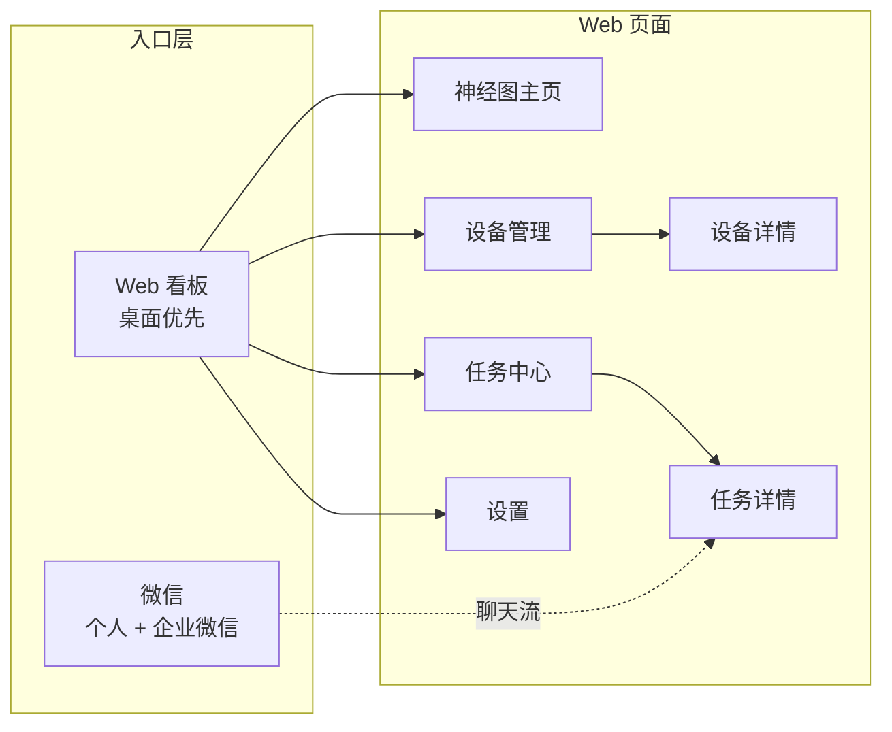

# 04 · UI 设计文档 — AgentMesh 跨设备超级智能体协同系统

> 版本 v0.1 · 产品经理：许清楚 · 技术栈：Vite + React + MUI + Tailwind CSS

---

## 1. 整体信息架构与页面结构

```
AgentMesh Web 看板
├── 神经图主页        （默认首页，全局态势 + 快捷下发）
├── 设备管理页        （设备卡片网格 → 设备详情页）
│   └── 设备详情页
├── 任务中心页        （任务列表 → 任务详情页）
│   └── 任务详情页    （消息流时间线）
└── 设置页            （通信 / 微信绑定 / 权限 / 关于）

入口：Web 看板（桌面优先）· 微信（个人 + 企业微信，移动对话流）
```



**导航模式**：桌面 = 左侧图标+文字侧边栏；平板 = 折叠图标栏；手机 = 底部 Tab（神经图 / 设备 / 任务 / 设置）。

---

## 2. 配色方案（浅色主题）

> 说明：不采用股市「红涨绿跌」语义；采用**国际通用状态色**——红=错误/失败，绿=成功/正常，灰=离线/禁用。整体现代浅色 + 品牌蓝紫。

### 2.1 语义色板

| Token | 色值 | 用途 |
|---|---|---|
| `--brand` | `#4F46E5`（Indigo） | 品牌主色、主按钮、激活态 |
| `--brand-soft` | `#EEF2FF` | 品牌浅底、选中背景 |
| `--accent` | `#0891B2`（Cyan） | 数据流、消息流、任务节点 |
| `--accent-soft` | `#ECFEFF` | 数据流浅底 |
| `--success` | `#10B981`（Emerald） | 在线、完成、成功 |
| `--warning` | `#F59E0B`（Amber） | 忙碌、运行中、告警 |
| `--danger` | `#EF4444`（Red） | 错误、失败、中断 |
| `--offline` | `#94A3B8`（Slate-400） | 离线、禁用、未知 |

### 2.2 中性色板

| Token | 色值 | 用途 |
|---|---|---|
| `--bg` | `#FFFFFF` | 主背景 |
| `--bg-subtle` | `#F8FAFC` | 卡片内底、表头、侧边栏底 |
| `--surface` | `#FFFFFF` | 卡片、面板 |
| `--border` | `#E2E8F0` | 边框、分割线 |
| `--text-strong` | `#0F172A` | 主标题、正文强调 |
| `--text` | `#334155` | 正文 |
| `--text-muted` | `#64748B` | 次要文字、时间戳 |

### 2.3 神经图节点色映射

| 节点类型 | 主色 | 状态色变化 |
|---|---|---|
| 设备 | `--brand` Indigo | 在线=`--success` 描边光晕 · 离线=`--offline` |
| Agent | `#7C3AED` Violet | 空闲=原色 · 忙碌=`--warning` · 异常=`--danger` |
| 任务 | `--accent` Cyan | 排队=灰 · 运行=`--warning` · 完成=`--success` · 失败=`--danger` |
| 消息流 | `--accent` Cyan 流动 | 流式态流动 · 静止态半透明 |

---

## 3. 组件规范

### 3.1 按钮 Button

| 变体 | 样式 | 用途 |
|---|---|---|
| 主按钮 Primary | 实心 `--brand`，白字 | 新建任务、确认 |
| 次按钮 Secondary | 白底 `--border` 描边，`--text` | 取消、返回 |
| 幽灵按钮 Ghost | 透明，悬停 `--brand-soft` | 表格行内操作 |
| 危险按钮 Danger | 实心/描边 `--danger` | 取消任务、移除设备 |

规格：圆角 `8px`，高度 `36px`（常规）/ `28px`（紧凑）。

### 3.2 状态徽标 Badge

| 状态 | 底 | 字 | 圆点 |
|---|---|---|---|
| 在线 / 完成 / 成功 | `#D1FAE5` | `#047857` | `--success` |
| 运行中 / 忙碌 | `#FEF3C7` | `#B45309` | `--warning` |
| 排队 / 待机 | `#F1F5F9` | `#475569` | `--offline` |
| 失败 / 错误 / 中断 | `#FEE2E2` | `#B91C1C` | `--danger` |

### 3.3 卡片 Card
- 白底、`1px` `--border`、圆角 `12px`、阴影 `0 1px 3px rgba(15,23,42,.08)`。
- 设备卡：顶部设备名+在线圆点，中部 agent 平台图标行，底部负载条。

### 3.4 表格 Table
- 表头 `--bg-subtle` 底、`--text-muted` 字；行高 `48px`；悬停 `--bg-subtle`；行尾操作用幽灵按钮。

### 3.5 输入 Input / 选择 Select
- 白底 `--border` 描边，聚焦描边 `--brand` + `2px` 外发光 `rgba(79,70,229,.15)`。

### 3.6 布局组件
- **侧边栏 Sidebar**：宽 `220px`（桌面），折叠 `64px`（平板），`--bg-subtle` 底。
- **顶栏 Topbar**：高 `56px`，白底，含全局搜索 + 新建任务 + 连接状态指示灯。
- **抽屉 Drawer**：右侧滑出，宽 `360px`，用于节点详情/快捷操作。
- **Toast 通知**：右上角，成功绿/失败红，自动消失 5s。

---

## 4. 核心「动态神经图」设计

> 全局态势主视觉。技术：力导向图（Force-Directed Graph），节点带斥力、连线带弹簧力，自动布局，用户可拖拽微调。

### 4.1 设计目标
1. 一眼看清「设备 → agent → 任务 → 消息流」的实时调用拓扑。
2. 活跃路径自动高亮，噪声自动淡化。
3. 全交互（缩放/拖拽/悬停/聚焦），移动端降级为只读。

### 4.2 节点类型与视觉规范

| 节点 | 形状 | 大小 | 标识 | 附加信息 |
|---|---|---|---|---|
| 设备 Device | 圆形，Indigo 实心 | 半径 22px | 图标（笔记本/手机/服务器） | 在线呼吸光晕，离线置灰 |
| Agent | 圆角方形，Violet | 14×14px | 平台首字母（C=Codex、Cℓ=Claude、D=DSH、G=Grok） | 忙碌时外圈琥珀描边 |
| 任务 Task | 菱形，Cyan/状态色 | 12px | 任务图标 | 状态色实时变 |
| 消息流 Message | 连线上的光点 | 3px | — | 沿方向流动 |

### 4.3 连线语义

| 连线 | 样式 | 语义 |
|---|---|---|
| 调用 call | 实线 + 箭头，`--brand` | 设备/任务 → agent 发起调用 |
| 返回 return | 虚线 + 箭头，`--success` | agent → 发起方回传结果 |
| 流式 stream | 动态流动虚线 + 光点，`--accent` | 进行中的流式输出 |
| 归属 belongs | 细实线无箭头，`--border` | 设备 ↔ 其 agent、agent ↔ 任务归属 |

### 4.4 动画规范

| 动画 | 触发 | 实现 |
|---|---|---|
| 脉冲 pulse | 设备在线、任务运行中 | 节点外圈光晕呼吸（`opacity` 0.4→0 循环，周期 2s） |
| 流动光点 flow | 消息流/流式连线 | 沿连线方向移动的光点（`stroke-dashoffset` 动画） |
| 激活高亮 highlight | 用户聚焦节点 | 聚焦节点及其一跳邻接高亮，其余节点/连线淡化为 `opacity 0.15` |
| 入场上浮 | 节点新增 | 新节点 `scale 0→1` + 上浮 200ms |

### 4.5 交互规范

| 交互 | 操作 | 效果 |
|---|---|---|
| 缩放 zoom | 滚轮 / 双指捏合 | 0.3×–4×，中心缩放 |
| 拖拽 drag | 拖节点 / 拖空白 | 节点重排 / 画布平移 |
| 悬停 hover | 指针停留 150ms | Tooltip：名称 + 状态 + 关键指标（负载/耗时/消息量） |
| 点击聚焦 focus | 单击节点 | 高亮邻接、淡化其余；右侧抽屉展开该节点详情 |
| 空白点击 | 单击画布 | 取消聚焦，恢复全局视图 |
| 图例 | 底部悬浮图例 | 节点/连线颜色语义说明 |

### 4.6 性能与降级
- 节点 > 300 时启用聚合（同设备内 agent 折叠为设备节点）。
- 移动端（<768px）神经图降级为**只读**：仅缩放/悬停，隐藏拖拽，默认显示「设备+运行中任务」精简层。

---

## 5. 自适应断点方案

| 断点 | 范围 | 布局策略 |
|---|---|---|
| 桌面 Desktop | ≥1280px | 侧边栏 `220px` + 主内容 + 右侧抽屉；神经图全功能；表格全列 |
| 平板 Tablet | 768–1279px | 侧边栏折叠为 `64px` 图标栏；神经图保留缩放/悬停/聚焦，隐藏拖拽；表格隐藏次要列（发起入口/耗时） |
| 手机 Mobile | <768px | 底部 Tab 导航；神经图只读（仅缩放/悬停）；列表卡片化；抽屉全屏化 |

**断点实现**：Tailwind `lg:`(≥1024) / `md:`(≥768) 为主，神经图交互能力按 `<768` 与 `≥768` 两档切换；`1280` 仅控制侧边栏展开态。

---

## 6. 关键界面线框

### 6.1 神经图主页（桌面 ≥1280）

```
┌───────────────┬────────────────────────────────────────┬──────────────┐
│  Sidebar      │  Topbar: [🔍搜索]        [连接:🟢局域网] [＋新建任务] │
│  ● 神经图      ├────────────────────────────────────────┤  Drawer(收)  │
│  ● 设备       │                                        │              │
│  ● 任务       │        （动态神经图 · 力导向）          │  点节点后    │
│  ● 设置       │                                        │  展开详情    │
│               │   ◯设备A ──▶ ▢Codex ──▶ ◇任务#1        │              │
│               │    │            │  ┄┄▶ 流式光点        │              │
│               │   ◯设备B ──▶ ▢Claude ──▶ ◇任务#2        │              │
│               │                                        │              │
├───────────────┴────────────────────────────────────────┴──────────────┤
│ 底部状态条:  在线设备 3 · 运行中任务 2 · 告警 1          [图例悬浮]      │
└───────────────────────────────────────────────────────────────────────┘
```

### 6.2 任务详情页（消息流时间线）

```
┌──────────────────────────────────────────────────────────────────────┐
│ ← 返回   任务 #12 修复登录超时      [🟡运行中]  耗时 3m12s            │
│ 目标: 设备A · Claude Code   发起: 微信                                    │
├──────────────────────────────────────────────────────────────────────┤
│  👤 用户(微信)  14:02  帮我修复登录超时的 bug                           │
│  🤖 agent      14:02  已接收，开始分析...                              │
│  🔧 工具调用   14:03  read src/auth.ts                                │
│  🤖 agent      14:04  发现问题在 token 刷新逻辑，正在修改...           │
│  📤 流式输出   14:05  diff: auth.ts +12 -3  ▓▓▓░░ (流式滚动)          │
├──────────────────────────────────────────────────────────────────────┤
│                        [取消]  [重试]  [导出日志]                       │
└──────────────────────────────────────────────────────────────────────┘
```

### 6.3 设备管理页

```
┌──────────────────────────────────────────────────────────────────────┐
│ 设备管理                                            [＋添加设备]       │
├───────────────┬───────────────┬───────────────┬──────────────────────┤
│ ┌───────────┐ │ ┌───────────┐ │ ┌───────────┐ │                      │
│ │ ● 在线     │ │ │ ● 在线     │ │ │ ○ 离线     │ │                      │
│ │ MacBook   │ │ │ PC-Win    │ │ │ 手机       │ │                      │
│ │ ID: a1b2  │ │ │ ID: c3d4  │ │ │ ID: e5f6  │ │                      │
│ │ [C][Cl][D]│ │ │ [C][G]    │ │ │ [Cl]      │ │                      │
│ │ 负载 ▓▓░░  │ │ │ 负载 ▓▓▓░  │ │ │ ─ 离线    │ │                      │
│ └───────────┘ │ └───────────┘ │ └───────────┘ │                      │
└───────────────┴───────────────┴───────────────┴──────────────────────┘
```

### 6.4 微信入口（对话流）

```
┌─────────────────────────┐
│  AgentMesh 助理          │
├─────────────────────────┤
│ 👤 帮我查下数据库慢查询   │
│ 🤖 已接收 · 任务#15      │
│    分配: PC-Win · Codex  │
│ 🤖 分析中...             │
│ 🤖 结果: 发现3条慢查询    │
│    详见: (链接打开看板)   │
├─────────────────────────┤
│ [输入消息...]  [发送]     │
└─────────────────────────┘
```

### 6.5 移动端（<768px）底部 Tab

```
┌─────────────────────────┐
│  Topbar  [🟢] [＋]      │
├─────────────────────────┤
│   （列表 / 只读神经图）   │
│   ┌───────────────────┐ │
│   │ 任务#12 🟡 运行中   │ │
│   │ 任务#15 🟢 完成     │ │
│   │ 设备A ● 在线        │ │
│   └───────────────────┘ │
├─────────────────────────┤
│ [神经图] [设备] [任务] [设置] │
└─────────────────────────┘
```

---

*本文档与《01-PRD》配套，动态神经图为架构师/工程师的核心实现依据。*
