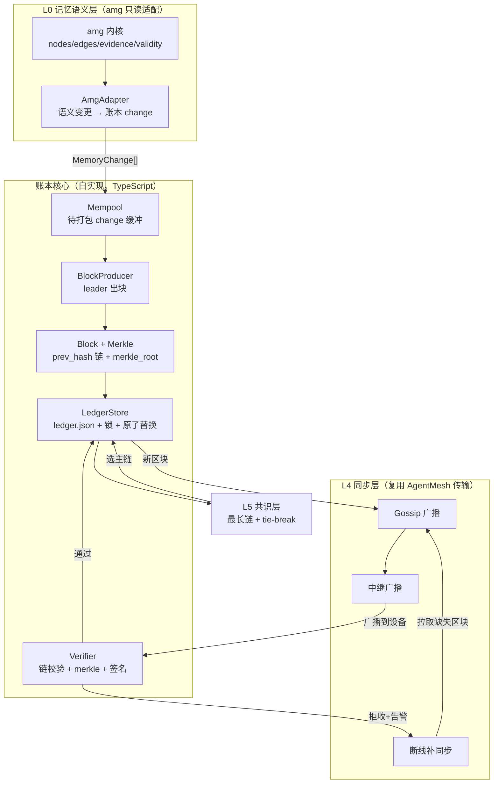
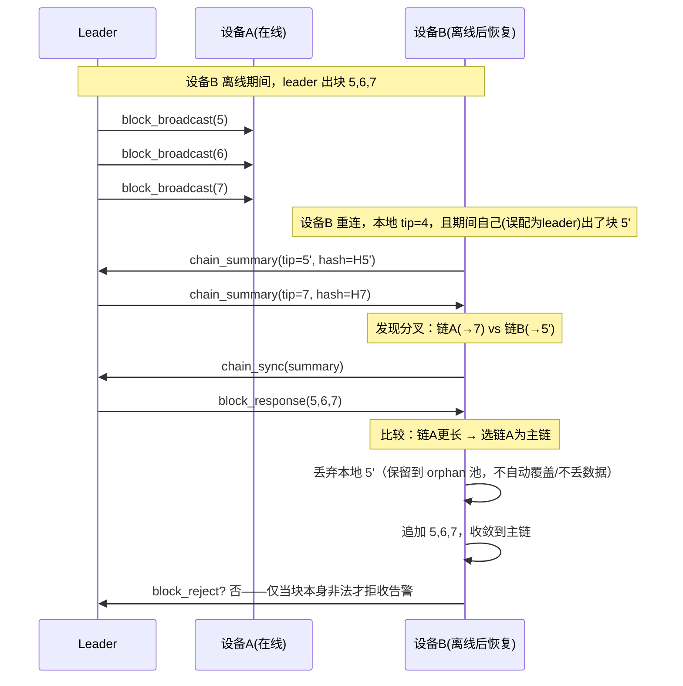
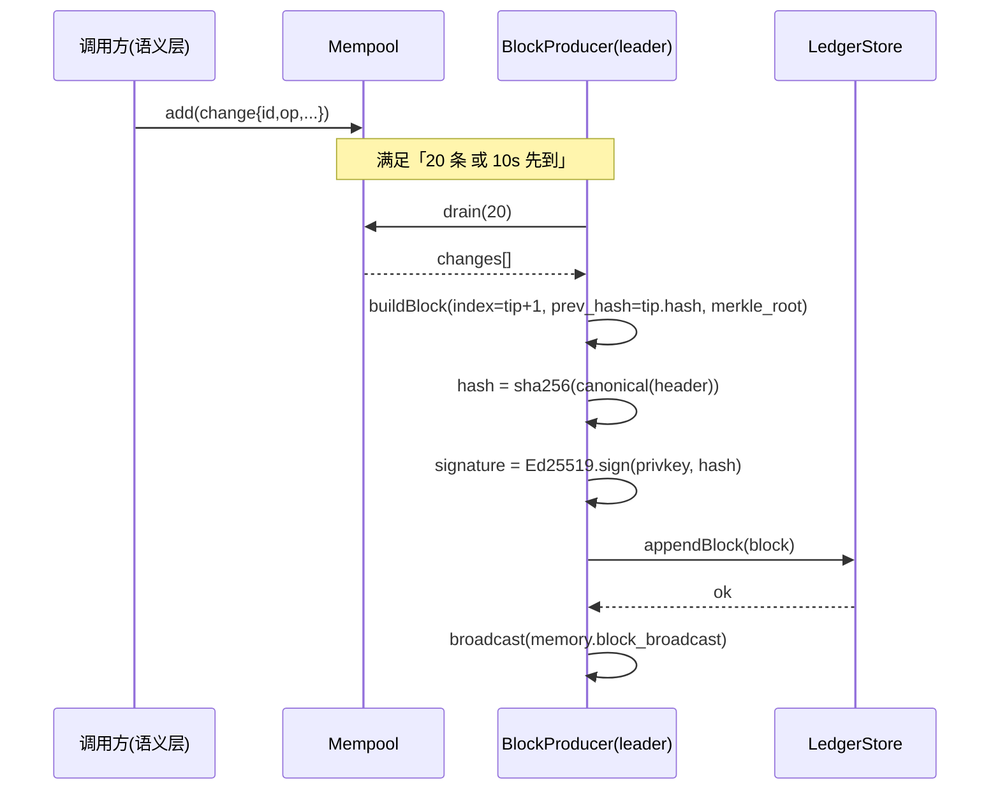
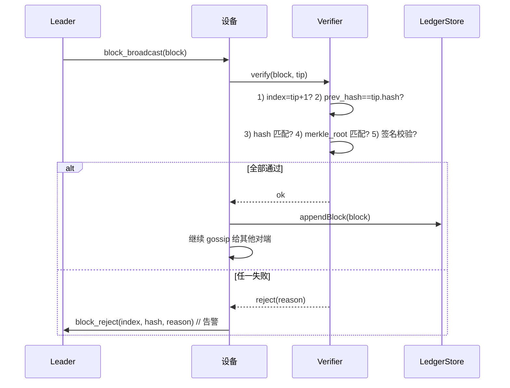
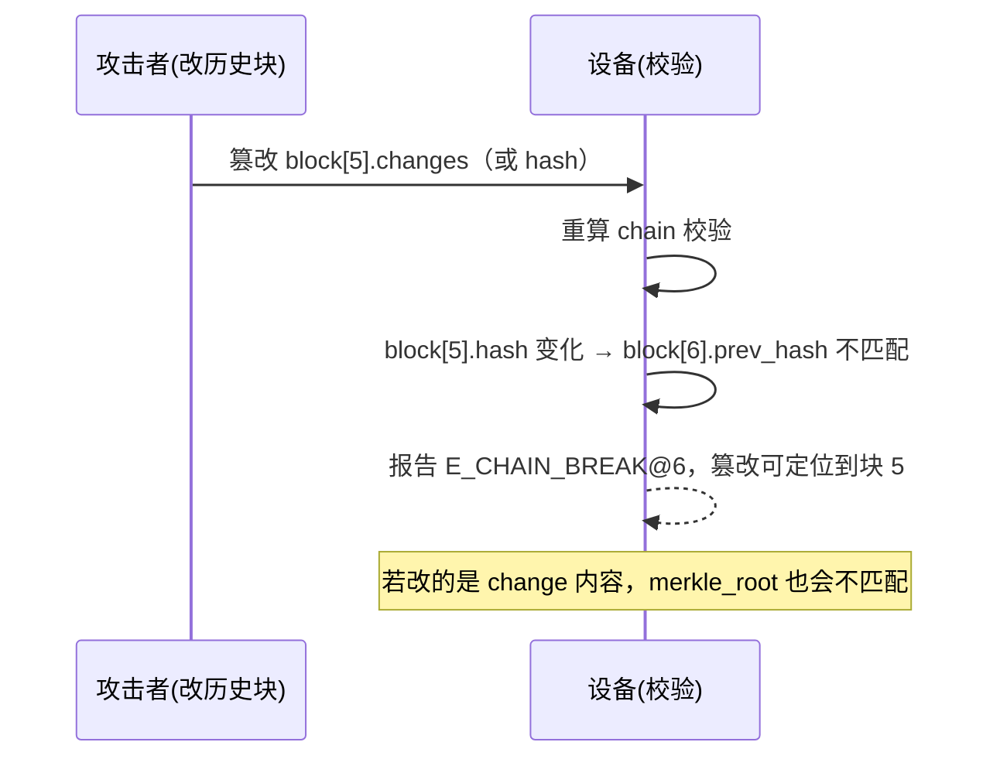
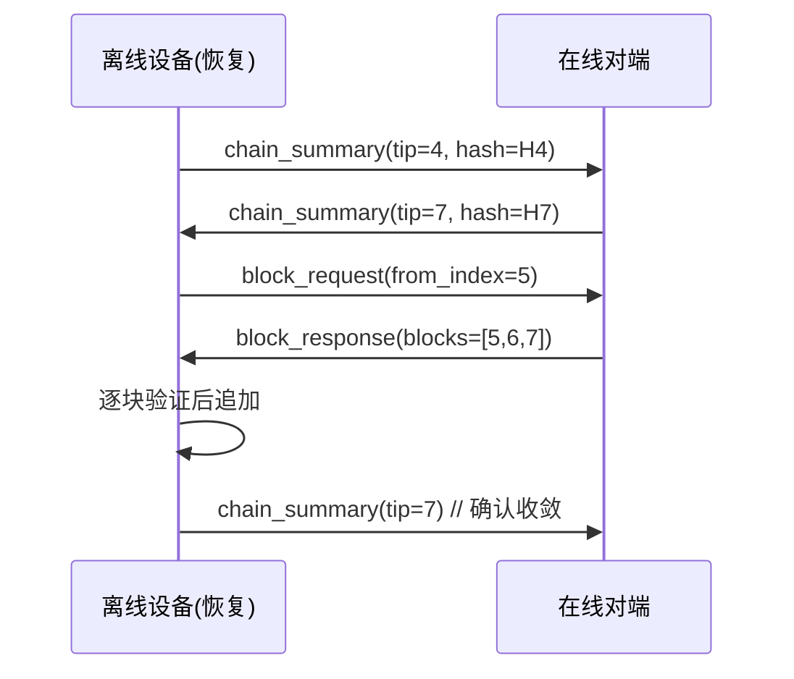

# 07 · 记忆账本架构设计 — AgentMesh 跨设备分布式记忆账本

> 版本 v0.1 · 架构师：高见远 · 状态：待评审
> 输入：`05-记忆架构研究`（amg 分析 + 区块链融合）· `06-记忆架构融合PRD`（需求基线 + 决策 D1-D7 + 待确认 Q1-Q8）
> 硬约束：**不修改 amg 原目录**（只读参考）；**不改 AgentMesh 原项目代码**；所有新产出放 `agentmesh-memory/`，账本核心独立实现，通过「协议适配接口」对接 amg 语义层。

---

## 0. 一句话定位与决策速览

**定位**：一套**纯 TypeScript 自实现的「许可制分布式记忆账本」**——amg 提供记忆的**语义与内容**（决策/任务/产物/证据/有效期），账本提供记忆的**时序与分布**（哈希链 + Merkle + 副本 + 同步 + 共识）。不做通用区块链，只做「可信局域网 + 少量设备」场景下的务实记忆账本。

| 决策项 | 结论（本文按此设计） | 对应 PRD |
|---|---|---|
| 语言/运行时 | TypeScript + Node ≥ 20，`node:crypto` 提供 sha256 + Ed25519，零第三方运行时依赖 | — |
| 区块模型 | `block = { index, prev_hash, timestamp, merkle_root, changes[], author, signature, hash }` | P0-1 |
| 哈希 | 单 sha256；`hash = sha256(canonical({prev_hash, merkle_root, timestamp, author, changes}))` | P0-1 |
| Merkle | 单 sha256 内节点；叶子 = `sha256(canonical(change))`；奇数复制末叶 | P0-2 |
| 存储 | 单文件 `ledger.json` + 原子替换 + 建议锁（对齐 amg `store.py` 思路，独立实现） | P0-3 |
| 同步 | 复用 AgentMesh 传输层，信封对齐 `Envelope{type,payload}`，新增 `memory.*` 消息类型 | P0-4 |
| 篡改检测 | 收块先验 `prev_hash` + `merkle_root` + `signature`，通过才追加，否则拒收告警 | P0-5 |
| 融合方式 | 不改 amg；MVP 在 TS 内定义与 amg 兼容的 change 结构；amg 完整语义（证据门控/检索/归档）作 P1 经 MCP server 对接 | P0-6 |
| 共识 | 固定 leader（协调后端）记账；「20 条 change 或 10s 先到」出块；最长链 + 同 index 按 `block.hash` 字典序（取小者）确定性选主链 | D1/D3/D4、Q1/Q2 |
| 签名 | Ed25519；`signature = sign(privkey, block.hash)`；`author` = deviceId，公钥经配对进本地信任表 | Q5 |
| 威胁边界 | 防「静默篡改 + 时序伪造」，不防「持 token 节点恶意写」 | D7 |

---

## 1. 总体架构分层

```
┌─────────────────────────────────────────────────────────────────┐
│  L0 记忆语义层（amg 只读适配，不修改）                             │
│   nodes / edges / evidence / validity / supersede / 检索 / 审计   │
│   ── MVP：TS 内定义与 amg 兼容的 change/node/edge 结构           │
│   ── P1 ：经 amg MCP server（stdio JSON-RPC）对接完整语义         │
├─────────────────────────────────────────────────────────────────┤
│  L1 区块化时序层（新增，核心）                                     │
│   change → 打包成 block；prev_hash 链；merkle_root               │
├─────────────────────────────────────────────────────────────────┤
│  L2 账本存储层（新增）                                            │
│   单文件 ledger.json；原子替换；建议锁；本地全量副本               │
├─────────────────────────────────────────────────────────────────┤
│  L3 验证层（新增）                                                │
│   prev_hash 链校验 + merkle 验证 + Ed25519 签名校验 + 篡改定位    │
├─────────────────────────────────────────────────────────────────┤
│  L4 同步层（复用 AgentMesh 传输，新增协议消息）                     │
│   gossip 广播 + 中继广播 + 断线补同步（区块拉取 + 收敛）           │
├─────────────────────────────────────────────────────────────────┤
│  L5 共识层（P1）                                                  │
│   固定 leader 记账 + 出块条件 + 最长链 + 确定性 tie-break         │
└─────────────────────────────────────────────────────────────────┘
```



### 各层职责与关键点

| 层 | 职责 | 关键点 | 新增/复用 |
|---|---|---|---|
| L0 记忆语义层 | 记忆内容与语义（决策/任务/产物/证据/有效期） | 不修改 amg；MVP 用 TS 兼容结构，P1 走 MCP | 复用（只读适配） |
| L1 区块化时序层 | 把 change 打包成 block，构造 `prev_hash` 链 + `merkle_root` | `rev`→`index`，哈希环环相扣 | 新增 |
| L2 账本存储层 | 单文件账本读写、原子替换、建议锁、本地全量副本 | 对齐 amg 单文件可靠性思路 | 新增 |
| L3 验证层 | 收块验证 `prev_hash` / merkle / 签名，拒收告警 | 篡改检测落点 | 新增 |
| L4 同步层 | 新区块 gossip + 中继广播、断线补同步、区块拉取 | 复用 AgentMesh 传输，不新造 | 复用传输 + 新增协议 |
| L5 共识层 | 记账权、最长链、确定性 tie-break、分叉解决 | 许可制 + 固定 leader | 新增（P1） |

**数据流主轴**：语义写入 → 生成 change → 进 mempool → leader 出块 → 落本地账本 → 广播 → 对端验证 → 追加副本 → 共识收敛。

---

## 2. 区块数据结构（字段级定义）

### 2.1 区块 `Block`

```typescript
// 字节序约定：所有哈希/签名均以「字符串」形式存储，不做二进制大小端假设。
// hash/prev_hash/merkle_root：64 位小写 hex（对齐 amg SHA256_RE = ^[0-9a-f]{64}$）
// signature：Ed25519 原始 64 字节的 base64（标准编码，88 字符）
interface Block {
  index: number;        // 区块序号，0 起，单调 +1
  prev_hash: string;    // 前一区块 hash；genesis = 64 个 '0'
  timestamp: number;    // 出块时间，epoch 毫秒（整数，确定性比较无时区歧义）
  merkle_root: string;  // 块内 changes 的 Merkle 根
  changes: MemoryChange[]; // 块内交易（本块承载的语义变更）
  author: string;       // 记账者 deviceId（'coordinator' 或设备 id），参与 hash
  signature: string;    // Ed25519(privkey, hash) 的 base64，不参与 hash（避免循环依赖）
  hash: string;         // 本块哈希，见 2.2
}
```

| 字段 | 类型 | 字节序/编码 | 说明 |
|---|---|---|---|
| `index` | number(整数) | 十进制，无科学计数法 | 从 0 开始，每块 +1 |
| `prev_hash` | string(64 hex) | 小写 hex | genesis 为 `"0"*64` |
| `timestamp` | number(整数) | epoch 毫秒 | 确定性排序；同一 leader 内单调不减 |
| `merkle_root` | string(64 hex) | 小写 hex | 空块为 `sha256("")` |
| `changes` | MemoryChange[] | 保持顺序（数组） | 块内顺序即语义执行顺序 |
| `author` | string | UTF-8 | deviceId，验签时查信任表得公钥 |
| `signature` | string(base64) | 64 字节 Ed25519 | 不参与 hash |
| `hash` | string(64 hex) | 小写 hex | 由 2.2 计算 |

### 2.2 区块哈希算法（对齐 amg `fingerprint.py` 的 canonical 思路）

> amg 的 `fingerprint.py` 用 `json.dumps(obj, ensure_ascii=False, sort_keys=True, separators=(",", ":"))` 做规范化后再 sha256。本账本**采用同一思想**，但规范化的是账本自己的 `change` 表示，而非 amg 的 `graph.json`。两者互补：amg 管「语义图一致性」，账本管「时序一致性」，不需要哈希互认。

```
block.hash = sha256_hex( canonical_json({
    prev_hash, merkle_root, timestamp, author, changes
}) )
```

- 该定义等价于 PRD 的 `sha256(prev_hash ‖ merkle_root ‖ timestamp ‖ author ‖ changes)`：canonical_json 把对象按 key 升序、无空白地编码，天然实现「无歧义拼接」，且**跨语言可复现**。
- `signature` 明确**不进入** hash 预映像（否则签名与哈希互相依赖）。
- `changes` 参与 hash 时，用其**规范化序列化**（见 2.4），保证「同一批 change 在任意设备上算出的 hash 一致」。

### 2.3 规范化序列化 `canonical_json`（跨语言约定）

与 Python `json.dumps(obj, ensure_ascii=False, sort_keys=True, separators=(",", ":"))` 语义一致，TS 侧实现规则：

| # | 规则 | 说明 |
|---|---|---|
| C1 | 对象 key 按 **Unicode 码点升序**递归排序 | 稳定、与插入顺序无关 |
| C2 | 字符串 UTF-8 编码，**不转义非 ASCII**（中文原样） | 与 `ensure_ascii=False` 一致 |
| C3 | 无多余空白（`{"a":1,"b":2}` 无空格） | 与 `separators=(",", ":")` 一致 |
| C4 | 数字：整数十进制、**禁止科学计数法**、无前导零、无小数点 | 整数确定性 |
| C5 | 数组保持元素顺序 | 顺序即语义 |
| C6 | 布尔 `true`/`false`、`null` | 标准 JSON |
| C7 | 对象内不保留 `undefined`；`undefined` 一律不序列化 | 与 amg 缺省字段语义一致 |

> ⚠️ 实现注意：TS 原生 `JSON.stringify` 默认（无 replacer）**不满足 C1/C2/C4 的稳定性**（key 顺序取决于插入顺序、`0` 与 `-0`、大数精度）。必须实现专用 `canonicalize()`：递归排序 key、字符串原样输出、数字用 `Number.isInteger` 走十进制整数字符串。这是账本一致性的**根基**，单测重点覆盖（见 08 文档 T2）。

### 2.4 块内交易 `MemoryChange`（与 amg 语义兼容）

```typescript
type ChangeOp = 'add_node' | 'set_status' | 'add_edge' | 'supersede' | 'expire' | 'import_node';

interface MemoryChange {
  id: string;        // 本 change 的稳定标识（uuid），Merkle 叶子/证明定位用
  op: ChangeOp;      // 语义操作，对齐 amg changes[].op
  target: string;    // 目标节点 id（或 edge 的 "from->to"）
  by: string;        // 写入者标识（对齐 amg changes[].by）
  at: string;        // 交易时间 ISO-8601（对齐 amg changes[].at）
  rev: number;       // amg 语义 rev（单调递增），账本内由 leader 分配
  note: string;      // 备注（对齐 amg changes[].note）
  // 语义载荷（按 op 区分）：
  node?: MemoryNode;         // add_node / import_node
  edge?: MemoryEdge;         // add_edge
  status?: string;           // set_status 的目标状态
  supersede?: { old_id: string; new_id: string }; // supersede
}
```

> `at`（交易时间）与 `node.valid_from/valid_until`（事实时间）严格分离，沿用 amg 语义：事实时间由调用方提供，绝不默认成写入时间。

---

## 3. 哈希链算法

### 3.1 Genesis 块定义

```typescript
const GENESIS: Block = {
  index: 0,
  prev_hash: "0".repeat(64),           // 全 0，链起点
  timestamp: 0,                        // 固定 0，确定性
  merkle_root: sha256Hex(""),          // 空树的固定值 e3b0c442...b855
  changes: [],
  author: "genesis",
  signature: "",                       // genesis 不签名（无来源），验签时特殊放行
  hash: "",                            // 由 2.2 计算
};
GENESIS.hash = computeHash(GENESIS);   // 确定性，全网一致
```

- genesis 是**确定性常量**：所有设备用同一套字段算出同一个 genesis hash，作为链的共同起点。
- 创世不承载任何语义 change；第一条记忆从 index=1 开始。

### 3.2 `prev_hash` 链接

```
block[i].prev_hash === block[i-1].hash   （i ≥ 1）
```

- 写块时：`block.prev_hash = tip.hash`，`block.index = tip.index + 1`。
- 篡改任意历史块 → 该块 `hash` 变 → 后一块 `prev_hash` 不再匹配 → 链断裂，且能**精确定位到断裂块**（比 amg 一次性 `history_sha256` 更强的能力：能指认「哪一块」被改）。

### 3.3 链校验算法（伪代码）

```
function verifyChain(blocks: Block[]): VerificationReport {
  report = { ok: true, errors: [] }
  // 1) genesis 必须是确定性常量
  if blocks[0].hash != GENESIS.hash: report.errors.push("E_BAD_GENESIS")
  // 2) 逐块校验
  prev = GENESIS.hash
  for (i, block) in blocks.enumerate():
    if block.index != i:                       report.errors.push(`E_BAD_INDEX@${i}`)
    if block.prev_hash != prev:                report.errors.push(`E_CHAIN_BREAK@${i}`)
    if computeHash(block) != block.hash:       report.errors.push(`E_BAD_HASH@${i}`)
    if !verifyMerkleRoot(block):               report.errors.push(`E_BAD_MERKLE@${i}`)
    if block.index > 0 && !verifySig(block):   report.errors.push(`E_BAD_SIG@${i}`)
    prev = block.hash
  report.ok = report.errors.isEmpty()
  return report
}
```

- 校验顺序固定：先 `hash` 再 `merkle` 再 `signature`，错误可精确到块号与类型。

---

## 4. Merkle 树算法

### 4.1 叶子与内节点

```
leaf_i   = sha256_hex( canonical_json(changes[i]) )     // 叶子 = change 的规范化哈希
inner    = sha256_hex( leftHex ‖ rightHex )             // 内节点 = 两子哈希拼接后哈希
merkle_root = 树的根哈希
```

- **单 sha256**（非双 sha256）：canonical_json 已是结构化数据、非秘密，无长度扩展攻击面；双 sha256 是比特币为抗 length-extension 的历史做法，此处不必要。
- 空块：`merkle_root = sha256_hex("")`（固定值 `e3b0c44298fc1c149afbf4c8996fb92427ae41e4649b934ca495991b7852b855`）。

### 4.2 奇数叶子处理

- 叶子数 n 为奇数时，**复制最后一个叶子**作为配对（比特币同款策略），保证每层两两配对、树结构确定：

```
奇数层： [L0, L1, L2]  →  配对 [(L0,L1), (L2,L2)]
```

- 好处：证明路径长度恒定 `ceil(log2(n))`，无需处理「悬空右子」特例。

### 4.3 `merkle_proof` 结构与验证算法

```typescript
interface MerkleProof {
  leaf_index: number;                 // change 在 changes[] 中的下标
  leaf_hash: string;                  // 该 change 的叶子哈希
  siblings: Array<{ hash: string; side: 'left' | 'right' }>; // 从叶到根
  root: string;                       // 期望的 merkle_root
}

function verifyMerkleProof(proof): boolean {
  let h = proof.leaf_hash
  for (sib of proof.siblings):
    h = (sib.side === 'left') ? sha256Hex(sib.hash + h)
                              : sha256Hex(h + sib.hash)
  return h === proof.root
}
```

- **价值**：设备可凭一条 proof 验证「某条记忆确实在某块账本中」，无需下载整链（对齐 PRD P0-2）。配合 amg 的 `verify-evidence`（对 `path:` 证据重算哈希），形成「记忆内容 + 记忆时序」双重验证。

---

## 5. 账本存储层

### 5.1 选型：单文件 vs 分块文件

| 方案 | 优点 | 缺点 | 结论 |
|---|---|---|---|
| **单文件 `ledger.json`** | 实现简单；原子替换天然保证一致性；amg 已实测该模式（1289 节点单毫秒读 / 147ms 写）；少量设备完整副本可控 | 全量读写 O(n)；无增量索引 | ✅ **MVP 采用** |
| 分块文件（每块一文件） | 增量读写、可并行 | 文件管理复杂；跨文件一致性难保证；需目录扫描排序 | P2 备选（账本 > 数十 MB 时迁移） |

**理由**：MVP 团队记忆规模为「数千 change」，单文件足够；原子替换是最简单的崩溃安全机制；分块文件带来的复杂度（目录扫描、跨文件一致性、gc）远超当前收益。未来账本膨胀时，迁移路径对齐 amg 的 `archive` 冷归档思路（旧区块移出活跃文件、留指针、可校验）。

### 5.2 `ledger.json` 结构

```json
{
  "schema": "amm/v1",
  "group": "team-name",
  "genesis": { "hash": "e3b0...", "created_at": "ISO-8601" },
  "blocks": [ { "index": 0, "...": "..." }, { "index": 1, "...": "..." } ],
  "tip": { "index": 12, "hash": "abc..." },
  "updatedAt": "ISO-8601"
}
```

- `schema = "amm/v1"`（agent-mesh-memory），与 amg 的 `"amg/v1"` 区分。
- `tip` 为冗余快照（快速定位链头，不必遍历 blocks）。
- 账本只存「区块 + change」，**语义图仍由 amg 维护**（对齐 PRD Q4 默认）。

### 5.3 原子替换 + 建议锁（对齐 amg `store.py` 思路，独立实现）

```
appendBlock(block):
  with lock(.lock):                       # 建议锁，防并发写
    doc = read(ledger.json)
    if block.index != doc.tip.index + 1:  # 幂等/乱序保护
        return "stale"                    # 交给 catchup 或丢弃
    doc.blocks.push(block); doc.tip = {...}; doc.updatedAt = now()
    atomicWrite(doc)                      # temp + fsync + rename 原子替换

atomicWrite(doc):
  tmp = dir + "/.ledger." + rand + ".tmp"
  write(tmp, dumps(doc)); fsync(tmp)
  os.replace(tmp, ledger.json)            # 崩溃只会留旧文件或新文件，无半写
```

- **建议锁**：POSIX `flock` / Windows `msvcrt.locking`，锁文件 `.lock` 与账本同目录，锁随句柄关闭自动释放（崩溃不楔死）。
- **回退指数退避**（对齐 amg `store.py`：1ms 起步、16ms 封顶、加抖动），防等锁方步调一致碰撞。

---

## 6. 跨设备同步协议

### 6.1 复用 AgentMesh `Envelope` 信封

```typescript
// 对齐 @agentmesh/shared 的 Envelope：type + payload，业务内容放 payload
interface Envelope<T> { v: 1; type: MessageType; id: string; ts: number; from: string; to: string; payload: T; }
```

新增 `memory.*` 消息类型（点分小写，对齐 AgentMesh 命名规范 `域.动作`），**不改 AgentMesh 现有 `messageTypes.ts`**，账本侧定义自己的扩展类型常量，走同一传输信道。

### 6.2 消息类型定义

| 消息类型 | 方向 | payload | 作用 |
|---|---|---|---|
| `memory.block_broadcast` | leader → 全网 | `{ block: Block }` | 新区块 gossip 广播（局域网直连 + 中继） |
| `memory.block_request` | 任意 → 对端 | `{ from_index: number, to_index?: number }` | 请求缺失区块（断线补同步） |
| `memory.block_response` | 对端 → 请求方 | `{ blocks: Block[] }` | 响应区块拉取 |
| `memory.chain_summary` | 任意 → 对端 | `{ tip_index: number, tip_hash: string, group: string }` | 链头摘要（快速判断谁领先/分叉） |
| `memory.chain_sync` | 落后方 → 对端 | `{ summary: ChainSummary }` | 请求链对齐（携带己方链头） |
| `memory.block_reject` | 验证方 → 发送方 | `{ index: number, hash: string, reason: string }` | 拒收告警（篡改检测落点） |
| `memory.proof_request` | 任意 → 对端 | `{ block_index: number, change_id: string }` | 请求 merkle 证明 |
| `memory.proof_response` | 对端 → 请求方 | `{ proof: MerkleProof }` | 返回 merkle 证明 |

```typescript
// sync/messages.ts 中定义（账本侧，不污染 AgentMesh 共享类型）
type MemoryMessageType =
  | 'memory.block_broadcast' | 'memory.block_request' | 'memory.block_response'
  | 'memory.chain_summary'    | 'memory.chain_sync'     | 'memory.block_reject'
  | 'memory.proof_request'    | 'memory.proof_response';
```

### 6.3 新区块 gossip + 中继广播

- **局域网直连**：leader 出块后，向已知在线设备逐一 `block_broadcast`。
- **中继广播**：跨网段设备经 AgentMesh 云端中继（`RELAY_PORT 4174`）转发同一 `block_broadcast`，中继只透传不改内容。
- 设备收到后走验证层，通过则追加本地副本并**继续 gossip 给其他未同步对端**（洪泛去重，去重键 = `block.hash`）。

### 6.4 断线补同步流程

```
设备重连 → 收到 leader 的 chain_summary → 发现己方 tip_index 落后
        → 发 block_request(from=己方tip+1)
        → 对端回 block_response(blocks[])
        → 设备逐块验证（prev_hash 链 / merkle / 签名）后追加
        → 若链头仍落后，重复拉取 → 收敛到 leader 链头
        → 若发现己方链头与对端不同 index 不同 hash（分叉），走共识层收敛
```

---

## 7. 共识机制（P1）

### 7.1 记账权与出块条件

| 项 | 决策 | 说明 |
|---|---|---|
| 记账权 | **固定 leader**（协调后端 `coordinator`） | 对齐 AgentMesh 已有 leader 架构；轮转作 P1 备选（Q1 默认） |
| 出块条件 | **「20 条 change 或 10s 先到」** | 先到即出块；参数可配，需实测调优（Q2 默认） |
| 区块内 rev | leader 统一分配，连续单调 | 保证跨块 rev 连续、语义图可重建 |

```
produceLoop():
  loop:
    wait until (mempool.size() >= N) or (elapsed >= T)
    if mempool.empty(): continue
    changes = mempool.drain(N)          // 取前 N 条
    block = buildBlock(changes)         // index=tip+1, prev_hash=tip.hash, merkle_root
    block.signature = sign(privkey, block.hash)
    ledger.appendBlock(block)
    broadcast(memory.block_broadcast, {block})
```

### 7.2 一致性规则：最长链 + 确定性 tie-break

1. **最长链原则**：分叉时选「累计最长」的那条链为主链（即 tip 最靠前的链）。
2. **同 index 分叉 tie-break**：若两条链长度相同且在某一 index 分叉，比较该 index 处的 `block.hash` **字典序（ASCII 码序）**，**取较小者**（`min`）所在链为主链——全网统一，无随机性，保证收敛。

```
chooseMainChain(candidates: Block[][]): Block[] {
  sort candidates by:
    (1) length desc                    // 最长链优先
    (2) at first divergent index, block.hash asc  // 字典序取小
  return candidates[0]
}
```

> 字典序「取小」是任意但**全局固定**的约定（换成取大也行，关键在全网一致）。本文固定取小。

### 7.3 分叉场景时序图



---

## 8. 与 amg 的适配接口

### 8.1 「amg 语义变更」→「账本 change」映射

| amg 语义操作（`changes[].op`） | 账本 `MemoryChange.op` | 载荷映射 |
|---|---|---|
| `add-node` | `add_node` | `node` = 完整节点（含 evidence/validity） |
| `import-node`（批量） | `import_node` | 同上（批量拆成多条 change，rev 连续） |
| `set-status` | `set_status` | `status` = 目标状态 |
| `add-edge` | `add_edge` | `edge` = { from, to, kind } |
| `supersede` | `supersede` | `supersede` = { old_id, new_id } |
| `expire` | `expire` | `target` = 节点 id |
| `migrate` | （不进账本，账本从 genesis 起） | — |

### 8.2 MVP 边界 vs P1 对接

| 阶段 | 语义层实现 | 账本对接方式 |
|---|---|---|
| **MVP（P0）** | TS 内定义与 amg **兼容**的 change/node/edge/evidence 结构（字段对齐，不调 amg） | 直接调用 `AmgAdapter.toChange()`，账本独立维护 rev |
| **P1** | 复用 amg 完整语义（证据门控 `gate.py` / 检索 `retrieval.py` / 归档 `archive.py`） | 经 amg **MCP server（stdio JSON-RPC）**对接，账本透传 amg 返回的 change |

- MCP server 已是 amg 自带能力（`mcp.py`，stdio、无网络暴露、写工具走同一证据门控），账本侧写一个 `AmgMcpClient`（spawn 子进程、发 JSON-RPC）即可，**不改 amg 内部**。

### 8.3 事务边界（Q7 决策）

```
① 语义变更先写 amg（或 MVP 的 TS 语义层）   → 成功，拿到 rev + change 记录
② 账本把 change 加入 mempool（按 change.id 幂等去重）
③ leader 出块（N 条 或 T 秒）
④ 广播区块
⑤ 各设备验证后追加本地副本
```

- **顺序保证**：先语义后账本。语义层已落盘的 change 若尚未上链，通过「change.id 幂等」保证重试不重复打包。
- **反向不可能**：区块不会先于语义落盘（出块以「语义写入成功返回的 change」为输入）。
- **语义图重建**：设备按 `rev` 顺序回放账本内 change，可重建出与 amg 一致的语义图（供检索/审计，P1 起由 amg 侧消费）。

---

## 9. 数据模型字段表

### 9.1 Block（区块）

| 字段 | 类型 | 必填 | 说明 |
|---|---|---|---|
| index | number | ✅ | 0 起单调 +1 |
| prev_hash | string(64hex) | ✅ | genesis 全 0 |
| timestamp | number(epoch ms) | ✅ | 出块时间 |
| merkle_root | string(64hex) | ✅ | 块内 change 的 Merkle 根 |
| changes | MemoryChange[] | ✅ | 可为空数组 |
| author | string | ✅ | 记账者 deviceId |
| signature | string(base64) | ✅ | genesis 除外 |
| hash | string(64hex) | ✅ | 计算字段 |

### 9.2 MemoryChange（块内交易）

| 字段 | 类型 | 必填 | 说明 |
|---|---|---|---|
| id | string(uuid) | ✅ | change 稳定标识 |
| op | ChangeOp | ✅ | 语义操作 |
| target | string | ✅ | 节点 id 或 "from->to" |
| by | string | ✅ | 写入者 |
| at | string(ISO-8601) | ✅ | 交易时间 |
| rev | number | ✅ | amg 语义 rev |
| note | string | ⬜ | 备注 |
| node / edge / status / supersede | 按 op | ⬜ | 语义载荷 |

### 9.3 MemoryNode（记忆节点，对齐 amg node）

| 字段 | 类型 | 说明 |
|---|---|---|
| id / type / label / status / source | string | 对齐 amg；source 拒绝 `unknown`/`manual`（IR-2） |
| owner / note | string? | 归属/备注 |
| evidence | Evidence[] | 证据对象列表 |
| conclusion | boolean | 是否结论型（decision/artifact） |
| valid_from / valid_until | string(ISO-8601)? | 事实有效期窗口 |
| recorded_at / superseded_at | string(ISO-8601)? | 记录时间/失效时间 |

### 9.4 Evidence（证据对象，对齐 amg gate.py）

| 字段 | 类型 | 必填 | 说明 |
|---|---|---|---|
| locator | string | ✅ | 前缀 `path:`/`cmd:`/`url:`/`sha256:` |
| content_sha256 | string(64hex) | ✅ | 被引用产物的哈希（绝不能是节点 id/rev） |
| captured_at | string(ISO-8601) | ✅ | 捕获时间 |
| graph_rev | number | ⬜ | 捕获时 rev（默认当前） |
| grade | number(1..5) | ⬜ | 验证强度，与检索质量分离 |

### 9.5 MemoryEdge（边）

| 字段 | 类型 | 必填 | 说明 |
|---|---|---|---|
| from / to | string | ✅ | 端点节点 id |
| kind | string | ✅ | `depends_on`/`blocks`/`supersedes`/…（对齐 amg EDGE_KINDS） |

---

## 10. 技术选型表

| 项 | 选型 | 理由 |
|---|---|---|
| 语言/运行时 | TypeScript + Node ≥ 20 | 与 AgentMesh 宿主同栈，便于「适配」而非「改」 |
| 哈希 | `node:crypto` `createHash('sha256')` | 零第三方依赖；与 amg sha256 语义一致 |
| 签名 | `node:crypto` `generateKeyPairSync('ed25519')` + `sign/verify` | 非对称、可验来源；对齐 PRD Q5 默认 |
| 账本存储 | 单文件 JSON + 原子替换 + 建议锁 | 对齐 amg 思路，独立实现 |
| 序列化 | 自实现 `canonicalize()` | 跨设备确定性哈希的根基 |
| 同步传输 | 复用 AgentMesh 信封 + 传输层 | 不新造传输 |
| 测试 | vitest | 快、与 TS 原生 |
| 共识 | 自实现最长链 + tie-break | 不引入区块链框架 |

### 依赖包清单（运行期零第三方依赖）

```
- typescript@^5.x        : 编译（devDependency）
- vitest@^2.x            : 单元测试（devDependency）
- @types/node@^20.x      : Node 类型（devDependency）
（运行期仅 node:crypto / node:fs / node:os，无 npm 运行时依赖）
```

> 与 amg「无第三方依赖、标准库优先」的哲学一致：账本核心运行期零依赖，`node:crypto` 即 Node 标准库。

---

## 11. 关键时序图

### 11.1 记账出块



### 11.2 跨设备广播 + 验证



### 11.3 篡改检测



### 11.4 断线补同步



### 11.5 分叉解决

见 §7.3（已含分叉时序图，此处不再重复）。

---

## 12. 安全设计

### 12.1 Ed25519 签名验来源

- 每设备/协调后端持有**一对 Ed25519 密钥**；私钥本地文件保存（`~/.agentmesh-memory/keys/<deviceId>.pem`，权限 0600）；公钥在配对时（复用 AgentMesh 配对 token 流程）交换并登记进**本地信任表**。
- `block.author = deviceId`；`block.signature = sign(privkey, block.hash)`。
- 验签：`verify(trustStore.get(author), block.hash, block.signature)`。
- genesis 无签名，验签时对 `index==0 && author=="genesis"` 特殊放行。

### 12.2 威胁边界（对齐 amg THREAT-MODEL §7，诚实界定）

| 能力 | 是否防御 | 说明 |
|---|---|---|
| 静默篡改历史块（改文件/改内存后重放） | ✅ 防 | prev_hash 链 + merkle + 签名，可定位到块 |
| 时序伪造（重排/回退区块顺序） | ✅ 防 | index 单调 + prev_hash 环环相扣 + rev 单调 |
| 伪造来源（冒充他人写块） | ✅ 防 | Ed25519 签名 + 公钥信任表 |
| 持有配对 token 的节点恶意写入 | ❌ 不防 | 许可制前提：节点经 token 认证即视为可信，恶意写会进入账本但留痕可审计 |
| 单点 leader 宕机导致暂停出块 | ⚠️ 部分 | P1 轮转备选；账本不丢（各设备有副本），但出块暂停 |

**结论**：账本防的是「静默篡改 + 时序伪造 + 来源伪造」，**不防「持 token 节点恶意写入」**——后者是许可制信任模型的边界，靠审计留痕兜底。

---

## 13. 待明确事项（PRD Q1-Q8 的架构决策）

| 问题 | 架构决策 | 状态 |
|---|---|---|
| Q1 记账权固定还是轮转 | **固定 leader（协调后端）**；轮转作 P1 备选 | ✅ 采用建议默认 |
| Q2 出块条件 | **20 条 change 或 10s 先到**；参数可配，需实测 | ✅ 采用建议默认，参数留可调 |
| Q3 amg 作 MCP server 还是移植 | **MVP 不调 amg（TS 兼容结构）→ P1 走 MCP server**；移植作 P2 | ✅ 采用建议默认 |
| Q4 账本落盘格式 | **新增 `ledger.json`**，语义图仍由 amg 维护，账本只存区块+change | ✅ 采用建议默认 |
| Q5 签名对称还是非对称 | **Ed25519 非对称**（可验来源） | ✅ 采用建议默认 |
| Q6 分叉提示与修复 | **自动选主链 + 告警**，不自动覆盖丢失分支（丢分支进 orphan 池，需人工确认） | ✅ 采用建议默认 |
| Q7 语义图与账本一致性 | **先写 amg 语义 → 打包区块 → 广播**；change.id 幂等防重 | ✅ 已定（§8.3） |
| Q8 是否单空间 | **MVP 单空间**，但账本顶层预留 `group` 字段（对齐 amg `group`） | ✅ 采用建议默认 |

---

*本文档为记忆账本架构基线，开发文档图谱（文件结构 + 任务分解）见 `08-记忆账本开发文档图谱.md`。*
