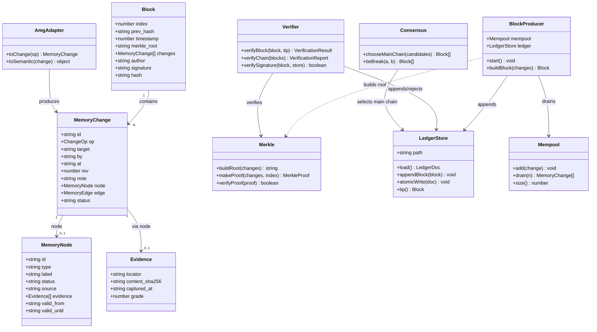
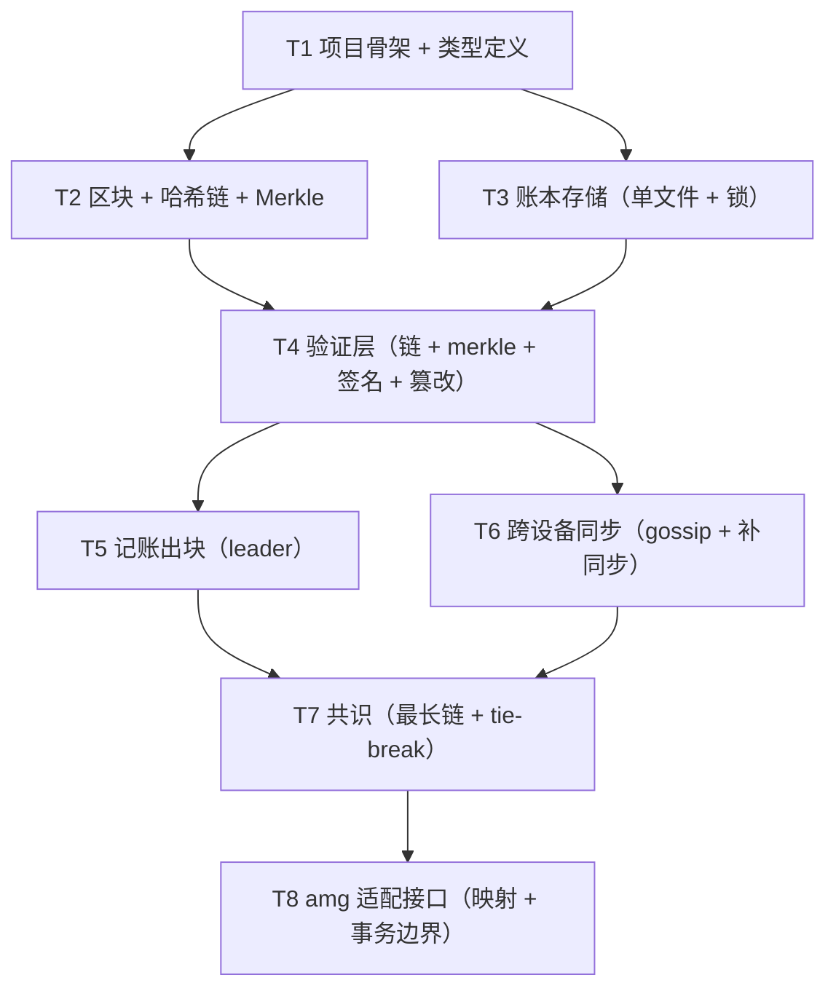

# 08 · 记忆账本开发文档图谱 — 文件结构 + 任务分解

> 版本 v0.1 · 架构师：高见远 · 输入：`07-记忆账本架构设计.md`
> 说明：本文档是工程师的实现蓝图——精确到文件的目录结构、模块职责、有序任务分解（T1-T8）、共享知识与依赖图。

---

## 1. 完整目录 / 文件结构

> 根目录：`agentmesh-memory/`（相对路径从此处起算）。所有新代码放 `src/`，文档放 `docs/`。**不触碰 amg 原目录与 AgentMesh 原项目。**

```
agentmesh-memory/
├── docs/
│   ├── 05-记忆架构研究-amg分析与区块链融合.md   # 研究基线（已有）
│   ├── 06-记忆架构融合PRD.md                   # 需求基线（已有）
│   ├── 07-记忆账本架构设计.md                   # 本架构设计（已产出）
│   └── 08-记忆账本开发文档图谱.md               # 本文档
├── src/
│   ├── package.json                  # 依赖声明 + scripts（test/build/typecheck）
│   ├── tsconfig.json                 # TS 编译配置（strict、ES2022、NodeNext）
│   ├── vitest.config.ts              # 测试配置
│   ├── .gitignore                    # 忽略 node_modules / dist / *.tmp / .lock
│   ├── README.md                     # 快速上手 + 运行说明
│   └── src/
│       ├── index.ts                  # 公共入口：聚合导出所有模块
│       ├── types/
│       │   ├── index.ts              # 类型统一导出
│       │   ├── block.ts              # Block / MemoryChange / ChangeOp / MerkleProof
│       │   ├── memory.ts             # MemoryNode / MemoryEdge / Evidence / 枚举常量
│       │   └── protocol.ts           # MemoryMessageType + 各同步 payload 类型
│       ├── crypto/
│       │   ├── canonical.ts          # canonical_json 确定性序列化
│       │   ├── hash.ts               # sha256Hex() 封装（node:crypto）
│       │   └── ed25519.ts            # 密钥生成 / sign / verify / TrustStore
│       ├── core/
│       │   ├── block.ts              # GENESIS / buildBlock / computeHash
│       │   ├── chain.ts              # prev_hash 链接 + verifyChain()
│       │   └── merkle.ts             # buildMerkleRoot / makeProof / verifyProof
│       ├── storage/
│       │   ├── lock.ts               # 建议锁（flock 风格，Node 实现）
│       │   └── ledger.ts             # LedgerStore：load / appendBlock / atomicWrite
│       ├── validation/
│       │   ├── verifier.ts           # verifyBlock / verifyChain / 签名校验
│       │   └── tamper.ts             # detectTamper()：定位被篡改的块
│       ├── consensus/
│       │   ├── mempool.ts            # Mempool：add / drain / size / 按 id 去重
│       │   ├── producer.ts           # BlockProducer：出块循环（N 条 或 T 秒）
│       │   └── fork.ts               # chooseMainChain()：最长链 + tie-break
│       ├── sync/
│       │   ├── messages.ts           # 同步消息类型 + encode/decode（对齐 Envelope）
│       │   ├── gossip.ts             # 广播 + 转发去重（去重键 block.hash）
│       │   └── catchup.ts            # 断线补同步：拉取 + 收敛
│       └── adapters/
│           ├── amg-mapper.ts         # amg 语义变更 → MemoryChange 映射
│           └── amg-mcp.ts            # (P1) amg MCP client（stdio JSON-RPC，骨架）
└── tests/
    ├── canonical.test.ts             # canonical 确定性（跨插入顺序/中文/数字）
    ├── hash.test.ts                  # sha256 已知向量
    ├── block.test.ts                 # genesis 常量 + computeHash + 字段
    ├── chain.test.ts                 # prev_hash 链 + 断裂检测
    ├── merkle.test.ts                # 奇数叶子 + proof 验证 + 空树
    ├── ledger.test.ts                # 原子替换 + appendBlock 幂等
    ├── lock.test.ts                  # 建议锁并发
    ├── verifier.test.ts              # 完整校验链 + 篡改拒收
    ├── consensus.test.ts             # 出块条件 + 去重
    ├── fork.test.ts                  # 最长链 + tie-break 确定性
    ├── sync.test.ts                  # 消息编解码 + 补同步收敛
    └── amg-mapper.test.ts            # 语义→change 映射
```

---

## 2. 各模块职责 + 关键文件说明

### 2.1 `types/`（类型定义，全项目单一事实源）

| 文件 | 职责 | 关键内容 |
|---|---|---|
| `block.ts` | 区块与交易类型 | `Block`、`MemoryChange`、`ChangeOp`、`MerkleProof` |
| `memory.ts` | 记忆语义类型 + 枚举 | `MemoryNode`、`MemoryEdge`、`Evidence`、`NODE_TYPES`、`STATUSES`、`EDGE_KINDS`、`LOCATOR_PREFIXES`（对齐 amg `const.py`） |
| `protocol.ts` | 同步消息类型 | `MemoryMessageType`、各 `*Payload`、`ChainSummary` |

### 2.2 `crypto/`（密码学原语，零第三方依赖）

| 文件 | 职责 | 关键函数 |
|---|---|---|
| `canonical.ts` | 确定性 JSON 序列化 | `canonicalize(value): string`（§2.3 规则 C1-C7） |
| `hash.ts` | sha256 封装 | `sha256Hex(data: string|Buffer): string`（64 位小写 hex） |
| `ed25519.ts` | 密钥 + 签名 | `generateKeyPair()`、`sign(priv, msg)`、`verify(pub, msg, sig)`、`TrustStore` |

### 2.3 `core/`（核心算法，纯函数无 IO，最易测）

| 文件 | 职责 | 关键函数 |
|---|---|---|
| `block.ts` | 区块构造 + 哈希 | `GENESIS`（确定性常量）、`buildBlock(changes, tip, author)`、`computeHash(block)` |
| `chain.ts` | 哈希链 | `verifyChain(blocks): VerificationReport`、`isLinked(prev, cur)` |
| `merkle.ts` | Merkle 树 | `buildMerkleRoot(changes)`、`makeProof(changes, i)`、`verifyProof(proof)` |

### 2.4 `storage/`（持久化）

| 文件 | 职责 | 关键函数 |
|---|---|---|
| `lock.ts` | 建议锁 | `withLock(lockfile, fn)`：`flock` 语义，指数退避 + 抖动 |
| `ledger.ts` | 单文件账本 | `LedgerStore.load()`、`appendBlock(block)`、`atomicWrite(doc)`、`tip()` |

### 2.5 `validation/`（验证与篡改检测）

| 文件 | 职责 | 关键函数 |
|---|---|---|
| `verifier.ts` | 收块验证 | `verifyBlock(block, tip)`、`verifyChain(blocks)`、`verifySignature(block, trustStore)` |
| `tamper.ts` | 篡改定位 | `detectTamper(blocks): TamperReport`（返回断裂块号 + 类型） |

### 2.6 `consensus/`（出块与一致性）

| 文件 | 职责 | 关键函数 |
|---|---|---|
| `mempool.ts` | 待打包缓冲 | `add(change)`（按 `change.id` 幂等去重）、`drain(n)`、`size()` |
| `producer.ts` | 出块循环 | `start(ledger, mempool, signer, opts)`：N 条或 T 秒先到即出块 |
| `fork.ts` | 分叉解决 | `chooseMainChain(candidates)`：最长链 + `hash` 字典序取小 |

### 2.7 `sync/`（跨设备同步，复用 AgentMesh 传输）

| 文件 | 职责 | 关键函数 |
|---|---|---|
| `messages.ts` | 消息编解码 | `encodeMemoryMessage(type, payload, from, to): Envelope`、`decodeMemoryMessage(raw)` |
| `gossip.ts` | 广播 | `broadcastBlock(block, peers, relay)`、转发去重（`block.hash`） |
| `catchup.ts` | 断线补同步 | `catchUp(selfTip, peerTip, transport)`：拉取 + 逐块验证 + 收敛 |

### 2.8 `adapters/`（amg 适配接口）

| 文件 | 职责 | 关键函数 |
|---|---|---|
| `amg-mapper.ts` | 语义变更映射 | `toChange(semanticOp): MemoryChange`、`toSemantic(change): SemanticOp` |
| `amg-mcp.ts` | amg MCP 对接（P1） | `AmgMcpClient`：spawn 子进程 + JSON-RPC 2.0（stdio） |

---

## 3. 核心类图（classDiagram）



---

## 4. 有序任务分解 T1-T8

> 依赖顺序：T1 → (T2, T3 可并行) → T4 → T5 → T6 → T7 → T8。粒度「工程师 1-2 轮可写完」，每个任务含产出文件 + 验收标准。

### T1 项目骨架（基础设施 + 类型定义）

**产出文件**
- `src/package.json`、`src/tsconfig.json`、`src/vitest.config.ts`、`src/.gitignore`、`src/README.md`
- `src/src/index.ts`
- `src/src/types/index.ts`、`types/block.ts`、`types/memory.ts`、`types/protocol.ts`

**验收标准**
- `npm run typecheck`（tsc --noEmit，strict）通过；`npm test` 空跑通过。
- 类型定义完整可导入：`Block` / `MemoryChange` / `ChangeOp` / `MemoryNode` / `MemoryEdge` / `Evidence` / `MemoryMessageType` 均已声明。
- 枚举常量对齐 amg：`NODE_TYPES` / `STATUSES` / `EDGE_KINDS` / `LOCATOR_PREFIXES`。

**依赖**：无

### T2 区块 + 哈希链 + Merkle（核心算法 + 单元测试）

**产出文件**
- `src/src/crypto/canonical.ts`、`crypto/hash.ts`、`crypto/ed25519.ts`
- `src/src/core/block.ts`、`core/chain.ts`、`core/merkle.ts`
- `tests/canonical.test.ts`、`hash.test.ts`、`block.test.ts`、`chain.test.ts`、`merkle.test.ts`

**验收标准**
- `canonicalize()` 确定性：同一对象不同插入顺序输出一致；中文不转义；整数无科学计数法。
- `sha256Hex("")` 返回 `e3b0c442...b855`（已知向量）。
- `GENESIS.hash` 为固定常量（测试硬编码断言，防漂移）。
- `computeHash()` 与 `hash` 字段一致；改任一字段（含 change 内容）hash 变化。
- `verifyChain()`：合法链返回 ok；篡改块 5 → 报告 `E_CHAIN_BREAK@6`。
- Merkle：3 个叶子（奇数）能出正确根；`verifyProof` 通过；篡改叶子 → 证明失败；空块根 = `sha256Hex("")`。
- Ed25519：`sign`/`verify` 往返通过；错误公钥验签失败。

**依赖**：T1

### T3 账本存储（单文件 + 原子替换 + 锁）

**产出文件**
- `src/src/storage/lock.ts`、`storage/ledger.ts`
- `tests/ledger.test.ts`、`lock.test.ts`

**验收标准**
- `appendBlock()`：正常追加后 `tip` 正确；重复追加同 index 块被拒（幂等/乱序保护）。
- 原子替换：写入中途崩溃（模拟异常）不产生半写文件，账本要么旧要么新。
- 建议锁：并发 `appendBlock` 无丢块无重复；锁超时可配置，超时抛 `E_LOCK_TIMEOUT`。
- 账本文件格式符合 §5.2（`schema="amm/v1"`、`group`、`blocks`、`tip`）。

**依赖**：T1（可于 T2 并行）

### T4 验证层（prev_hash 链校验 + merkle + 签名 + 篡改检测）

**产出文件**
- `src/src/validation/verifier.ts`、`validation/tamper.ts`
- `tests/verifier.test.ts`

**验收标准**
- `verifyBlock(block, tip)`：合法块通过；`prev_hash` 不匹配 / `hash` 错 / `merkle_root` 错 / 签名伪造 分别返回对应错误码。
- `verifyChain(blocks)`：整链校验通过；能定位到具体断裂块号 + 错误类型。
- `detectTamper(blocks)`：篡改历史块能被定位到「块号 + 篡改类型（hash/merkle/signature）」。
- 签名校验：`author` 无信任表记录 → 拒收；`author="genesis"` 且 `index=0` 特殊放行。

**依赖**：T2, T3

### T5 记账出块（leader 打包 change 成块）

**产出文件**
- `src/src/consensus/mempool.ts`、`consensus/producer.ts`
- `tests/consensus.test.ts`

**验收标准**
- Mempool：按 `change.id` 去重；`drain(n)` 返回前 n 条并移除。
- 出块条件：达到 N 条 或 经过 T 秒先到即出块；空 mempool 不出块。
- 出块字段正确：`index = tip+1`、`prev_hash = tip.hash`、`merkle_root` 匹配、`author` 为 leader、`signature` 可验。
- 出块后本地账本 `tip` 前移。

**依赖**：T4

### T6 跨设备同步协议（gossip + 中继广播 + 断线补同步）

**产出文件**
- `src/src/sync/messages.ts`、`sync/gossip.ts`、`sync/catchup.ts`
- `tests/sync.test.ts`

**验收标准**
- 消息编解码：`block_broadcast`/`block_request`/`block_response`/`chain_summary`/`block_reject` 对齐 `Envelope{type,payload}`，round-trip 无损。
- gossip：`broadcastBlock` 广播到已知对端 + 中继；转发按 `block.hash` 去重（同一块不重复转发）。
- 断线补同步：落后方发 `block_request`，对端回 `block_response`，落后方逐块验证后追加并收敛到对端链头。
- 收到非法块 → 回 `block_reject`（含 reason），不追加。

**依赖**：T4（消息编解码可与 T1 并行，但完整同步依赖验证层）

### T7 共识（最长链 + 分叉 tie-break）

**产出文件**
- `src/src/consensus/fork.ts`
- `tests/fork.test.ts`

**验收标准**
- `chooseMainChain()`：候选链中选最长链。
- 同长度同 index 分叉：按 `block.hash` 字典序**取小者**，全网确定性一致（多设备运行结果相同）。
- 丢分支进 orphan 池，不自动覆盖、不删除数据。
- 收敛：设备采纳主链后 tip 与 leader 一致。

**依赖**：T6

### T8 与 amg 适配接口（change 结构 + 事务边界）

**产出文件**
- `src/src/adapters/amg-mapper.ts`、`adapters/amg-mcp.ts`（P1 骨架）
- `tests/amg-mapper.test.ts`

**验收标准**
- `toChange()`：amg 语义操作（add-node / set-status / add-edge / supersede / expire）正确映射为 `MemoryChange`，字段不丢（evidence / validity 透传）。
- `toSemantic()`：反向可从 change 重建语义操作（供 P1 amg 消费）。
- 事务边界：先语义后账本；`change.id` 幂等保证重复提交不重复打包。
- `amg-mcp.ts` 骨架：能 spawn amg MCP server 子进程并完成一次 `initialize` + `tools/list`（P1 预留，MVP 不强制）。

**依赖**：T7（结构映射可早于 T7，但整体收尾放在最后）

---

## 5. 共享知识（跨任务约定，工程师必读）

### 5.1 命名规范

| 对象 | 规范 | 示例 |
|---|---|---|
| 文件 | 小写短词，模块名 = 职责 | `merkle.ts`、`ledger.ts` |
| 类型/接口 | PascalCase | `Block`、`MemoryChange` |
| 函数/变量 | camelCase | `computeHash`、`verifyChain` |
| 常量 | UPPER_SNAKE | `GENESIS`、`DEFAULT_BLOCK_INTERVAL_MS` |
| **JSON 序列化字段** | **snake_case**（对齐 amg JSON 风格） | `prev_hash`、`merkle_root`、`valid_from` |

### 5.2 哈希 / 序列化约定（**根基，所有模块共用**）

- 所有哈希输出：**64 位小写 hex**（`^[0-9a-f]{64}$`，对齐 amg `SHA256_RE`）。
- `hash`/`prev_hash`/`merkle_root` 一律小写 hex；`signature` 为 base64。
- `canonicalize()` 规则（§07 2.3 C1-C7）：key 按 Unicode 码点升序、字符串不转义非 ASCII、整数十进制无科学计数法、无空白。
- 区块哈希：`sha256Hex(canonicalize({prev_hash, merkle_root, timestamp, author, changes}))`。
- Merkle 叶子：`sha256Hex(canonicalize(change))`；内节点 `sha256Hex(left‖right)`；奇数复制末叶。

### 5.3 消息类型枚举（账本侧扩展，不改 AgentMesh）

```
memory.block_broadcast | memory.block_request | memory.block_response
memory.chain_summary    | memory.chain_sync     | memory.block_reject
memory.proof_request    | memory.proof_response
```

### 5.4 区块字段约定

| 字段 | 约定 |
|---|---|
| `index` | 0 起单调 +1；genesis = 0 |
| `prev_hash` | genesis = 64 个 `'0'` |
| `timestamp` | epoch 毫秒整数 |
| `author` | deviceId；genesis = `"genesis"` |
| `signature` | Ed25519 对 `hash` 签名，base64；genesis 为空，验签特殊放行 |

### 5.5 错误码（`E_` 前缀，对齐 amg 风格）

```
E_BAD_GENESIS / E_BAD_INDEX / E_BAD_HASH / E_CHAIN_BREAK / E_BAD_MERKLE
E_BAD_SIG / E_STALE_BLOCK / E_DUP_CHANGE / E_LOCK_TIMEOUT / E_BAD_CHANGE
```

### 5.6 事务与幂等

- 顺序：**先写 amg 语义 → 打包区块 → 广播**（Q7）。
- 幂等键：`change.id`（mempool 去重）与 `block.hash`（gossip 去重）。
- 乱序保护：`appendBlock` 仅接受 `index == tip.index + 1`，否则返回 `E_STALE_BLOCK` 交 catchup。

---

## 6. 依赖图（Mermaid）



**并行建议**：T2 与 T3 可并行（互不依赖）；T5 与 T6 可并行（都只依赖 T4）。

---

*本文档是工程师实现蓝图，验收以 `tests/` 单测 + 上述验收标准为准。实现完成后由 QA 依据 P0 六项需求做集成测试（见团队任务 #4）。*
