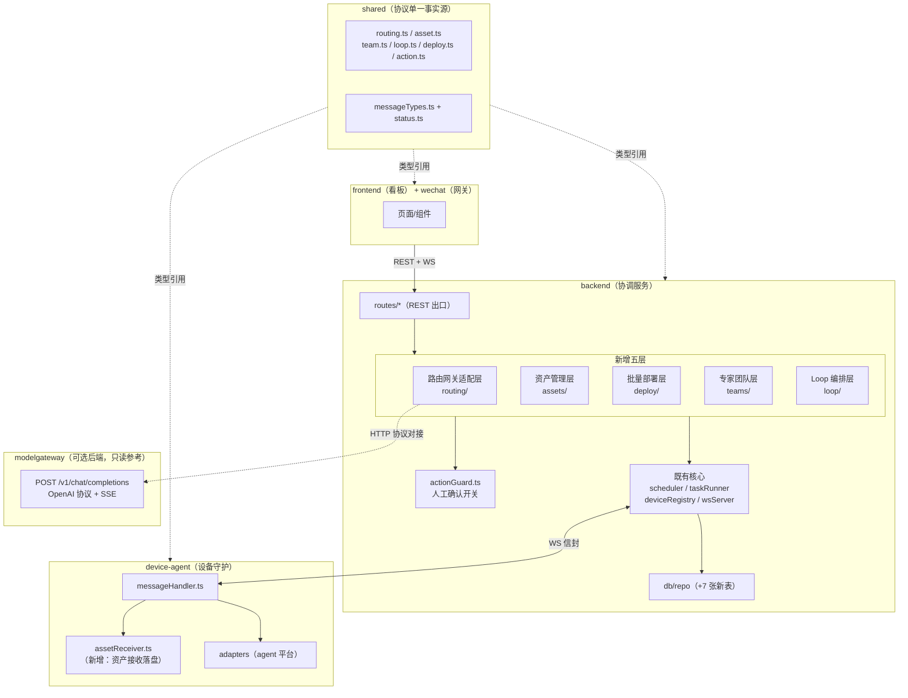
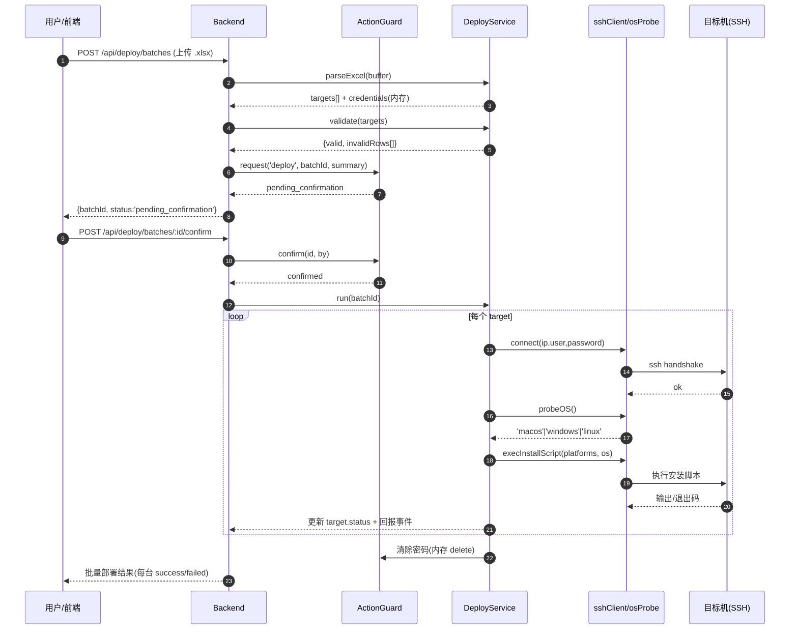
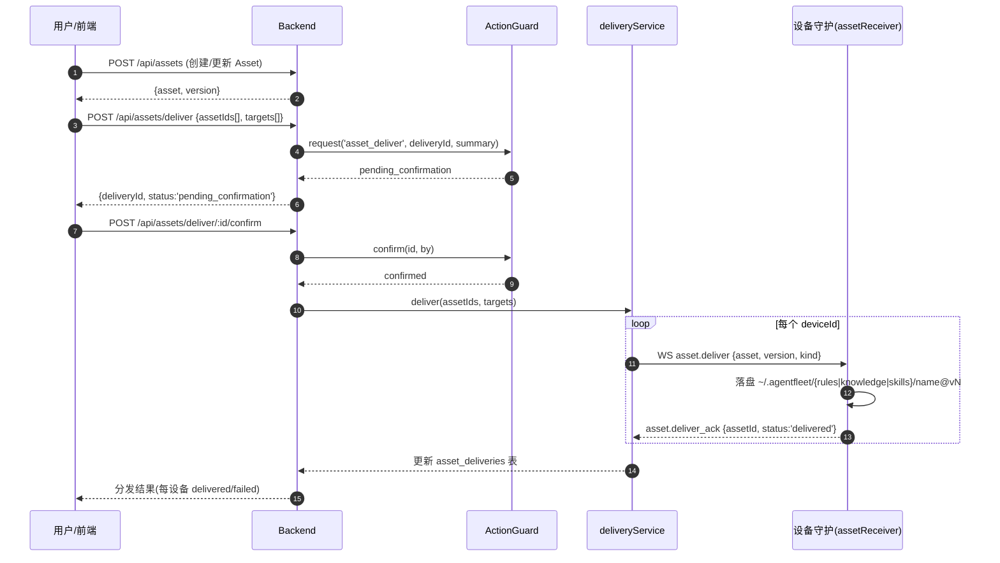
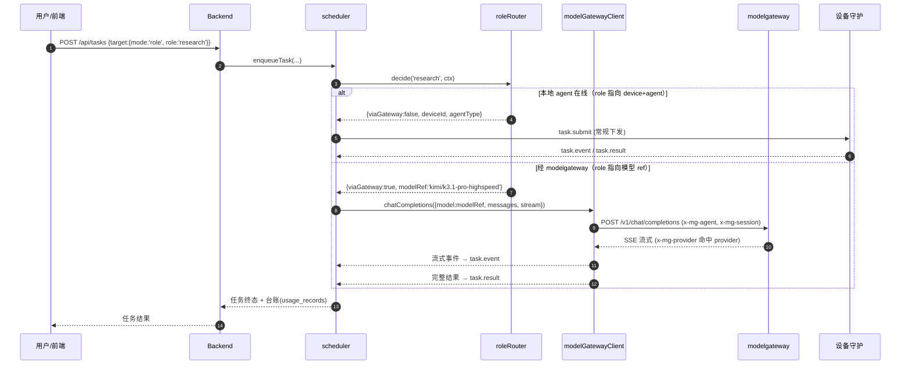
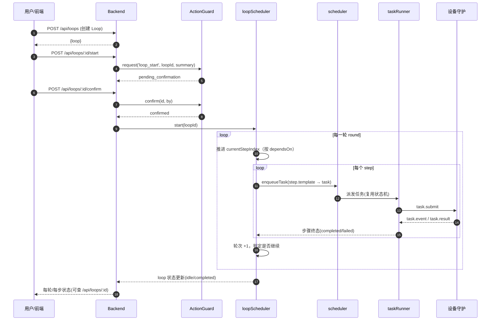

# 11 · 路由网关融合架构设计 — AgentFleet + ModelGateway + 六大新功能

> 版本 v0.1 · 架构师：高见远 · 状态：待工程师实现
> 上游基线：《09-路由网关研究》《10-路由网关融合PRD》《03-开发文档图谱》《02-架构设计》
> 硬约束：**不移植 modelgateway 代码**，协议对接（modelgateway 作为可选后端）；**融合进 AgentFleet**，不新造系统。

---

## 1. 设计目标与约束

| # | 目标 | 落地方式 |
|---|---|---|
| G1 | 闭环管理：设备发现 → 部署平台 → 下发资产 → 编排任务 → 角色路由执行 | 四新层（路由/资产/部署/编排）叠加在既有「设备网格 + 调度状态机」上 |
| G2 | 资产一次定义、多处复用 | 统一 `Asset{kind,version}` + 传输层下发 + 设备侧落盘 |
| G3 | 编排可控、路由可 failover | 角色路由泛化 + loop 状态机复用 tasks 状态机 |

**三条铁律（不破）**
1. 角色路由**不新造概念**：复用 modelgateway 的 `role → primary/fallback → bot → model`，AgentFleet 仅泛化为 `role → device+agent+model`。
2. 资产（规则/资料库/skills）**统一 Asset 模型**，复用传输层，不各自造一套。
3. 对外动作（部署/下发/loop 启动）**一律人工确认开关**（对齐项目安全红线）。

---

## 2. 总体架构分层

在 AgentFleet 现有五端（shared / backend / device-agent / frontend / wechat）+ memory 之上，新增五个**backend 内服务层** + 一个**设备侧能力**：



**关键分层关系（对齐 PRD §5）**

| 层 | 位置 | 职责 | 复用的既有能力 |
|---|---|---|---|
| 路由网关适配层 | `backend/src/services/routing/` | 角色路由表副本 + 角色决策 + modelgateway 协议对接 + 台账 | scheduler（路由）、taskRunner（回收） |
| 资产管理层 | `backend/src/services/assets/` | Asset CRUD + 版本 + 分发编排 | wsServer（下发）、actionGuard（确认） |
| 批量部署层 | `backend/src/services/deploy/` | Excel 解析 + SSH + OS 探测 + 安装脚本 + 回报 | actionGuard、db repo |
| 专家团队层 | `backend/src/services/teams/` | Team CRUD + 角色路由复用 | routing 层 roleRouter |
| Loop 编排层 | `backend/src/services/loop/` | Loop CRUD + 编排器（调度 step→task） | scheduler.enqueueTask、taskRunner 状态机 |

---

## 3. 组件职责与数据模型（字段级）

### 3.1 路由网关适配层（RG）

对齐 modelgateway `data/agent-role-routes.json` 的 `role → primary/fallback/capability/bots` 结构，AgentFleet 侧扩展 `deviceId/agentType/model` 实现「角色 → 设备+agent+模型」泛化。

```ts
// shared/src/routing.ts
type RoleCapability = 'chat' | 'decision-only';

interface RoleRoute {
  role: string;              // 'research' | 'execution' | 'reasoning' | 'review-verdict' | ... 可自定义
  primary: string;           // 主路由 ref：provider/group/model 或 device+agent 标识
  fallback: string[];        // 兜底路由 ref 列表（三级兜底，对齐 modelgateway）
  capability: RoleCapability;
  bots: string[];            // 对应 bot 展示名（对齐 agent-role-routes.json）
  deviceId?: string;         // 【泛化】指定设备（可空 = 路由时再定）
  agentType?: AgentType;     // 【泛化】指定 agent 平台
  model?: string;            // 【泛化】指定模型（经 modelgateway 透传）
  enabled: boolean;
}

interface RoleRoutingDecision {
  role: string;
  resolved: {
    deviceId?: string;       // 命中本地 agent 时返回
    agentType?: AgentType;   // 命中本地 agent 时返回
    modelRef?: string;       // 命中 modelgateway 模型时返回（如 'kimi/k3.1-pro-highspeed'）
    botName?: string;
  };
  viaGateway: boolean;       // true = 经 modelgateway 执行；false = 本地设备 agent 执行
  fallbackLevel: number;     // 0=primary，1..n=fallback 序号
}
```

**组件**：
- `roleRouteStore.ts`：本地角色路由表副本（SQLite `role_routes` 表）+ 启动时从 `agent-role-routes.json` 导入 + CRUD。
- `roleRouter.ts`：`decide(role, ctx)` → `RoleRoutingDecision`。决策顺序：primary 可用 → fallback[0] → fallback[1]；每级判断「本地 agent 在线 / modelgateway 在线」。
- `modelGatewayClient.ts`：`POST /v1/chat/completions` 客户端（OpenAI 协议 + SSE 流式 + `x-mg-*` 头）。
- `usageLedger.ts`：台账（借鉴 `ledger.jsonl` 思路，落 `usage_records` 表）。

### 3.2 资产管理层（F2/F3/F4）

```ts
// shared/src/asset.ts
type AssetKind = 'rule' | 'knowledge' | 'skill';
type AssetContentType = 'text' | 'file';       // MVP 只用 text，P1 扩展 file

interface Asset {
  id: string;
  kind: AssetKind;
  name: string;
  content: string;            // text 内容；file 时为路径/引用
  contentType: AssetContentType;
  version: number;            // 单调递增
  tags: string[];
  createdAt: number;
  updatedAt: number;
}

type DeliveryStatus = 'pending' | 'confirmed' | 'sending' | 'delivered' | 'failed';

interface AssetDelivery {
  id: string;
  assetId: string;
  assetVersion: number;
  deviceId: string;
  status: DeliveryStatus;
  error?: string;
  createdAt: number;
  deliveredAt?: number;
}
```

**组件**：
- `assetService.ts`：Asset CRUD + 版本递增。
- `deliveryService.ts`：`deliver(assetIds, targets)` → 生成 AssetDelivery → 经 actionGuard 确认 → 经 wsServer 下发 `asset.deliver` → 回收 `asset.deliver_ack`。
- `assetReceiver.ts`（**device-agent 侧**）：接收资产 → 按 kind 落盘到 `~/.agentfleet/{rules|knowledge|skills}/<name>@v<version>`。

### 3.3 批量部署层（F1）

```ts
// shared/src/deploy.ts
type DeployOS = 'macos' | 'windows' | 'linux' | 'unknown';
type DeployTargetStatus = 'pending' | 'connecting' | 'probing' | 'installing' | 'verifying' | 'success' | 'failed';

interface DeploymentBatch {
  id: string;
  name: string;
  status: 'pending_confirmation' | 'running' | 'completed' | 'failed' | 'cancelled';
  targets: DeploymentTarget[];
  createdAt: number;
}

interface DeploymentTarget {
  id: string;
  batchId: string;
  ip: string;
  user: string;
  os: DeployOS;               // SSH 探测后填充
  platforms: AgentType[];     // 要安装的 agent 平台
  status: DeployTargetStatus;
  error?: string;
  createdAt: number;
  finishedAt?: number;
}

// 密码仅存在于内存（DeploymentCredential），绝不落库
interface DeploymentCredential {
  targetId: string;
  password: string;
}
```

**组件**：
- `excelParser.ts`：`xlsx` 解析 → 提取 `IP/账号/密码` 列 → 生成 DeploymentTarget + DeploymentCredential（密码只进内存）。
- `sshClient.ts`：`ssh2` 封装 `connect/exec/probe`。
- `osProbe.ts`：`uname -a` / `ver` 探测 OS。
- `installScripts.ts`：按 OS × 平台生成安装脚本（MVP 提供 codex/claude/dsh/grok 脚本骨架，本地回环验证）。
- `deployService.ts`：编排 解析 → 校验 → 确认 → SSH → 探测 → 安装 → 回报。

### 3.4 专家团队层（F5）

```ts
// shared/src/team.ts
interface TeamMember {
  role: string;               // 复用角色概念
  deviceId?: string;          // 可空 = 路由时再定（Q8）
  agentType?: AgentType;
}

interface Team {
  id: string;
  name: string;
  members: TeamMember[];
  routes: Record<string, RoleRoute>;  // role → 路由（复用 RG 概念，不新造）
  createdAt: number;
  updatedAt: number;
}
```

**组件**：
- `teamService.ts`：Team CRUD + `resolveTeamRoutes(teamId)` 复用 roleRouter 逐成员决策。

### 3.5 Loop 编排层（F6）

```ts
// shared/src/loop.ts
type LoopState = 'idle' | 'running' | 'paused' | 'completed' | 'failed' | 'cancelled';
type LoopTrigger = 'manual' | 'schedule' | 'event';   // MVP 仅 manual，P2 扩展

interface LoopTaskTemplate {
  prompt: string;
  target: {
    mode: 'auto' | 'device' | 'agent' | 'role';       // 新增 'role'
    deviceId?: string;
    agentType?: AgentType;
    role?: string;
  };
  options: TaskOptions;       // 复用既有
}

interface LoopStep {
  id: string;
  name: string;
  template: LoopTaskTemplate;
  dependsOn: string[];        // 步骤依赖（step id）
  condition?: string;         // 条件表达式（P1 预留）
}

interface Loop {
  id: string;
  name: string;
  steps: LoopStep[];
  trigger: LoopTrigger;
  targets: string[];          // deviceId 列表（单/批量/跨设备）
  state: LoopState;
  currentRound: number;
  currentStepIndex: number;
  createdAt: number;
  updatedAt: number;
}
```

**组件**：
- `loopService.ts`：Loop CRUD。
- `loopScheduler.ts`：编排器。`start(loop)` 后逐 round 逐 step，把每个 step 的 template 转成 `enqueueTask()`（复用 tasks 状态机），监听 task 终态推进 step；`pause/cancel` 中断。

### 3.6 人工确认开关（横切，安全红线）

```ts
// shared/src/action.ts
type ActionKind = 'deploy' | 'asset_deliver' | 'loop_start';
type ActionStatus = 'pending_confirmation' | 'confirmed' | 'rejected' | 'executed' | 'expired';

interface ActionConfirmation {
  id: string;
  kind: ActionKind;
  refId: string;              // 关联 batchId / deliveryId / loopId
  status: ActionStatus;
  payloadSummary: string;     // 展示给用户确认的摘要（不含密码）
  createdAt: number;
  confirmedAt?: number;
  confirmedBy?: string;
}
```

**组件**：`backend/src/services/actionGuard.ts`
- `request(kind, refId, summary)` → 生成确认记录，返回待确认态。
- `confirm(id, by)` → 置 confirmed，触发对应动作执行。
- `isConfirmed(kind, refId)` → 动作执行前校验。
- 密码只在 `DeploymentCredential`（内存 Map）中，确认执行后立即 `delete`。

---

## 4. 关键数据模型总览（classDiagram）

```mermaid
classDiagram
    class RoleRoute {
        +string role
        +string primary
        +string[] fallback
        +string capability
        +string[] bots
        +string deviceId
        +string agentType
        +string model
        +boolean enabled
    }
    class RoleRoutingDecision {
        +string role
        +object resolved
        +boolean viaGateway
        +int fallbackLevel
    }
    class Asset {
        +string id
        +string kind
        +string name
        +string content
        +string contentType
        +int version
        +string[] tags
        +number createdAt
        +number updatedAt
    }
    class AssetDelivery {
        +string id
        +string assetId
        +int assetVersion
        +string deviceId
        +string status
        +string error
        +number createdAt
        +number deliveredAt
    }
    class DeploymentBatch {
        +string id
        +string name
        +string status
        +DeploymentTarget[] targets
        +number createdAt
    }
    class DeploymentTarget {
        +string id
        +string batchId
        +string ip
        +string user
        +string os
        +string[] platforms
        +string status
        +string error
        +number createdAt
        +number finishedAt
    }
    class Team {
        +string id
        +string name
        +TeamMember[] members
        +Map~string,RoleRoute~ routes
        +number createdAt
        +number updatedAt
    }
    class TeamMember {
        +string role
        +string deviceId
        +string agentType
    }
    class Loop {
        +string id
        +string name
        +LoopStep[] steps
        +string trigger
        +string[] targets
        +string state
        +int currentRound
        +int currentStepIndex
        +number createdAt
        +number updatedAt
    }
    class LoopStep {
        +string id
        +string name
        +LoopTaskTemplate template
        +string[] dependsOn
        +string condition
    }
    class ActionConfirmation {
        +string id
        +string kind
        +string refId
        +string status
        +string payloadSummary
        +number createdAt
        +number confirmedAt
        +string confirmedBy
    }
    class RoleRouter {
        +loadRoleRoutes() RoleRoute[]
        +decide(role, ctx) RoleRoutingDecision
        +isGatewayAvailable() boolean
    }
    class ModelGatewayClient {
        +chatCompletions(body, opts) Promise
        +streamCompletions(body, opts) AsyncIterable
        +health() Promise
    }
    class ActionGuard {
        +request(kind, refId, summary) ActionConfirmation
        +confirm(id, by) boolean
        +isConfirmed(kind, refId) boolean
    }
    class DeployService {
        +parseExcel(buffer) DeploymentTarget[]
        +validate(targets) object
        +run(batchId) Promise
    }
    class AssetService {
        +createAsset(input) Asset
        +updateAsset(id, input) Asset
        +deliver(assetIds, targets) AssetDelivery[]
    }
    class TeamService {
        +createTeam(input) Team
        +resolveTeamRoutes(teamId) object
    }
    class LoopScheduler {
        +start(loopId) void
        +pause(loopId) void
        +cancel(loopId) void
        +tick() void
    }

    Team "1" *-- "*" TeamMember : contains
    Team "1" *-- "*" RoleRoute : routes
    Loop "1" *-- "*" LoopStep : steps
    DeploymentBatch "1" *-- "*" DeploymentTarget : targets
    RoleRouter ..> RoleRoute : reads
    RoleRouter ..> RoleRoutingDecision : returns
    RoleRouter ..> ModelGatewayClient : viaGateway
    TeamService ..> RoleRouter : reuses
    AssetService ..> ActionGuard : guards
    DeployService ..> ActionGuard : guards
    LoopScheduler ..> ActionGuard : guards
```



---

## 5. 关键时序图

### 5.1 Excel 批量部署（F1）



### 5.2 资产分发（F2/F3/F4）



### 5.3 角色路由决策 + modelgateway 对接（RG）



### 5.4 Loop 编排调度（F6）



---

## 6. 技术选型表 + 落位论证

| 能力 | 选型 | 落位 | 理由 |
|---|---|---|---|
| Excel 解析 | `xlsx`（SheetJS CE） | `backend` 依赖 | 解析 `.xlsx/.csv`，零服务依赖，前端上传后端解析 |
| SSH 连接 | `ssh2`（+`@types/ssh2`） | `backend` 依赖 | Node 侧成熟 SSH 客户端，支持密码/密钥/exec |
| 角色路由结构 | 对齐 `agent-role-routes.json` | `shared/src/routing.ts` + `backend/src/services/routing/` | 复用 role→primary/fallback→bot→model，泛化为 device+agent+model |
| modelgateway 对接 | 原生 `fetch`（Node 20+）+ SSE 解析 | `backend/src/services/routing/modelGatewayClient.ts` | OpenAI 协议 + SSE，无需新依赖；Node 20 自带 fetch |
| 台账 | better-sqlite3 `usage_records` 表 | `backend/src/services/routing/usageLedger.ts` | 复用既有 SQLite，借鉴 ledger.jsonl 思路 |
| 状态机 | 复用既有 `TaskStatus` 六态 + 新增 Loop/Deploy/Delivery 状态 | `shared/src/status.ts` | 不新造状态机 |

### 6.1 为什么全部落 backend 内 services/，而非新 workspace

| 维度 | backend 内 services/（✅ 采纳） | 新 workspace（❌ 否决） |
|---|---|---|
| 与核心耦合 | 编排层需双向调用 `scheduler.enqueueTask`、`wsServer.sendToDevice`、`taskRunner` 状态机、`db/repo` | 新包与 backend 互相 import → **循环依赖** |
| 数据共享 | 直接复用 `agentfleet.db` 同一 SQLite，统一 `db/repo` 模式 | 跨包数据库访问，需重新暴露 DAO |
| 依赖管理 | `xlsx`/`ssh2` 只加在 `backend/package.json` | 每包独立 package.json，依赖分散 |
| 对照 memory | — | memory 是**纯计算库**（区块链账本，backend 单向依赖、无回调），与六大功能的**编排层**性质不同 |
| 构建 | 无需新增 workspace 与 tsconfig | 需新增 workspace + 独立 build + 根 scripts |

**唯一例外**：设备侧「资产接收落盘」是设备的职责，落在 `device-agent/src/assetReceiver.ts`（device-agent 是既有 workspace，只新增模块，不是新造系统）。

### 6.2 modelgateway 协议对接细节（RG-3）

| 项 | 值 |
|---|---|
| 地址 | `MODELGATEWAY_URL` 环境变量，默认 `http://127.0.0.1:18765`（对齐 modelgateway `MG_PORT` 默认值） |
| 端点 | `POST /v1/chat/completions`（OpenAI chat completions 协议） |
| 请求体 | `{ model, messages, stream, max_tokens }`（model 取 `RoleRoutingDecision.resolved.modelRef`） |
| 请求头 | `x-mg-agent`（bot 名）、`x-mg-session`（会话）、`x-mg-platform`（默认 dsh）、`x-mg-task`（已登记 taskId，可选） |
| 响应 | `stream:false` → JSON；`stream:true` → SSE（`text/event-stream`） |
| 响应头 | `x-mg-provider`（命中 provider）、`x-mg-degraded`（降级标记）、`x-mg-capability`（unknown 时） |
| 本地兜底 | AgentFleet 本地存 `role_routes` 表副本；modelgateway 离线时 roleRouter 降级到「本地 agent 路由」（Q5 默认） |

---

## 7. 安全设计

| 红线 | 设计 |
|---|---|
| 密码不落库 | `DeploymentTarget` 表**无 password 列**；密码仅存内存 `DeploymentCredential`（Map），SSH 执行完成/失败后立即 `delete`。落库只存 `ip/user/os/platforms` |
| 人工确认开关 | 部署/资产下发/loop 启动 三类对外动作统一走 `actionGuard.request → confirm`，未确认不执行（对齐项目铁律） |
| SSH 认证 | MVP 密码认证（对齐 Excel 输入，Q2 默认）；P1 支持密钥（`ssh2` 私钥路径） |
| token 演进 | P2 以设备配对 token 替代密码（复用既有 pairing 机制，Q1 默认） |
| 审计 | 确认记录（`action_confirmations`）+ 部署/分发/loop 状态全程落库，可追责 |
| 密钥不落盘 | modelgateway 自身「网关不存明文 key」（keyEnv 指向环境变量），AgentFleet 对接时仅透传，不复制 key |

---

## 8. 待明确事项（Q1–Q8 建议默认落定）

| # | 问题 | 建议默认（本设计采纳） |
|---|---|---|
| Q1 | Excel 密码字段明文还是加密？ | **MVP 不落库明文，仅内存使用**；P2 转配对 token |
| Q2 | SSH 用密码还是密钥认证？ | **MVP 密码**（对齐 Excel 输入）；P1 支持密钥 |
| Q3 | 专家团队是否复用 modelgateway 的 role 概念？ | **复用 role 概念 + 可自定义扩展角色**（role 为 string，非枚举锁死） |
| Q4 | Loop 触发方式？ | **MVP 手动触发**；P2 定时 + 事件 |
| Q5 | modelgateway 离线时角色路由怎么办？ | **AgentFleet 本地存角色路由表副本**；modelgateway 在线时增强 failover/台账，离线时降级到本地 agent 路由 |
| Q6 | 资产下发目标设备离线时如何补偿？ | **离线排队**：delivery 状态 `pending`，设备上线后补发（对齐断线降级策略） |
| Q7 | Excel 部署支持哪些 OS？ | **MVP 先 Mac + Windows**（Linux 脚本预留） |
| Q8 | 一台设备多团队 / 一个团队跨设备并存？ | **支持**：`TeamMember.deviceId` 可空（路由时再定） |

---

*本设计为《12-路由网关融合开发文档图谱》的输入；任务分解、共享知识、依赖图见下篇。*
