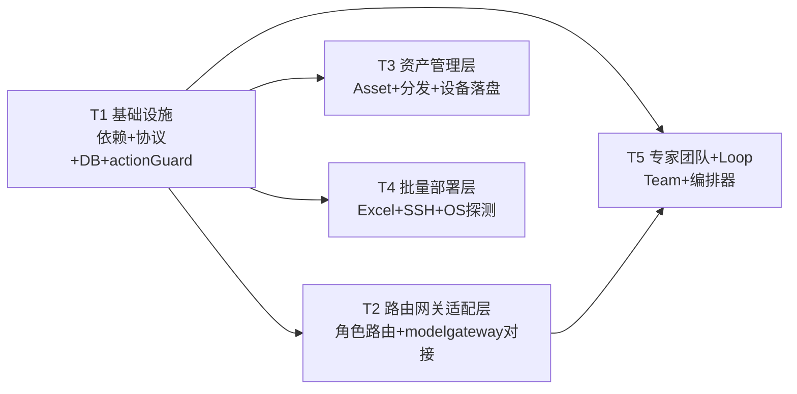

# 12 · 路由网关融合开发文档图谱

> 版本 v0.1 · 架构师：高见远 · 配套 `11-路由网关融合架构设计.md`
> 本文档是工程师（software-engineer）实现「路由网关融合 + 六大新功能」的依据：完整目录 + 模块职责 + 有序任务分解（T1–T5）+ 共享知识 + 依赖图。
> 实现范围：**可运行 MVP = 六大功能 P0 核心**（Excel 解析 + SSH 骨架、Asset 模型 + 分发、Team 模型 + 角色路由、Loop 模型 + 调度骨架、路由网关适配层数据结构 + 决策）。SSH 用「解析 + 连接骨架 + 本地回环验证」，不要求真连远程。

---

## 1. 完整目录 / 文件结构（精确到文件）

> 标记：`[新增]` 本阶段新建 · `[改]` 修改既有文件。前端 UI 属 P1，本 MVP 不纳入 T1–T5（REST API 可用 curl 验证）。

```
agent-mesh/
├── package.json                          # [不改] npm workspaces（既有）
│
├── shared/                               # ① 共享协议（单一事实源）
│   ├── src/
│   │   ├── index.ts                      # [改] 新增导出 routing/asset/deploy/team/loop/action
│   │   ├── status.ts                     # [改] TargetMode 增 'role'；新增 AssetKind/DeliveryStatus/DeployOS/LoopState/ActionKind 等枚举
│   │   ├── messageTypes.ts               # [改] 新增 asset.deliver / asset.deliver_ack
│   │   ├── task.ts                       # [改] TaskTarget 增 mode:'role' + role 字段
│   │   ├── routing.ts                    # [新增] RoleRoute / RoleRoutingDecision / RoleCapability
│   │   ├── asset.ts                      # [新增] Asset / AssetDelivery
│   │   ├── deploy.ts                     # [新增] DeploymentBatch / DeploymentTarget / DeploymentCredential
│   │   ├── team.ts                       # [新增] Team / TeamMember
│   │   ├── loop.ts                       # [新增] Loop / LoopStep / LoopTaskTemplate
│   │   └── action.ts                     # [新增] ActionConfirmation
│   └── (envelope.ts / device.ts / constants.ts / wechat.ts)  # [不改]
│
├── backend/                              # ② 协调服务 + 中继
│   ├── package.json                      # [改] 新增依赖 xlsx、ssh2、@types/ssh2
│   └── src/
│       ├── index.ts                      # [改] 注册 routing/assets/deploy/teams/loop 路由
│       ├── config.ts                     # [改] 新增 modelGatewayUrl / ssh 超时 / 部署开关等
│       ├── db/
│       │   ├── schema.sql                # [改] 新增 8 张表（见 §3.2）
│       │   └── repo/
│       │       ├── roleRoutes.ts         # [新增] 角色路由表 CRUD + 导入
│       │       ├── assets.ts             # [新增] 资产 CRUD + 版本
│       │       ├── assetDeliveries.ts    # [新增] 资产分发记录
│       │       ├── teams.ts              # [新增] 团队 CRUD（members/routes JSON）
│       │       ├── loops.ts              # [新增] Loop CRUD（steps/targets JSON）
│       │       ├── deployments.ts        # [新增] 部署批次 + 目标（无密码列）
│       │       ├── confirmations.ts      # [新增] 人工确认记录
│       │       └── usage.ts              # [新增] 台账 usage_records
│       ├── services/
│       │   ├── actionGuard.ts            # [新增] 人工确认开关（横切，供 deploy/assets/loop 共用）
│       │   ├── routing/                  # 路由网关适配层
│       │   │   ├── roleRouteStore.ts     # [新增] 角色路由表加载 + agent-role-routes.json 导入
│       │   │   ├── roleRouter.ts         # [新增] 角色路由决策 decide(role)
│       │   │   ├── modelGatewayClient.ts # [新增] /v1/chat/completions 协议对接
│       │   │   └── usageLedger.ts        # [新增] token 台账
│       │   ├── assets/                   # 资产管理层
│       │   │   ├── assetService.ts       # [新增] Asset CRUD + 版本
│       │   │   └── deliveryService.ts    # [新增] 分发编排
│       │   ├── deploy/                   # 批量部署层
│       │   │   ├── excelParser.ts        # [新增] xlsx 解析
│       │   │   ├── sshClient.ts          # [新增] ssh2 封装
│       │   │   ├── osProbe.ts            # [新增] OS 探测
│       │   │   ├── installScripts.ts     # [新增] 安装脚本生成
│       │   │   └── deployService.ts      # [新增] 部署编排
│       │   ├── teams/
│       │   │   └── teamService.ts        # [新增] Team CRUD + 角色路由复用
│       │   └── loop/
│       │       ├── loopService.ts        # [新增] Loop CRUD
│       │       └── loopScheduler.ts      # [新增] 编排器（step→task）
│       │   └── (scheduler.ts)            # [改] 支持 mode:'role' 决策
│       ├── routes/
│       │   ├── routing.ts                # [新增] 角色路由/台账 REST
│       │   ├── assets.ts                 # [新增] 资产 CRUD/分发 REST
│       │   ├── deploy.ts                 # [新增] Excel 上传/确认 REST
│       │   ├── teams.ts                  # [新增] 团队 REST
│       │   └── loop.ts                   # [新增] Loop REST
│       └── (transport/ security/ relayEntry.ts)  # [不改]
│
├── device-agent/                         # ③ 设备守护
│   └── src/
│       ├── assetReceiver.ts              # [新增] 资产接收 + 落盘
│       └── messageHandler.ts             # [改] 新增 asset.deliver 处理分支
│
├── frontend/ wechat/ memory/             # [本阶段不改，UI 属 P1]
```

---

## 2. 模块职责与关键文件说明

### 2.1 `shared/` 新增协议（单一事实源）

| 文件 | 职责 |
|---|---|
| `routing.ts` | 角色路由 `RoleRoute`（对齐 agent-role-routes.json，扩展 deviceId/agentType/model）+ 决策结果 `RoleRoutingDecision` |
| `asset.ts` | 统一资产 `Asset{kind,version}` + 分发记录 `AssetDelivery` |
| `deploy.ts` | 部署批次/目标 + 内存凭证 `DeploymentCredential`（密码不落库） |
| `team.ts` | `Team{members[],routes{}}`（复用角色概念） |
| `loop.ts` | `Loop{steps,targets,state}` + `LoopStep` + 任务模板 |
| `action.ts` | 人工确认记录 `ActionConfirmation` |
| `status.ts`（改） | `TargetMode` 增 `'role'`；新增各功能枚举 |
| `messageTypes.ts`（改） | 新增 `asset.deliver` / `asset.deliver_ack` |
| `task.ts`（改） | `TaskTarget.mode` 支持 `'role'`，新增 `role` 字段 |

### 2.2 `backend/` 新增服务层

| 层 | 文件 | 职责 |
|---|---|---|
| 横切 | `actionGuard.ts` | 对外动作（deploy/asset_deliver/loop_start）请求 → 确认 → 放行；密码内存清理钩子 |
| 路由网关 | `roleRouteStore.ts` | 本地角色路由表副本 + 从 `agent-role-routes.json` 导入 |
| 路由网关 | `roleRouter.ts` | `decide(role,ctx)`：primary→fallback 逐级决策到「本地 agent」或「modelgateway 模型」 |
| 路由网关 | `modelGatewayClient.ts` | `POST /v1/chat/completions`（OpenAI + SSE + `x-mg-*` 头） |
| 路由网关 | `usageLedger.ts` | 任务 token 台账（落 `usage_records`） |
| 资产 | `assetService.ts` | Asset CRUD + 版本递增 |
| 资产 | `deliveryService.ts` | 分发编排：确认 → 下发 `asset.deliver` → 回收 ack |
| 部署 | `excelParser.ts` | `xlsx` 解析 IP/账号/密码 |
| 部署 | `sshClient.ts` | `ssh2` 连接/exec 封装 |
| 部署 | `osProbe.ts` | `uname -a`/`ver` 探测 OS |
| 部署 | `installScripts.ts` | 按 OS × 平台生成安装脚本 |
| 部署 | `deployService.ts` | 解析 → 校验 → 确认 → SSH → 探测 → 安装 → 回报 |
| 团队 | `teamService.ts` | Team CRUD + `resolveTeamRoutes` 复用 roleRouter |
| Loop | `loopService.ts` | Loop CRUD |
| Loop | `loopScheduler.ts` | step→`enqueueTask`，逐轮推进，监听终态 |

### 2.3 `device-agent/` 新增

| 文件 | 职责 |
|---|---|
| `assetReceiver.ts` | 接收 `asset.deliver`，按 kind 落盘 `~/.agentmesh/{rules\|knowledge\|skills}/<name>@v<version>` |
| `messageHandler.ts`（改） | `handleEnvelope` 增加 `asset.deliver` 分支 |

---

## 3. 数据库新增（8 张表，均 epoch 毫秒 INTEGER）

```sql
CREATE TABLE IF NOT EXISTS role_routes (
  role          TEXT PRIMARY KEY,
  primary_ref   TEXT NOT NULL,
  fallback_refs TEXT NOT NULL DEFAULT '[]',   -- JSON array
  capability    TEXT NOT NULL DEFAULT 'chat',
  bots          TEXT NOT NULL DEFAULT '[]',   -- JSON array
  device_id     TEXT,
  agent_type    TEXT,
  model         TEXT,
  enabled       INTEGER NOT NULL DEFAULT 1,
  updated_at    INTEGER NOT NULL
);

CREATE TABLE IF NOT EXISTS assets (
  asset_id     TEXT PRIMARY KEY,
  kind         TEXT NOT NULL,                 -- rule|knowledge|skill
  name         TEXT NOT NULL,
  content      TEXT NOT NULL DEFAULT '',
  content_type TEXT NOT NULL DEFAULT 'text',  -- text|file
  version      INTEGER NOT NULL DEFAULT 1,
  tags         TEXT NOT NULL DEFAULT '[]',
  created_at   INTEGER NOT NULL,
  updated_at   INTEGER NOT NULL
);

CREATE TABLE IF NOT EXISTS asset_deliveries (
  delivery_id   TEXT PRIMARY KEY,
  asset_id      TEXT NOT NULL,
  asset_version INTEGER NOT NULL,
  device_id     TEXT NOT NULL,
  status        TEXT NOT NULL DEFAULT 'pending',  -- pending|confirmed|sending|delivered|failed
  error         TEXT,
  created_at    INTEGER NOT NULL,
  delivered_at  INTEGER
);

CREATE TABLE IF NOT EXISTS teams (
  team_id    TEXT PRIMARY KEY,
  name       TEXT NOT NULL,
  members    TEXT NOT NULL DEFAULT '[]',      -- JSON array
  routes     TEXT NOT NULL DEFAULT '{}',      -- JSON object
  created_at INTEGER NOT NULL,
  updated_at INTEGER NOT NULL
);

CREATE TABLE IF NOT EXISTS loops (
  loop_id            TEXT PRIMARY KEY,
  name               TEXT NOT NULL,
  steps              TEXT NOT NULL DEFAULT '[]',  -- JSON array
  trigger            TEXT NOT NULL DEFAULT 'manual',
  targets            TEXT NOT NULL DEFAULT '[]',
  state              TEXT NOT NULL DEFAULT 'idle',
  current_round      INTEGER NOT NULL DEFAULT 0,
  current_step_index INTEGER NOT NULL DEFAULT 0,
  created_at         INTEGER NOT NULL,
  updated_at         INTEGER NOT NULL
);

CREATE TABLE IF NOT EXISTS deployment_batches (
  batch_id   TEXT PRIMARY KEY,
  name       TEXT NOT NULL,
  status     TEXT NOT NULL DEFAULT 'pending_confirmation',
  created_at INTEGER NOT NULL
);

CREATE TABLE IF NOT EXISTS deployment_targets (   -- 无密码列（安全红线）
  target_id  TEXT PRIMARY KEY,
  batch_id   TEXT NOT NULL,
  ip         TEXT NOT NULL,
  user       TEXT NOT NULL,
  os         TEXT NOT NULL DEFAULT 'unknown',
  platforms  TEXT NOT NULL DEFAULT '[]',
  status     TEXT NOT NULL DEFAULT 'pending',
  error      TEXT,
  created_at INTEGER NOT NULL,
  finished_at INTEGER
);

CREATE TABLE IF NOT EXISTS action_confirmations (
  confirmation_id TEXT PRIMARY KEY,
  kind            TEXT NOT NULL,                 -- deploy|asset_deliver|loop_start
  ref_id          TEXT NOT NULL,
  status          TEXT NOT NULL DEFAULT 'pending_confirmation',
  payload_summary TEXT NOT NULL DEFAULT '',
  created_at      INTEGER NOT NULL,
  confirmed_at    INTEGER,
  confirmed_by    TEXT
);

CREATE TABLE IF NOT EXISTS usage_records (
  record_id   TEXT PRIMARY KEY,
  task_id     TEXT,
  provider    TEXT,
  model       TEXT,
  tokens_in   INTEGER,
  tokens_out  INTEGER,
  created_at  INTEGER NOT NULL
);
```

---

## 4. 有序任务分解（T1–T5）

> 按依赖排列；T1 是地基，T2/T3/T4 可并行，T5 依赖 T2。每任务产出 ≥3 文件，粒度 = 工程师 1–2 轮可写完。

### T1 · 基础设施：依赖 + 共享协议 + 数据库 + 人工确认开关

- **依赖**：无
- **产出文件**：
  - `backend/package.json`（改：`xlsx`、`ssh2`、`@types/ssh2`）
  - `shared/src/{routing,asset,deploy,team,loop,action}.ts`（新增 6 个协议）
  - `shared/src/{status,messageTypes,task,index}.ts`（改）
  - `backend/src/db/schema.sql`（改：+8 表）
  - `backend/src/db/repo/{roleRoutes,assets,assetDeliveries,teams,loops,deployments,confirmations,usage}.ts`（新增 8 个 repo）
  - `backend/src/services/actionGuard.ts`（新增）
  - `backend/src/config.ts`（改：`modelGatewayUrl` 默认 `http://127.0.0.1:18765`、SSH 超时、部署开关）
- **验收标准**：
  1. `npm install` 后 `npm run typecheck` 全 workspace 通过（shared 新类型被四处正确引用）。
  2. `npm run dev:backend` 启动，SQLite 自动新增 8 张表。
  3. 每个 repo 的 CRUD 函数可被直接调用（插入 → 查询 → 更新 → 删除）。
  4. `actionGuard.request/confirm/isConfirmed` 单测通过：未确认动作 `isConfirmed=false`，确认后 `=true`。

### T2 · 路由网关适配层（RG）

- **依赖**：T1
- **产出文件**：
  - `backend/src/services/routing/roleRouteStore.ts`
  - `backend/src/services/routing/roleRouter.ts`
  - `backend/src/services/routing/modelGatewayClient.ts`
  - `backend/src/services/routing/usageLedger.ts`
  - `backend/src/routes/routing.ts`
  - `backend/src/services/scheduler.ts`（改：`pickTarget` 支持 `mode:'role'` → 调 `roleRouter.decide`）
  - `backend/src/index.ts`（改：注册 routing 路由）
- **验收标准**：
  1. 给定 `agent-role-routes.json`，能导入到 `role_routes` 表（role/primary/fallback/capability/bots 字段对齐）。
  2. `POST /api/tasks {target:{mode:'role', role:'research'}}` 能决策返回 `{viaGateway, deviceId|modelRef}`；本地 agent 在线时走设备，否则（modelgateway 配置且模型 ref 匹配）走网关。
  3. `modelGatewayClient` 对本地假上游（`stream:false` 返回 JSON / `stream:true` 返回 SSE）能正确解析；响应头 `x-mg-provider` 记录到台账。
  4. 任务经 modelgateway 完成时，`usage_records` 落一条台账。

### T3 · 资产管理层（F2/F3/F4）

- **依赖**：T1
- **产出文件**：
  - `backend/src/services/assets/assetService.ts`
  - `backend/src/services/assets/deliveryService.ts`
  - `backend/src/routes/assets.ts`
  - `device-agent/src/assetReceiver.ts`
  - `device-agent/src/messageHandler.ts`（改：`asset.deliver` 分支）
  - `backend/src/index.ts`（改：注册 assets 路由）
- **验收标准**：
  1. `POST /api/assets` 创建规则/资料库/skills，`version=1`；再次更新同资产 `version` 递增。
  2. `POST /api/assets/deliver` 返回 `pending_confirmation`，未 `confirm` 前不产生任何 `asset.deliver` 消息。
  3. `confirm` 后，目标在线设备收到 `asset.deliver`，落盘到 `~/.agentmesh/{rules|knowledge|skills}/<name>@v<version>`，回 `asset.deliver_ack{status:'delivered'}`，`asset_deliveries` 表更新。
  4. 目标设备离线时，delivery 保持 `pending`（Q6 排队语义），上线补发。

### T4 · 批量部署层（F1）

- **依赖**：T1
- **产出文件**：
  - `backend/src/services/deploy/excelParser.ts`
  - `backend/src/services/deploy/sshClient.ts`
  - `backend/src/services/deploy/osProbe.ts`
  - `backend/src/services/deploy/installScripts.ts`
  - `backend/src/services/deploy/deployService.ts`
  - `backend/src/routes/deploy.ts`
  - `backend/src/index.ts`（改：注册 deploy 路由）
- **验收标准**：
  1. `POST /api/deploy/batches`（上传 `.xlsx`）解析出 `targets[]{ip,user}` + 内存凭证 `{password}`；坏行（缺 IP/账号）返回 `invalidRows[]`。
  2. `deployment_targets` 表落库**无 password 列**，密码仅内存；`confirm` 执行后内存密码被清除。
  3. 对 `127.0.0.1` 本地回环验证 `sshClient.connect + osProbe` 骨架：能发起连接、探测 `uname -a`/`ver`（连不通也能正确回 `failed` 不崩溃）。
  4. 每台 target 状态流转 `pending → connecting → probing → installing → verifying → success|failed`，结果回报到 `deployment_targets` 与 REST 响应。

### T5 · 专家团队 + Loop 编排（F5/F6）

- **依赖**：T1、T2
- **产出文件**：
  - `backend/src/services/teams/teamService.ts`
  - `backend/src/routes/teams.ts`
  - `backend/src/services/loop/loopService.ts`
  - `backend/src/services/loop/loopScheduler.ts`
  - `backend/src/routes/loop.ts`
  - `backend/src/index.ts`（改：注册 teams/loop 路由）
- **验收标准**：
  1. `POST /api/teams` 创建单设备/跨设备团队；`members[].deviceId` 可空（Q8）。
  2. `resolveTeamRoutes(teamId)` 逐成员复用 `roleRouter.decide`，返回 role→决策映射（复用 RG 不新造）。
  3. `POST /api/loops` 创建 loop（steps 含 `mode:'role'` 的模板）；`POST /api/loops/:id/start` 需 `actionGuard` 确认。
  4. `loopScheduler` 启动后逐 step 调 `enqueueTask`，step 终态推进 `currentStepIndex`，一轮完成 `currentRound+1`；`pause/cancel` 生效，状态经 `GET /api/loops/:id` 可查。

---

## 5. 任务依赖图



> 关键路径（先跑通 MVP 最短链路）：**T1 → T2 → T5**（角色路由 → 团队/Loop 复用）；T3（资产）与 T4（部署）可在 T1 后**并行**推进，不阻塞主链路。

---

## 6. 共享知识（跨文件约定）

### 6.1 命名规范（沿用 03 §6.1）

| 项 | 约定 |
|---|---|
| 文件名 | kebab-case（`role-router.ts`）；React 组件 PascalCase |
| 类型/接口 | PascalCase（`RoleRoute`、`AssetDelivery`） |
| 函数/方法 | camelCase（`decideRole`、`deliverAssets`） |
| 消息类型 | 点分小写：`域.动作`（`asset.deliver` / `asset.deliver_ack`） |

### 6.2 新增枚举（以 `shared/src/status.ts` 为准，四处引用同一份）

```ts
TargetMode = 'auto' | 'device' | 'agent' | 'role'      // 扩展 role
AssetKind = 'rule' | 'knowledge' | 'skill'
DeliveryStatus = 'pending' | 'confirmed' | 'sending' | 'delivered' | 'failed'
DeployOS = 'macos' | 'windows' | 'linux' | 'unknown'
DeployTargetStatus = 'pending' | 'connecting' | 'probing' | 'installing' | 'verifying' | 'success' | 'failed'
LoopState = 'idle' | 'running' | 'paused' | 'completed' | 'failed' | 'cancelled'
LoopTrigger = 'manual' | 'schedule' | 'event'
ActionKind = 'deploy' | 'asset_deliver' | 'loop_start'
ActionStatus = 'pending_confirmation' | 'confirmed' | 'rejected' | 'executed' | 'expired'
RoleCapability = 'chat' | 'decision-only'
```

### 6.3 新增消息类型（`messageTypes.ts`）

```ts
| 'asset.deliver'        // 协调 → 设备：下发资产 {asset, version, kind}
| 'asset.deliver_ack'    // 设备 → 协调：落盘结果 {assetId, status:'delivered'|'failed', error?}
```

### 6.4 目录 / 端口 / 时间约定

| 项 | 约定 |
|---|---|
| modelgateway 地址 | `MODELGATEWAY_URL`，默认 `http://127.0.0.1:18765`（对齐 modelgateway `MG_PORT`） |
| 设备资产落盘目录 | `~/.agentmesh/{rules\|knowledge\|skills}/<name>@v<version>` |
| 时间戳 | 一律 epoch **毫秒**（number），落库 `INTEGER` |
| 数据库 | 复用 `./data/agentmesh.db`（新增 8 张表，不新开库） |

### 6.5 安全红线约定（必须遵守）

1. **密码不落库**：`deployment_targets` 无 password 列；密码仅内存 `DeploymentCredential`，执行后立即清除。
2. **对外动作一律人工确认**：`deploy` / `asset_deliver` / `loop_start` 触发前必须过 `actionGuard`，未确认不执行。
3. **错误不静默吞**：部署/分发失败一律通过状态字段 + `error` 回报，不静默。

### 6.6 复用既有能力约定

- Loop step 转任务：统一走 `scheduler.enqueueTask()`，复用 `taskRunner` 六态状态机。
- 资产下发/部署回报：统一走 `wsServer.sendToDevice()` 与 `deviceRegistry` 通道。
- 角色路由：`roleRouter.decide` 结果被 `scheduler.pickTarget` 与 `teamService.resolveTeamRoutes` 复用，**不重复实现决策逻辑**。

---

*任务完成后，由 QA（software-qa-engineer）按 T1–T5 验收标准逐项验证；架构如需调整，回写本文件与《11-路由网关融合架构设计.md》。*
