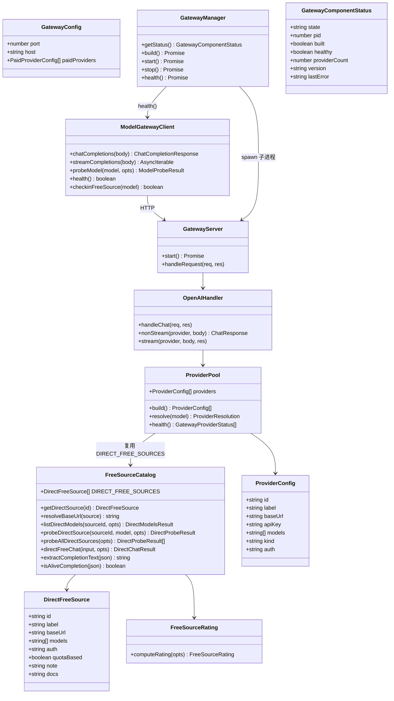
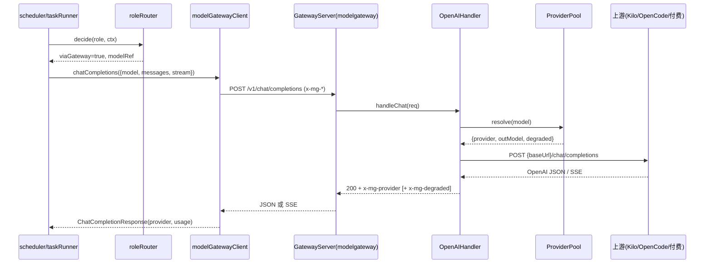
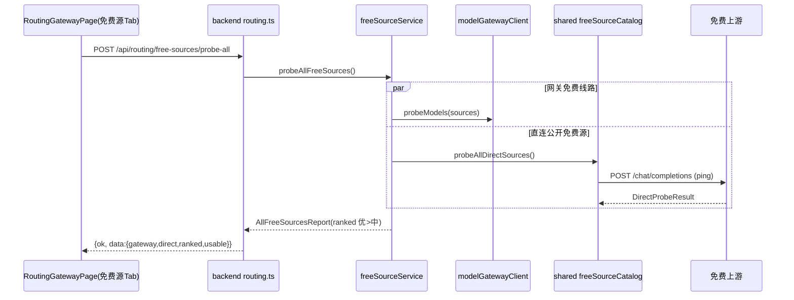
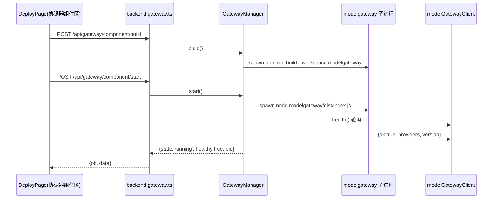

# 15 · 管理界面补全 + 神经图深化 + 内置 modelgateway（增量设计）

> 架构师：高见远（Bob）。上游基线：《14-平台模型绑定与部署即用》《10-路由网关融合PRD》。
> 关键架构修正（用户）：AgentMesh 是 GitHub 开源项目，**不能依赖某开发者本机 modelgateway**，
> 故 modelgateway 必须**内置为第 7 个 workspace**，随项目 build/部署，任何 clone 用户开箱即用。

---

## 1. 实现方案 + 框架选型

| 难点 | 选型 | 理由 |
|---|---|---|
| modelgateway 内置（第 7 workspace） | Node 20 `node:http` + `@agentmesh/shared` + `dotenv` | **零新增第三方依赖**；协议对齐 `modelGatewayClient.ts`，**不改 backend 客户端** |
| 免费源直连逻辑复用 | **下沉到 `shared`** | 单一事实源，backend 与 modelgateway 共用 |
| 协调器组件部署 | backend 新增 `GatewayManager`（`child_process.spawn`）+ `modelGatewayClient.health()` | 零新依赖；13 平台走 SSH，modelgateway 走本机 spawn，完全分离 |
| 部署进度展示 | 前端轮询 3–5s | 决策已定，不新增 WS 协议 |
| 前端 3 管理页 | 复用 Vite+React+MUI+Tailwind | 后端 API 已就绪，纯前端补全 |
| 神经图交互深化 | 现有 d3-force `NeuralGraph.tsx` 上叠加 SeeCode 式交互 | 不换渲染引擎，增量叠加状态 |

### 1.1 关键决策：freeSourceCatalog 直连逻辑放哪？

**下沉到 `shared`（`shared/src/freeSourceCatalog.ts` + `shared/src/freeSourceRating.ts`），backend 与 modelgateway 都从 `@agentmesh/shared` import，删除 backend 旧副本。**

理由：shared 是单一事实源；直连逻辑是纯逻辑 + Node20 原生 fetch，无 backend-only 依赖；backend 反向依赖 modelgateway 破坏分层。backend 仅 3 处 import 需改指 shared。

**浏览器安全**：`process.env`/`fetch` 仅在函数体内访问，模块顶层只声明纯数据，frontend 引入 shared 不触发浏览器顶层 `process`。

### 1.2 modelgateway 协议契约（对齐 modelGatewayClient，不改客户端）

- `POST /v1/chat/completions`：请求体 `{model, messages, stream?, max_tokens?, temperature?}`；头透传 `x-mg-agent/x-mg-session/x-mg-platform/x-mg-task`。
- 响应：`stream:false` → OpenAI JSON；`stream:true` → SSE（`data:` + `[DONE]`）。
- 响应头：`x-mg-provider`、`x-mg-degraded: true`（降级免费默认源时）、`x-mg-capability: chat`。
- `GET /health` → 200 `{ok, version, uptimeMs, providers, defaultModel}`。
- `POST /v1/free/checkin` 与 `/v1/checkin` → 200 `{ok:true}`（直连源无公开签到端点）。

### 1.3 内置 provider 池（providers.ts）

- **直连免费源**：shared `DIRECT_FREE_SOURCES`（Kilo `kilo-auto/free`、OpenCode `big-pickle/beam-free`）。
- **可配置付费 provider**：`MG_PAID_PROVIDERS` 环境变量 JSON 数组 `[{id,label,baseUrl,apiKey,models}]`，apiKey 仅 env（不落 UI）。
- `resolve(model)`：付费精确匹配 → 直连免费匹配 → 默认 `kilo-free:kilo-auto/free`（置 `x-mg-degraded`）。

### 1.4 协调器组件部署（backend GatewayManager）

- `GET /api/gateway/component/status`、`POST .../build|start|stop|health`。
- `build()` → spawn `npm run build --workspace modelgateway`；`start()` → spawn `node modelgateway/dist/index.js`（detached，记 pid）；`health()` → `modelGatewayClient.health()`。

---

## 2. 文件列表

### 新增：modelgateway workspace
```
modelgateway/package.json
modelgateway/tsconfig.json
modelgateway/src/index.ts          # 入口：读配置→建 server→listen
modelgateway/src/config.ts         # port/host/MG_PAID_PROVIDERS
modelgateway/src/providers.ts      # 提供者池 + resolve + health 汇总
modelgateway/src/openai.ts         # /v1/chat/completions（stream/non-stream）+ x-mg-* 头
modelgateway/src/server.ts         # node:http 路由
```

### 修改/新增：shared
```
shared/src/freeSourceCatalog.ts    # 新增：从 backend 移入
shared/src/freeSourceRating.ts     # 新增：移入
shared/src/index.ts                # 修改：export 上述两模块
```

### 修改：backend
```
backend/src/services/routing/modelGatewayClient.ts   # 改：computeRating import → @agentmesh/shared
backend/src/services/routing/freeSourceService.ts    # 改：catalog/rating import → @agentmesh/shared
backend/src/routes/routing.ts                        # 改：catalog import → @agentmesh/shared
backend/src/services/routing/freeSourceCatalog.ts    # 删除（下沉 shared）
backend/src/services/routing/freeSourceRating.ts     # 删除（下沉 shared）
backend/src/services/gateway/gatewayManager.ts       # 新增：子进程 build/start/stop + 健康检查
backend/src/routes/gateway.ts                        # 新增：/api/gateway/component/* 路由
backend/src/index.ts                                 # 修改：注册 registerGatewayRoutes
```

### 修改/新增：frontend
```
frontend/src/api/http.ts                             # 修改：新增 uploadForm 辅助
frontend/src/api/deploy.ts                           # 新增：部署批次 API
frontend/src/api/routing.ts                          # 新增：角色路由/台账/免费源/平台模型/网关健康 API
frontend/src/api/gateway.ts                          # 新增：协调器组件生命周期 API
frontend/src/pages/DeployPage.tsx                    # 新增
frontend/src/pages/PlatformModelsPage.tsx            # 新增
frontend/src/pages/RoutingGatewayPage.tsx            # 新增
frontend/src/components/deploy/BatchList.tsx         # 新增
frontend/src/components/deploy/NewBatchDialog.tsx    # 新增
frontend/src/components/deploy/BatchDetailDrawer.tsx # 新增
frontend/src/components/deploy/GatewayComponentPanel.tsx # 新增
frontend/src/components/platformmodels/DevicePlatformList.tsx # 新增
frontend/src/components/platformmodels/ModelEditorPanel.tsx   # 新增
frontend/src/components/routing/RoleRouteTab.tsx     # 新增
frontend/src/components/routing/UsageLedgerTab.tsx   # 新增
frontend/src/components/routing/FreeSourceTab.tsx    # 新增
frontend/src/components/routing/GatewayHealthTab.tsx # 新增
frontend/src/components/graph/GraphToolbar.tsx       # 新增
frontend/src/components/graph/NeuralGraph.tsx        # 修改（hover/focus/lens/walk）
frontend/src/components/graph/GraphLink.tsx          # 修改（hover 高亮+trace）
frontend/src/components/graph/FlowParticle.tsx       # 修改（hover trace 流动）
frontend/src/components/graph/GraphNode.tsx          # 修改（透镜类别高亮/弱化）
frontend/src/pages/GraphPage.tsx                     # 修改（接入 GraphToolbar）
frontend/src/theme.ts                                # 修改（暗色主题）
frontend/src/styles/globals.css                      # 修改（暗色 CSS 变量）
frontend/src/App.tsx                                 # 修改（注册 /deploy /platform-models /routing）
frontend/src/layouts/MainLayout.tsx                  # 修改（导航 +3 项）
frontend/src/layouts/MobileTabBar.tsx                # 修改（移动端 +3 项）
```

### 修改：根
```
package.json          # workspaces + modelgateway；scripts + build:gateway/dev:gateway/start:gateway
.env.example          # MODELGATEWAY_PORT/HOST、MG_PAID_PROVIDERS
```

---

## 3. 数据结构与接口（classDiagram）



---

## 4. 程序调用流程

### 4.1 任务经内置 modelgateway 执行模型



### 4.2 免费源探测（综合）



### 4.3 modelgateway 组件部署/启停/健康



---

## 5. 任务列表（≤5，有序）

### T01 项目基础设施 + 共享层下沉（P0）— 无依赖
- `package.json`（根）：workspaces 加 `modelgateway`；scripts 加 build:gateway/dev:gateway/start:gateway，并入 build
- `.env.example`：`MODELGATEWAY_PORT=18765`/`MODELGATEWAY_HOST=127.0.0.1`/`MG_PAID_PROVIDERS=[]`
- `shared/src/freeSourceCatalog.ts`、`shared/src/freeSourceRating.ts`、`shared/src/index.ts`
- backend 引用迁移（modelGatewayClient.ts、freeSourceService.ts、routes/routing.ts 改 import）；删除旧 freeSourceCatalog.ts、freeSourceRating.ts

### T02 modelgateway 内置组件 + 协调器组件部署（P0）— 依赖 T01
- `modelgateway/{package.json,tsconfig.json,src/index.ts,src/config.ts,src/providers.ts,src/openai.ts,src/server.ts}`
- `backend/src/services/gateway/gatewayManager.ts`、`backend/src/routes/gateway.ts`、`backend/src/index.ts`

### T03 前端数据访问层 + 类型（P0）— 依赖 T01
- `frontend/src/api/http.ts`（改）、`frontend/src/api/deploy.ts`、`frontend/src/api/routing.ts`、`frontend/src/api/gateway.ts`

### T04 前端管理三页 + 导航路由（P0）— 依赖 T03
- `DeployPage.tsx` + `components/deploy/{BatchList,NewBatchDialog,BatchDetailDrawer,GatewayComponentPanel}.tsx`
- `PlatformModelsPage.tsx` + `components/platformmodels/{DevicePlatformList,ModelEditorPanel}.tsx`
- `RoutingGatewayPage.tsx` + `components/routing/{RoleRouteTab,UsageLedgerTab,FreeSourceTab,GatewayHealthTab}.tsx`
- `App.tsx`、`layouts/MainLayout.tsx`、`layouts/MobileTabBar.tsx`

### T05 神经图交互深化 + 主题切换（P1）— 依赖 T01
- `components/graph/GraphToolbar.tsx`
- `components/graph/{NeuralGraph,GraphLink,FlowParticle,GraphNode}.tsx`（改）
- `pages/GraphPage.tsx`、`theme.ts`、`styles/globals.css`（改）

---

## 6. 依赖包（零新增第三方）

```
- @agentmesh/shared@0.1.0        # workspace 已有；modelgateway 唯一业务依赖
- dotenv@^16.4.5                 # monorepo 已有
- node:http / node:child_process # Node20 内置
- tsx / typescript               # monorepo 已有
- react@^18 / @mui/material@^6 / d3-force@^3 / tailwindcss@^3 / zustand  # 前端现有
```

---

## 7. 共享知识（跨文件约定）

1. REST 响应统一 `{ok, data, error?}`；错误码 400/403/404/409。
2. modelgateway 协议：请求头 `x-mg-*`，响应头 `x-mg-provider/x-mg-degraded/x-mg-capability`，SSE `data:`+`[DONE]`；**不改 modelGatewayClient.ts**。
3. 免费源直连唯一事实源 `shared/src/freeSourceCatalog.ts`；backend 与 modelgateway 均 import，禁止复制。
4. `process.env`/`fetch` 只函数体内访问，shared 顶层仅纯数据。
5. modelgateway 默认端口 18765；backend `MODELGATEWAY_URL` 默认 `http://127.0.0.1:18765`。
6. 部署进度轮询 3–5s，不新增 WS 协议。
7. 敏感红线：apiKey 只 env 不落 UI/库；SSH 密码仅内存。
8. 13 平台枚举用 `AGENT_TYPES`（shared）；时间戳 ms epoch。
9. 语义分离：modelgateway 组件部署 = 协调器本机 spawn（`/api/gateway/component/*`）；13 平台部署 = SSH（`/api/deploy/*`）。
10. multipart 上传走 `uploadForm()`（FormData，不手动设 Content-Type）。

---

## 8. 待明确事项 → 主理人已拍板

1. 付费 provider 仅 env 配置，不做 UI。
2. 路径漫游 = 任务节点沿 call/stream 连线逐跳漫游。
3. 透镜只做节点 type 维度（设备/agent/任务/消息）。
4. 主题 localStorage 持久化 + 默认浅色，不跟随系统。
5. modelgateway 默认提供 `/v1/models`。
6. 默认手动启动；`MODELGATEWAY_AUTO_START=1` 时 backend 启动后自动 spawn。
7. 移动端 Tab 直接追加 + 文字缩小 + 「更多」折叠。
