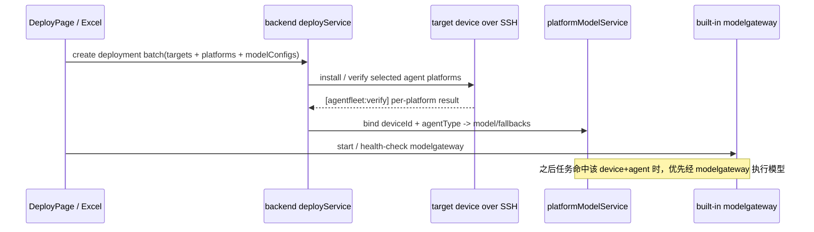
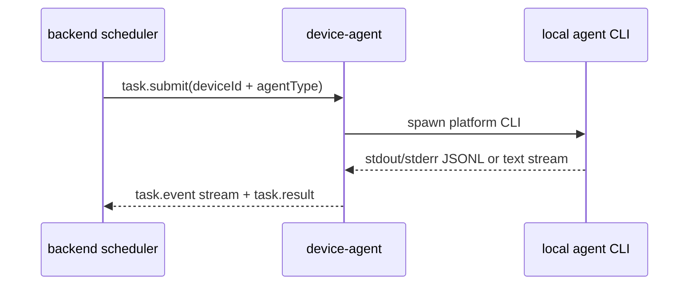

# 17-Agent 平台安装、卸载与调用矩阵

本文明确 AgentFleet 对各 AI agent 平台「负责到哪一步」，避免把 **安装/卸载**、**发现上报**、**本地 CLI 真接调用**、**经 modelgateway 执行模型** 混为一谈。

## 1. 结论

可以把 AgentFleet 理解为：

> **多设备 + 多 agent 平台 + 统一模型路由网关的多蜂群协同系统。**

但当前能力边界分为四层：

1. **安装 / 卸载**：由 `backend/src/services/deploy/installScripts.ts` 生成 OS 自适应脚本，经 SSH 在目标设备执行。
2. **发现 / 上报**：由 `device-agent/src/adapters/platformCatalog.ts` 与 `GrokAdapter` 探测本机命令、版本、能力，并上报协调器。
3. **经 modelgateway 执行模型**：部署成功后可为任意「设备 + agent 平台」绑定网关模型，任务优先经内置 `modelgateway/` 执行；失败时自动切换 fallback，全部失败再降级本地 CLI。
4. **本地 CLI 真接调用**：已真接 11 个平台（ACP：grok/kimi/workbuddy；专用 Adapter：dsh；单轮 cliRunner：codex/claude/cursor/aider/gemini/qwen/opencode）。cody/doubao/windsurf 受上游限制（无稳定 headless CLI）维持 unsupported。

## 2. 平台能力矩阵

说明：
- 「自动安装」= AgentFleet 可生成并执行公开包管理器安装命令。
- 「自动卸载」= AgentFleet 可生成并执行公开包管理器卸载命令，并验证命令消失。
- 「发现上报」= 设备守护可探测已安装命令并上报看板。
- 「网关模型执行」= 可在部署或平台模型页绑定 modelgateway 模型，任务由网关执行，不依赖该平台 CLI 的 headless 调用能力。
- 「本地 CLI 真接」= 设备守护直接启动该平台 CLI 运行任务并流式回传。

| 平台 key | 显示名 | 自动安装 | 自动卸载 | 发现上报 | 网关模型执行 | 本地 CLI 真接 | 说明 |
|---|---|---:|---:|---:|---:|---:|---|
| `codex` | Codex | ✅ npm `@openai/codex` | ✅ npm uninstall | ✅ | ✅ | ✅ cli-text（实机验证） | 默认部署集之一；`codex exec "{prompt}"` 单轮（可配 kilo 免费源免登录） |
| `claude` | Claude Code | ✅ npm `@anthropic-ai/claude-code` | ✅ npm uninstall | ✅ | ✅ | ✅ cli-stream（实机验证） | 默认部署集之一；`claude -p "{prompt}" --output-format stream-json --verbose`，需登录或走 modelgateway 免登录 |
| `dsh` | DSH Desktop | 手动/验证 | 手动/验证 | ✅ | ✅ | ✅ DshAdapter（headless） | 逆向 Electron Node 模式 headless（`ELECTRON_RUN_AS_NODE=1` 跑 `harness-node-entry.mjs` + `lib/bin.js`），专用 DshAdapter |
| `grok` | Grok Bot | 手动/验证 | 手动/验证 | ✅ | ✅ | ✅ GrokAdapter（ACP） | `GrokAdapter` 走 ACP（`grok agent stdio`，完整 bot 循环），登录 = 网页授权 `grok login --device-auth` |
| `cursor` | Cursor | ✅ macOS brew cask / Windows winget | ✅ brew/winget | ✅ | ✅ | ✅ cli-text | `cursor-agent -p "{prompt}"` headless（print 模式，`--force` 允许改文件）；Linux 无统一安装 |
| `aider` | Aider | ✅ pipx `aider-chat` | ✅ pipx uninstall | ✅ | ✅ | ✅ cli-text | 默认部署集之一；`aider --message "{prompt}" --no-git --yes` 单轮（无 headless agent 循环） |
| `gemini` | Gemini CLI | ✅ npm `@google/gemini-cli` | ✅ npm uninstall | ✅ | ✅ | ✅ cli-text | 默认部署集之一；`gemini -p "{prompt}"` 单轮（需 GEMINI_API_KEY） |
| `cody` | Cody | 手动/验证 | 手动/验证 | ✅ | ✅ | ❌ unsupported | `@sourcegraph/cody-cli` 是 experimental 交互式工具、需 SRC_ACCESS_TOKEN，无稳定 headless 单轮模式 |
| `qwen` | Qwen Code | ✅ npm `@qwen-code/qwen-code` | ✅ npm uninstall | ✅ | ✅ | ✅ cli-text | 默认部署集之一；`qwen -p "{prompt}"` 单轮（需 API key） |
| `doubao` | 豆包 TRAE | 手动/验证 | 手动/验证 | ✅ | ✅ | ❌ unsupported（TRAE CLI headless 待实测） | TRAE（豆包 AI IDE/CLI）经官方渠道安装；登录为手机号/邮箱验证码 |
| `kimi` | Kimi Code CLI | ✅ npm `@moonshot-ai/kimi-code` | ✅ npm uninstall | ✅ | ✅ | ✅ acp（实机验证） | `kimi acp` 走 ACP（spawnArgs=['acp']）；旧 `kimi-cli` 是 PyPI 已归档 |
| `opencode` | OpenCode | ✅ npm `opencode-ai` | ✅ npm uninstall | ✅ | ✅ | ✅ cli-text | 默认部署集之一；`opencode run "{prompt}"` 单轮；免费源探测里也包含 OpenCode 上游线路 |
| `windsurf` | Windsurf | ✅ macOS brew cask / Windows winget | ✅ brew/winget | ✅ | ✅ | ❌ unsupported | Windsurf 是 IDE（Cascade），无官方 headless CLI；第三方 windsurf-cli 只是打开文件的辅助工具 |
| `workbuddy` | WorkBuddy (CodeBuddy) | 手动/验证 | 手动/验证 | ✅ | ✅ | ✅ WorkbuddyAdapter | `CODEBUDDY_FORCE_LITE_WB_BUNDLE=1` + `--serve --acp` 走 ACP stdio，复用桌面登录态，CLI 藏在 Electron app 内 |

## 3. 默认一键部署集

当 Excel/JSON 未显式填写平台时，AgentFleet 按 OS 使用默认 CLI 优先集：

| OS | 默认平台 |
|---|---|
| macOS | `codex`, `claude`, `gemini`, `qwen`, `aider`, `opencode` |
| Linux | `codex`, `claude`, `gemini`, `qwen`, `aider`, `opencode` |
| Windows | `codex`, `claude`, `gemini`, `qwen`, `aider`, `opencode` |
| unknown | `codex`, `claude`, `gemini`, `qwen` |

如果用户显式指定平台，则按指定平台生成计划；对不具备公开自动安装方式的平台，脚本会输出 `manual_required` 并执行安装后验证。

## 4. 调用链路说明

### 4.1 部署完成直接可用（推荐路径）

这条路径下，AgentFleet 可以给多个 agent 平台配置模型并执行任务，即使本地 CLI 的 headless 调用尚未逐个平台稳定化，也可以先通过统一网关把任务跑起来。

### 4.2 本地 CLI 真接路径

当前已真接 **11 个平台**（codex/claude/dsh/grok/cursor/aider/gemini/qwen/kimi/opencode/workbuddy），覆盖三种方式：

- **ACP 真接**：grok（GrokAdapter）、kimi（catalogAdapter acp）、workbuddy（WorkbuddyAdapter `--serve --acp`）
- **专用 Adapter**：dsh（Electron Node headless）
- **单轮 cliRunner**：codex / claude / cursor / aider / gemini / qwen / opencode

剩余 **3 个平台**（cody / doubao / windsurf）客观无稳定 headless CLI，维持 `unsupported`（诚实口径）：

- cody：`@sourcegraph/cody-cli` experimental 交互式、需 SRC_ACCESS_TOKEN
- doubao：TRAE CLI 已发布但 headless 非交互参数待实测
- windsurf：纯 IDE（Cascade），无官方 headless CLI

## 5. GitHub 展示口径

对外 README 应保持以下表述：

- AgentFleet **负责 14 个平台的安装/卸载脚本生成、验证、发现上报、平台模型绑定与网关执行**。
- AgentFleet **本地 CLI 真接调用 11 个平台**（codex/claude/dsh/grok/cursor/aider/gemini/qwen/kimi/opencode/workbuddy）。
- cody / doubao / windsurf 三个平台受上游限制（无稳定 headless CLI）暂未真接，已在看板诚实标注。

这样既能体现 AgentFleet 的多平台能力，也避免误导用户以为所有第三方 CLI 的 headless 调用都已完成并实机验证。
