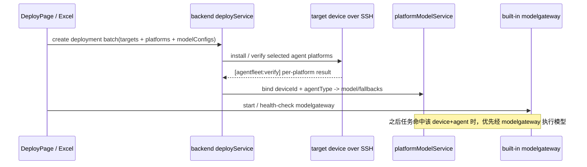
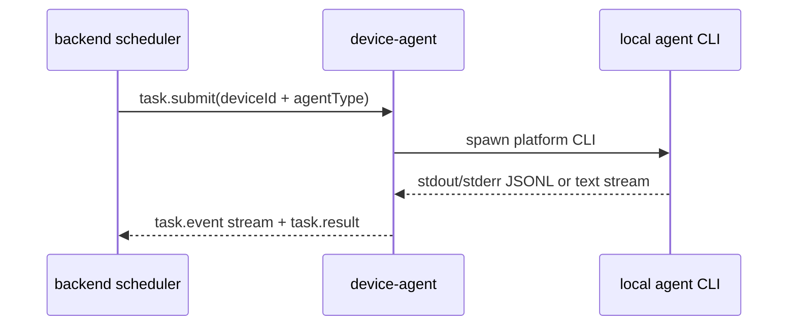

# 17-Agent 平台安装、卸载与调用矩阵

本文明确 AgentFleet 对各 AI agent 平台「负责到哪一步」，避免把 **安装/卸载**、**发现上报**、**本地 CLI 真接调用**、**经 modelgateway 执行模型** 混为一谈。

## 1. 结论

可以把 AgentFleet 理解为：

> **多设备 + 多 agent 平台 + 统一模型路由网关的多蜂群协同系统。**

但当前能力边界分为四层：

1. **安装 / 卸载**：由 `backend/src/services/deploy/installScripts.ts` 生成 OS 自适应脚本，经 SSH 在目标设备执行。
2. **发现 / 上报**：由 `device-agent/src/adapters/platformCatalog.ts` 与 `GrokAdapter` 探测本机命令、版本、能力，并上报协调器。
3. **经 modelgateway 执行模型**：部署成功后可为任意「设备 + agent 平台」绑定网关模型，任务优先经内置 `modelgateway/` 执行；失败时自动切换 fallback，全部失败再降级本地 CLI。
4. **本地 CLI 真接调用**：当前稳定真接的是 Grok；其余平台已具备发现与派发骨架，但不同 CLI 的 headless 参数、登录态和输出格式差异较大，需要逐个平台做实测适配后再标为稳定真接。

## 2. 平台能力矩阵

说明：
- 「自动安装」= AgentFleet 可生成并执行公开包管理器安装命令。
- 「自动卸载」= AgentFleet 可生成并执行公开包管理器卸载命令，并验证命令消失。
- 「发现上报」= 设备守护可探测已安装命令并上报看板。
- 「网关模型执行」= 可在部署或平台模型页绑定 modelgateway 模型，任务由网关执行，不依赖该平台 CLI 的 headless 调用能力。
- 「本地 CLI 真接」= 设备守护直接启动该平台 CLI 运行任务并流式回传。

| 平台 key | 显示名 | 自动安装 | 自动卸载 | 发现上报 | 网关模型执行 | 本地 CLI 真接 | 说明 |
|---|---|---:|---:|---:|---:|---:|---|
| `codex` | Codex | ✅ npm `@openai/codex` | ✅ npm uninstall | ✅ | ✅ | cli-text 待验证 | 默认部署集之一；`codex exec "{prompt}"` 单轮，待实机验证 |
| `claude` | Claude Code | ✅ npm `@anthropic-ai/claude-code` | ✅ npm uninstall | ✅ | ✅ | cli-stream 待验证 | 默认部署集之一；`claude -p "{prompt}" --output-format stream-json`，需用户本机已登录 |
| `dsh` | DSH Desktop | 手动/验证 | 手动/验证 | ✅ | ✅ | **headless 已确认（逆向）** | 逆向确认 `dsh headless "<prompt>"` 单轮可行（`ELECTRON_RUN_AS_NODE=1` 跑 `harness-node-entry.mjs` + `app.asar/.../lib/bin.js`）；报错仅「缺 credentials + agent-loop 插件」，需登录 + profile 配置，待专用 DshAdapter |
| `grok` | Grok | 手动/验证 | 手动/验证 | ✅ | ✅ | ✅ 稳定 | `GrokAdapter` 走 ACP（`grok agent stdio`，完整 bot 循环），认证用 `XAI_API_KEY` 或 `grok login` |
| `cursor` | Cursor | ✅ macOS brew cask / Windows winget | ✅ brew/winget | ✅ | ✅ | cli-text 待验证 | `cursor-agent -p "{prompt}"` headless（print 模式，`--force` 允许改文件）；Linux 无统一安装 |
| `aider` | Aider | ✅ pipx `aider-chat` | ✅ pipx uninstall | ✅ | ✅ | cli-text 单轮 | 默认部署集之一；`aider --message "{prompt}" --no-git --yes` 单轮（无 headless agent 循环） |
| `gemini` | Gemini CLI | ✅ npm `@google/gemini-cli` | ✅ npm uninstall | ✅ | ✅ | cli-text 待验证 | 默认部署集之一；`gemini -p "{prompt}"` 单轮，需用户本机登录 |
| `cody` | Cody | ✅ npm `@sourcegraph/cody` | ✅ npm uninstall | ✅ | ✅ | 骨架 | 本地调用协议待实测 |
| `qwen` | Qwen Code | ✅ npm `@qwen-code/qwen-code` | ✅ npm uninstall | ✅ | ✅ | 骨架 | 默认部署集之一；通常需要用户本机登录或配置凭证 |
| `doubao` | 豆包 MarsCode | ✅ npm `@bytedance/mars-code` | ✅ npm uninstall | ✅ | ✅ | 骨架 | 本地调用协议待实测 |
| `kimi` | Kimi CLI | ✅ npm `kimi-cli` | ✅ npm uninstall | ✅ | ✅ | ACP 待验证 | 支持 ACP（`kimi acp`，类似 grok），待泛化 acpClient 接入 |
| `opencode` | OpenCode | ✅ npm `opencode-ai` | ✅ npm uninstall | ✅ | ✅ | 骨架 | 默认部署集之一；免费源探测里也包含 OpenCode 上游线路 |
| `windsurf` | Windsurf | ✅ macOS brew cask / Windows winget | ✅ brew/winget | ✅ | ✅ | 待确认（GUI） | GUI/Cascade 为主，headless CLI 参数未证实；Linux 无统一安装 |
| `workbuddy` | WorkBuddy (CodeBuddy) | 手动/验证 | 手动/验证 | ✅ | ✅ | cli-text 待验证 | 腾讯 CodeBuddy（`@genie/agent-cli`）；`codebuddy -p "{prompt}"` 单轮（`--output-format stream-json`），CLI 藏在 Electron app 内 |

## 3. 默认一键部署集

当 Excel/JSON 未显式填写平台时，AgentFleet 按 OS 使用默认 CLI 优先集：

| OS | 默认平台 |
|---|---|
| macOS | `codex`, `claude`, `gemini`, `qwen`, `aider`, `opencode` |
| Linux | `codex`, `claude`, `gemini`, `qwen`, `aider`, `opencode` |
| Windows | `codex`, `claude`, `gemini`, `qwen`, `aider`, `opencode` |
| unknown | `codex`, `claude`, `gemini`, `qwen` |

如果用户显式指定平台，则按指定平台生成计划；对不具备公开自动安装方式的平台，脚本会输出 `manual_required` 并执行安装后验证。

## 4. 调用链路说明

### 4.1 部署完成直接可用（推荐路径）

这条路径下，AgentFleet 可以给多个 agent 平台配置模型并执行任务，即使本地 CLI 的 headless 调用尚未逐个平台稳定化，也可以先通过统一网关把任务跑起来。

### 4.2 本地 CLI 真接路径

当前稳定真接：`grok`。

其余平台当前处于「发现 + 派发骨架」状态：设备守护可以识别并上报这些平台，协调器可以路由到对应 agentType；但真正启动 CLI 执行任务前，需要按平台实测 headless 参数、认证方式、输出格式和取消行为。

## 5. GitHub 展示口径

对外 README 应保持以下表述：

- AgentFleet **负责 14 个平台的安装/卸载脚本生成、验证、发现上报、平台模型绑定与网关执行**。
- AgentFleet **当前稳定本地 CLI 真接调用 Grok**。
- 其他平台的本地 CLI 真接调用不是不可做，而是需要逐平台实测，不应在 README 中提前宣传为已稳定。

这样既能体现 AgentFleet 的多平台能力，也避免误导用户以为所有第三方 CLI 的 headless 调用都已完成并实机验证。
