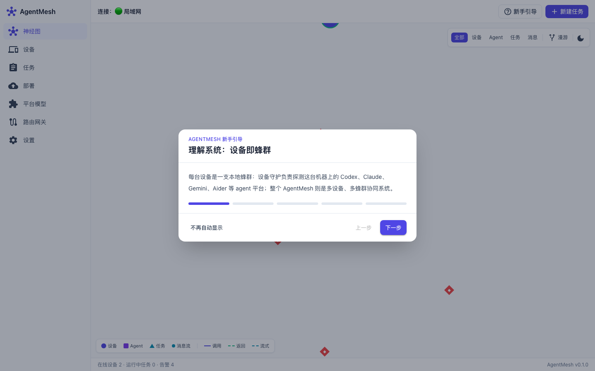
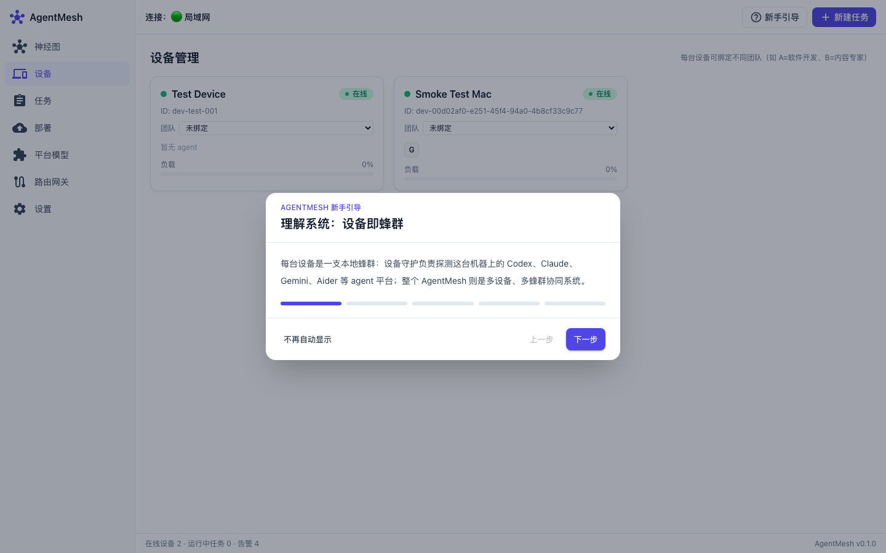
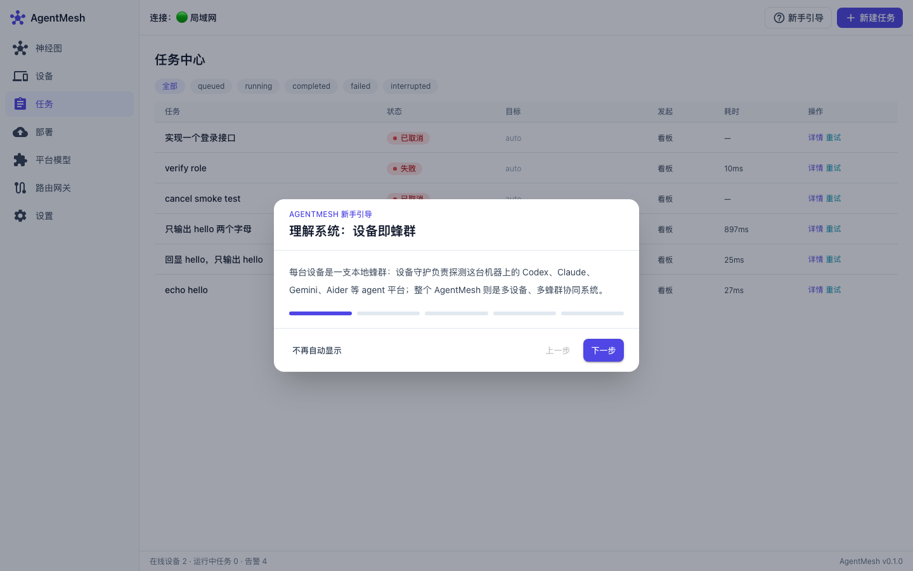
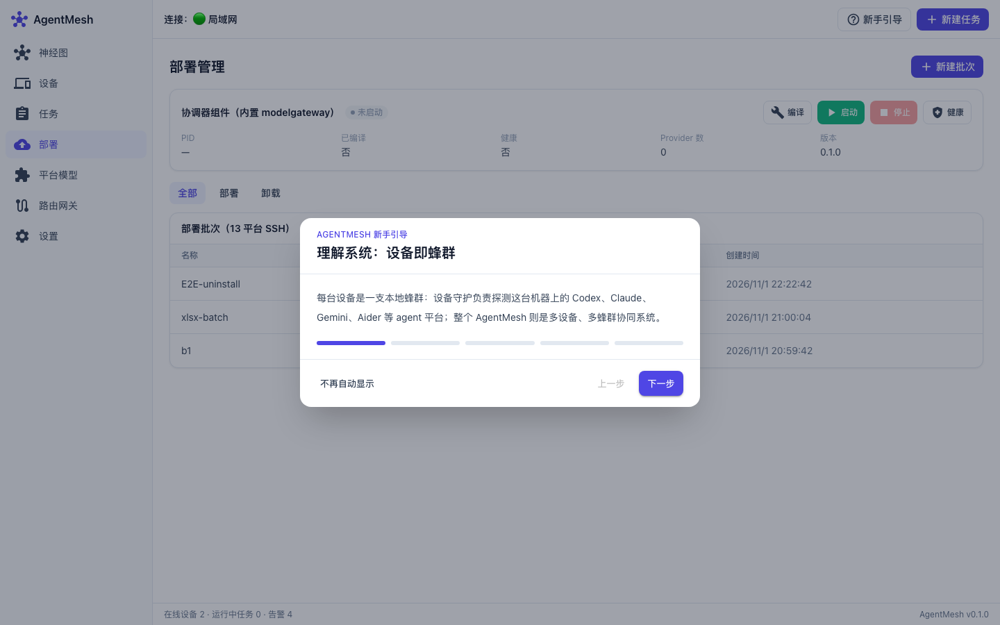
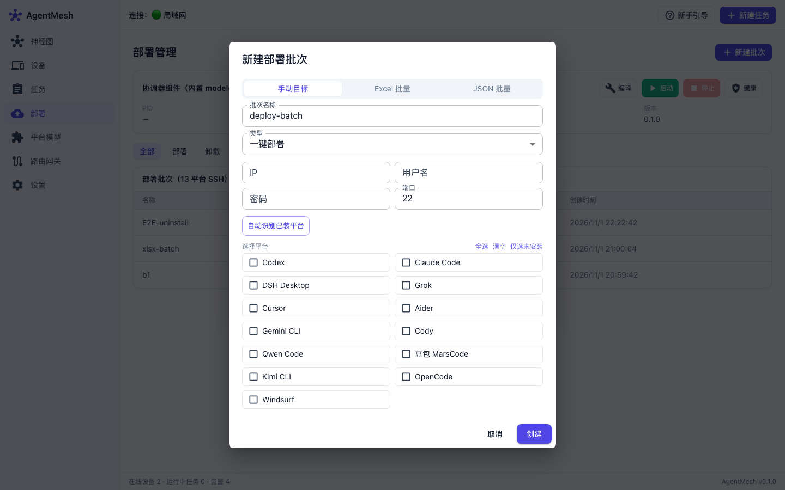
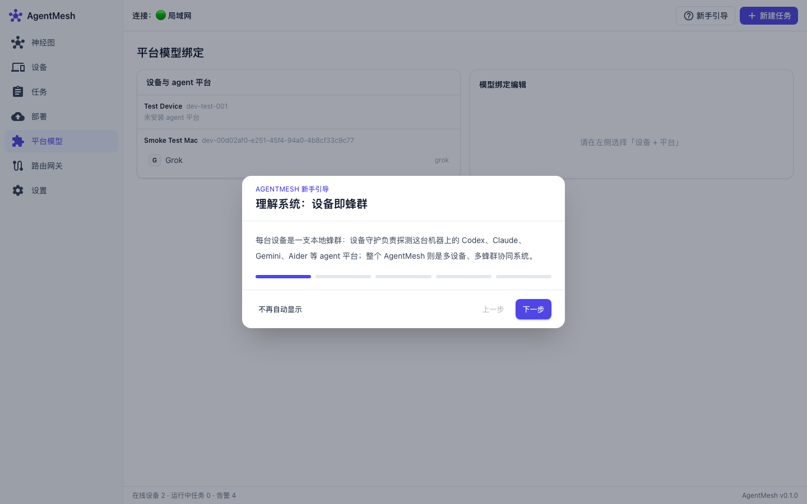
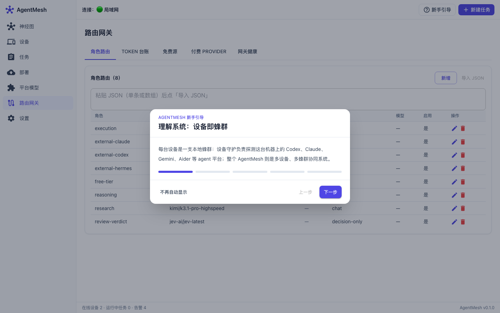
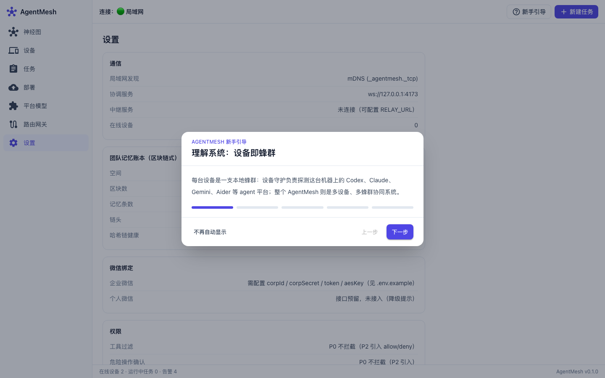

# AgentMesh 操作手册

> 本手册基于项目真实运行界面编写（v0.1.0），所有截图取自本机实际启动的前端看板。
> 覆盖：启动方式、七个页面操作、一键部署（含批量选择平台 + 自动识别已装平台）、平台模型绑定、路由网关、常见问题。

## 目录

1. [项目是什么](#1-项目是什么)
2. [如何启动](#2-如何启动)
3. [界面总览](#3-界面总览)
4. [神经图（首页）](#4-神经图首页)
5. [设备管理](#5-设备管理)
6. [任务管理](#6-任务管理)
7. [一键部署 / 卸载（重点）](#7-一键部署--卸载重点)
8. [平台模型绑定](#8-平台模型绑定)
9. [路由网关](#9-路由网关)
10. [设置](#10-设置)
11. [常见问题](#11-常见问题)

---

## 1. 项目是什么

AgentMesh 是一个**跨设备多 agent 协同系统**：每台设备是一支「本地蜂群」，其上已安装的 AI agent 平台（Codex、Claude Code、Cursor、Aider、Gemini CLI、Cody、Qwen Code、豆包 MarsCode、Kimi CLI、OpenCode、Windsurf、DSH、Grok 等 13 个平台）都是「工蜂」，AgentMesh 统一调度多设备蜂群协作完成 AI 任务。

核心能力一览：

| 能力 | 说明 |
|------|------|
| 跨设备调度 | 五种路由模式（auto / device / agent / role / team）+ 认领限流 |
| 动态神经图 | 实时看板，直观展示设备 / agent / 任务拓扑 |
| 一键部署 | SSH 批量部署 13 个 agent 平台，支持**批量勾选平台** + **自动识别已装平台** |
| 一键卸载 | 按 OS × 平台生成卸载脚本并验证已移除 |
| 平台模型绑定 | 为「设备 + 平台」绑定网关模型，故障自动/手动切换 |
| 智能路由网关 | 角色路由 + token 台账 + 免费源探测 + 付费 Provider 池 |
| 团队记忆账本 | 区块链式哈希链 + Merkle + 双层账本 + 共识 |

## 2. 如何启动

> ⚠️ **必须使用 Node 24**。默认 shell 可能是 Node 22，会导致 better-sqlite3 ABI 报错。

```bash
# 1) 切到 Node 24
export PATH="$HOME/.nvm/versions/node/v24.22.1/bin:$PATH"

# 2) 启动后端协调器（:4173）
npm run start --workspace backend

# 3) 启动前端看板（:5173，开发模式）
npm run dev --workspace frontend
```

启动后访问 **http://127.0.0.1:5173** 打开看板。

> 若 Vite dev 启动报 `safe-delete` 相关错误（因批量删除 `node_modules/.vite/deps` 被拦截），可改用生产预览：
> ```bash
> npm run build --workspace frontend
> npm run preview --workspace frontend -- --port 5173 --host 127.0.0.1
> ```

其它组件（按需）：

| 组件 | 命令 | 端口 |
|------|------|------|
| 中继 | `npm run relay --workspace backend` | 4174 |
| 设备守护 | `npm run dev --workspace device-agent` | — |
| 微信网关 | `npm run dev --workspace wechat` | 4175 |
| 内置模型网关 | `npm run dev --workspace modelgateway` | 18765 |

## 3. 界面总览

左侧为导航（桌面侧边栏 / 平板折叠 / 手机底部 Tab），共 7 个入口：

`神经图` · `设备` · `任务` · `部署` · `平台模型` · `路由网关` · `设置`

顶栏显示连接状态（🟢 中继 / 🟢 局域网 / 🟡 演示模式 / 🔴 未连接），右侧有「新手引导」与「新建任务」按钮。底部状态条显示「在线设备 / 运行中任务 / 告警」计数与版本号。

## 4. 神经图（首页）



- 实时展示设备节点、agent 节点与任务流转，d3-force 力导向布局。
- 后端无真实设备时自动进入**演示模式**（mockEngine），便于离线预览。
- 图例说明节点类型；可缩放、拖拽查看拓扑。
- **登录激活平台**：点击某个 agent 神经元（圆角方块），右侧详情抽屉会显示「打开平台应用登录激活」按钮；点击后设备端会弹出对应平台应用（GUI 应用直接打开、CLI 在终端启动），完成登录即激活该平台。

## 5. 设备管理



- 以卡片网格展示所有设备：在线状态、OS 平台/架构、负载（CPU/内存）、busyAgents。
- 支持设备配对（生成配对码）、删除设备、设置主 AI agent、绑定团队。

## 6. 任务管理



- 任务六态：queued / running / completed / failed / cancelled / interrupted。
- 点「新建任务」创建任务，可指定路由模式（auto / device / agent / role / team）与目标。
- 任务详情页展示消息时间线（text / thinking / tool_call / tool_result）。

## 7. 一键部署 / 卸载（重点）



部署管理页包含两部分：

1. **协调器组件面板**（内置 modelgateway）：编译 / 启动 / 停止 / 健康 按钮。
2. **部署批次列表**：按「全部 / 部署 / 卸载」筛选，展示历史批次。

### 7.1 新建部署批次

点右上「新建批次」打开对话框，有三种创建方式：



**① 手动目标（默认，支持批量勾选平台 + 自动识别已装平台）**

1. 填写目标机 `IP`、`用户名`、`密码`、`端口`（默认 22）。
2. 点「**自动识别已装平台**」：系统 SSH 连接目标机，探测 OS 并识别 13 个平台中哪些**已安装**（已装项显示绿色「已装」标签），便于跳过重复安装。
   - 识别失败会以红色提示返回原因（如 `HTTP 502: connect ECONNREFUSED ...`），不会影响界面。
3. 在「选择平台」网格中**批量勾选**要部署的平台（13 个：Codex / Claude Code / DSH Desktop / Grok / Cursor / Aider / Gemini CLI / Cody / Qwen Code / 豆包 MarsCode / Kimi CLI / OpenCode / Windsurf）。
   - 顶部提供「全选 / 清空 / 仅选未安装」快捷操作（「仅选未安装」仅部署时显示）。
4. 选择类型「一键部署 / 一键卸载」，点「创建」。

**② Excel 批量**：上传 `.xlsx / .xls / .csv`，按表头（IP / 账号 / 密码 / 端口 / 平台 / 设备ID / 模型）批量解析多台目标机。

**③ JSON 批量**：直接粘贴 JSON targets 数组；单个 target 未填 `platforms` 时，自动用当前勾选的平台兜底。

### 7.2 确认执行

创建后批次进入「待确认」状态，在批次详情抽屉中点「**确认执行**」后，系统按 `SSH 连接 → 探测 OS → 逐平台安装 → 逐平台验证` 流程执行，目标机状态机为：

`待执行 → 连接中 → 探测 OS → 安装中 → 验证中 → 成功/失败`

> 安全红线：密码仅存内存，单目标执行完立即清除，绝不落库。

## 8. 平台模型绑定



- 为「设备 + agent 平台」配置网关模型（主模型 + 备用 fallbacks）。
- 部署完成即用：一键部署时若指定了 modelConfigs，自动绑定。
- 支持手动切换模型（故障恢复）与重置健康状态。

## 9. 路由网关



五个标签页：

| 标签 | 功能 |
|------|------|
| 角色路由 | 角色 → 主模型 / 备用 的 CRUD + JSON 导入 + 空表播种默认角色 |
| token 台账 | 调用量 / token 出入统计 |
| 免费源 | 免费源真实探测 + 评级（优/中，只留优中）+ 自动签到 |
| 付费 Provider | 付费模型 Provider 批量配置（密钥 / baseUrl / 模型列表） |
| 网关健康 | 内置 modelgateway 连通性 / 健康状态 |

## 10. 设置



- 系统配置、连接相关参数、新手引导入口等。

## 11. 常见问题

| 问题 | 处理 |
|------|------|
| 启动报 `NODE_MODULE_VERSION` ABI 错误 | 未用 Node 24，先 `export PATH="$HOME/.nvm/versions/node/v24.22.1/bin:$PATH"` |
| Vite dev 报 `safe-delete` 拦截 | 改用 `npm run build && npm run preview` 方式启动 |
| 「自动识别已装平台」报 502 ECONNREFUSED | 目标机未开 SSH（22 端口），确认目标机已启用 sshd 且 IP/端口/账号正确 |
| 部署某些平台提示 `manual_required` | 该平台无公开包管理器安装源（如 Grok / DSH），仅能验证已装，需手动安装 |
| 目标机 GUI 平台（Cursor/Windsurf） | macOS 走 brew cask、Windows 走 winget、Linux 仅提示（unsupported） |
| 无设备时看板空白 | 正常，系统自动进入演示模式；接入真实设备后自动切换 |

---

*本手册随项目持续更新，最新功能以代码与界面的实际行为为准。*
