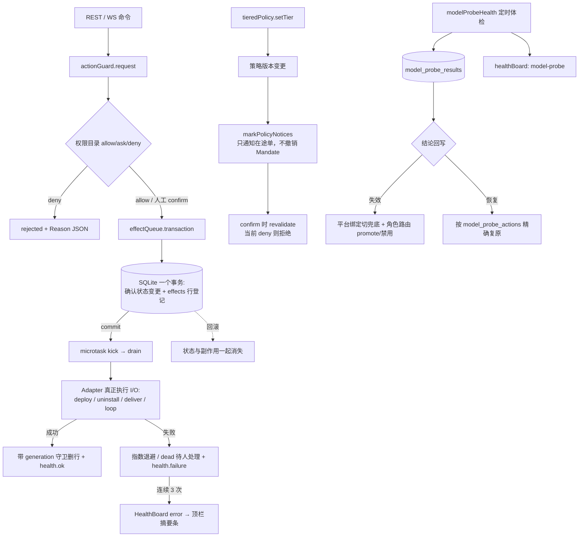

# DSH-SUPERAGENT 架构深度对标与融合落地

> 日期：2026-11-05 · 状态：**核心机制已落地并全量验证**
> 对标对象：① DeepSeek 官方 research prototype `dsh-superagent-prototype`；② 本地演进版 `dsh-team-workbench 2.99.1`
> 本文是 `docs/19-DSH超智能体借鉴分析.md` 的深化与收口：19 号文档只做了「建议清单」，本文逐机制给出**落地证据 + 测试 + 运维出口**。
> 权威能力清单同步更新至 `docs/00-能力地图-已实现与缺失.md` §2.12。

---

## 1. 结论先行

**结论：DSH 的核心架构思想已全部融入 AgentFleet，且其价值不在于「功能清单」，而在于「可靠性契约」。**

| DSH 核心机制 | 融合前 | 融合后 | 证据 |
|---|---|---|---|
| 单写者 + 每命令一个事务 + 提交后副作用 | ❌ fire-and-forget | ✅ | `effectQueue.transaction()` + `actionGuard.confirm()` |
| 持久 Effects（幂等/合并/退避/崩溃续跑） | ❌ | ✅ | `backend/src/services/effects/effectQueue.ts` |
| 统一 HealthBoard（单一写入者 / 3 次才告警） | 🟡 只有内存 circuitBreaker | ✅ | `backend/src/services/healthBoard.ts` |
| 结构化 Reason 码 | ❌ 自由中文文本 | ✅ | `shared/src/reason.ts` |
| 内容派生幂等 ID `key()` | ❌ 随机 ID | ✅ | `shared/src/idKey.ts` |
| policyVersion / Mandate / revalidate | 🟡 有 HITL 门但无版本 | ✅ | `tieredPolicy.ts` + `actionGuard.ts` |
| 「只把需要人的东西摆到人面前」 | ✅ 顶栏摘要条已有 | ✅ 扩充 | `MainLayout.tsx` + `SystemHealthPage.tsx` |
| 模型路由真实推理体检 | 🟡 只出报告不回写 | ✅ 闭环 | `modelProbeHealth.ts` |
| 持久 worker session + steer + inbox | 🟡 仅任务交接摘要 | 🟡 未升级 | 见 §6 |

**这次融合修掉的真实缺陷**：`updateConfirmationStatus()` 在 `rejected` 状态下把原因文本直接丢掉（`confirmed_by` 只在 confirmed/executed 时写），导致「为什么拒绝」不可追溯。现已新增 `action_confirmations.reason` 存结构化 Reason JSON。

---

## 2. 两个 DSH 项目读到的东西

### 2.1 `dsh-superagent-prototype`（官方 research prototype）

定位是「面向单个 GitHub 仓库的主动式编码 agent」，三条产品哲学直接决定了架构：

1. **只把需要人的东西摆到人面前** —— 健康态折叠，不打扰
2. **尽可能少占用人的注意力** —— 连续失败才告警、成功即清除
3. **诚实报告** —— 失败不吞、不假装成功、原因可判定

架构契约（`docs/007-architecture.md`）：

```
Engine（唯一写入者）
  └─ 每个命令在一个 transaction 内变更聚合
       ├─ Port：事务内只「登记」外部工作（Outbox/Effects 行）
       └─ Adapter：afterCommit 之后才真正执行 I/O
Views（只读投影）  ←  Store（SQLite）  ←  Effects（持久副作用队列）
```

关键机制：

| 机制 | 原文要点 | 解决的问题 |
|---|---|---|
| 单写者 + 事务 | 领域核心纯同步；每命令一个事务 | 状态与副作用不会「半成功」 |
| Effects | `PRIMARY KEY(kind,key)` 幂等、`generation` 合并保护、`seq` 保序、coalescing、指数退避、`Later` 延期不计失败、按 kind 并发、`ordered` 严格保序、崩溃后 drain | 进程崩溃不丢外部工作 |
| HealthBoard | 每个健康条目一个写入者，`claim()` 拒绝二次声明；连续 3 次失败才 `error`；成功一次即清除 | 网络抖动不惊动人 |
| Reason | `Reason{code, values?, taskId?, deviceId?}` + `reasonText()` 模板 | 可判定、可本地化、可聚合，告别字符串匹配中文 |
| `key()` | `sha256(canonical(values))[:32]` | 相等输入 → 相等 ID，天然幂等，无需去重表 |
| policyVersion / Mandate | 受理时锁住策略版本；策略变更只通知在途单、不撤销既有授权；命令执行前复检 | 授权语义稳定、策略热更新安全 |
| 命令 vs 报告 | 命令用祈使式且可被拒绝；报告用过去式且只幂等记录 | 边界清晰，不把「想做」写成「已做」 |
| 最小权限接口 | `Pick<Engine, ...>` 切成 `EngineForSources / MainSession / People / Executor` | 各组件只能拿到自己该有的能力 |

### 2.2 `dsh-team-workbench 2.99.1`（本地演进版）

把上面的架构翻译到「聊天/协作域」，值得对齐的是：

| 概念 | 含义 | AgentFleet 对应 |
|---|---|---|
| Thread → Ticket | 每条用户消息 = 一张有开/结状态的工单 | 任务 + 确认记录 |
| Mandate | 消息本身即授权，记录发起人/范围/策略版本 | `action_confirmations.policy_version` ✅ 本轮落地 |
| Eval / Decision | 每次判定落 `decisions.json`，含原因与策略版本 | `decision_gates` + `reason` 🟡 未升级为四表 |
| Assignment / Subscription | 派单与订阅 | `claimAgent` + DashboardPatch ✅ |
| L0–L3 记忆 | 分层上下文 | `memory/` 四路 RRF + 语义分层 ✅ |
| 持久 worker session + steer + inbox | 常驻会话、中途改向、消息收件箱 | 🟡 仅有 `sessions`/`taskContexts` |
| 模型路由真实推理体检 | 发最小 chat 请求验证而非读 `/models` 元数据 | 🟡→✅ 本轮补成闭环 |
| 并行泳道 / 慢节点隔离 / @ 接力 | 流式扇出与慢节点 15s 隔离 | 🟡 未升级 |

---

## 3. 落地设计（不是照搬，是翻译）

### 3.1 总体链路



### 3.2 关键设计决策（以及为什么没照搬）

1. **SHA-256 用纯 TS 实现，不用 `node:crypto`**
   `shared` 要被前端 Vite 打包，`key()` 必须在浏览器也能算。已用 `node:crypto` 做向量比对（空串/`abc`/中文/emoji/55/56/64/1000 字节跨块）全部一致，见 `backend/tests/idKeyAndReason.test.ts`。

2. **Effects 的「running」只在内存，DB 行永远保持 pending**
   这是崩溃恢复的关键：进程被 kill 时没有机会把状态改成 running，重启后 `effectQueue.start()` 的首次 kick 会自动续跑。结算一律带 `WHERE seq=? AND generation=?`，运行中若被 coalescing 合并，旧尝试删不掉新 payload。

3. **`executed` 的语义显式收窄**
   `actionGuard.confirm()` 把确认单置为 `executed`，含义是「副作用已在事务内登记待执行」，**不是业务终态**。真正终态看 `effects` 行是否消失 / 是否 dead。这修正了旧 fire-and-forget 下「显示已执行但其实 Promise 静默失败」的诚实性问题。

4. **HealthBoard 不替代 circuitBreaker**
   `circuitBreaker.ts` 是 device+agent 维度的内存熔断（调度路径，要求低延迟）；HealthBoard 是持久、全局、单一写入者的可观测条目（人看）。两者并存，职责不同。

5. **模型体检加了「基础设施故障」护栏（最重要的一条）**
   如果 modelgateway 挂了，所有模型探测都会失败。若照搬「失败即清理」，一次断网就能清空整套路由配置。因此：
   - 网关未配置 → 直接返回，不探测、不清理
   - 本轮**全部失败** → 判为网关/网络故障，只记 `health.failure`，**零破坏性动作**
   - 只有「至少一个模型成功」时，才把失败项视为该模型自身的问题并切换
   - 自动切换全部记入 `model_probe_actions`，模型恢复后精确复原，不单向劣化配置
   - **真机验证补的一条**：网关不可达时系统本来就会自动降级本地路由，因此这种情况用 `HealthHandle.warn()` 只标 `degraded`（失败计数封顶在 `FAILURES_BEFORE_ERROR-1`），**永不升 error**，顶栏不会常驻红条。只有「至少一个模型成功、个别模型失败」这种需要人换模型的情形才走 `failure()` 三次告警

6. **`tieredPolicy` 保持 core 无 I/O**
   `setTier()` 只发出 `PolicyChange` 通知，真正写 `policy_notice` 的 adapter 在 `backend/src/index.ts` 注入（对应 DSH「Ports 在事务内登记、Adapters 提交后执行」的分层）。

7. **老库兼容**
   `CREATE TABLE IF NOT EXISTS` 只建新表不改老表，所以 `action_confirmations` 的 `policy_version / policy_notice / reason` 三列都在 `runMigrations()` 里用 `PRAGMA table_info` + `ALTER TABLE` 补齐（这是本项目踩过的坑）。

---

## 4. 代码与表变更清单

### 新增文件

| 文件 | 职责 |
|---|---|
| `shared/src/idKey.ts` | `canonical()` / `sha256Hex()` / `key()`，纯 JS SHA-256 |
| `shared/src/reason.ts` | `Reason` / `reasonOf` / `reasonText` / `reasonJson` / `parseReason` / `said` |
| `backend/src/services/effects/effectQueue.ts` | 持久副作用队列（`LaterError`/`later`/`EffectQueue`） |
| `backend/src/services/healthBoard.ts` | 统一健康看板（claim/ok/failure/release/summary） |
| `backend/src/services/routing/modelProbeHealth.ts` | 真实推理体检闭环 + 定时 loop |
| `frontend/src/pages/SystemHealthPage.tsx` | 四视图可观测页 |
| `backend/tests/{idKeyAndReason,healthBoard,effectQueue,policyVersion,modelProbeHealth}.test.ts` | 32 个新用例 |
| `docs/29-DSH架构深度对标与融合落地.md` | 本文 |

### 修改文件

| 文件 | 变更 |
|---|---|
| `shared/src/index.ts` / `action.ts` | 导出新模块；`ActionConfirmation` 增 `policyVersion` / `policyNotice` / `reason` |
| `backend/src/db/schema.sql` | 新增 4 表（`effects` / `component_health` / `model_probe_results` / `model_probe_actions`）、`action_confirmations` 增 3 列；**总表数 21 → 25** |
| `backend/src/db/database.ts` | 老库补列迁移 |
| `backend/src/db/repo/confirmations.ts` | Mandate CRUD + `markPolicyNotices` / `listPolicyNotices` + 原因持久化 |
| `backend/src/services/tieredPolicy.ts` | `version()` / `onChange()` / `PolicyChange` |
| `backend/src/services/actionGuard.ts` | 事务内登记、Mandate revalidate、结构化拒绝原因、`primeEffectHandlers()` |
| `backend/src/services/relayClient.ts` | `setRelayStateHandler()` 上报真实连接状态 |
| `backend/src/index.ts` | 启动预热 handler + `effectQueue.start()` + 策略变更 adapter + relay 健康 claim + 体检 loop；shutdown 停止扫描**但保留 pending 行** |
| `backend/src/routes/system.ts` | 7 个新增 REST 出口、`/api/system/attention` 扩充摘要维度 |
| `backend/src/config.ts` | `MODEL_PROBE_ENABLED` / `MODEL_PROBE_INTERVAL_MS`（默认 30min） |
| `frontend/src/api/http.ts` / `App.tsx` / `layouts/MainLayout.tsx` / `i18n/translations.ts` | 新 API、路由、顶栏摘要条、双语文案 |
| `backend/tests/qa-p0-gateway.integration.test.ts` | 表数断言 21 → 25 并校验 4 张新表 |

### 新增 REST 出口

| 端点 | 用途 |
|---|---|
| `GET /api/system/health/components` | HealthBoard 明细 + 汇总 |
| `GET /api/system/effects` | 副作用队列（可按 kind/status 过滤）+ stats |
| `POST /api/system/effects/retry` | 人工复活 dead 行 |
| `GET /api/actions/policy/notices` | 当前策略版本 + 收到变更通知的在途单 |
| `GET /api/system/model-probes` | 体检历史结果 |
| `POST /api/system/model-probes/run` | 手动跑一轮体检（含路由清理动作计数） |
| `GET /api/system/attention`（扩充） | 新增 `healthErrors / healthDegraded / deadEffects / pendingEffects / policyNotices / failedProbes` |

---

## 5. 验证结果

| 项目 | 结果 |
|---|---|
| 全量构建（7 workspace） | ✅ `npm run build`（含 frontend `tsc` 类型检查） |
| backend 单测 | ✅ **318 / 318**（42 文件；新增 5 组测试文件；修正表数断言后全绿） |
| memory 单测 | ✅ 132 / 132 |
| device-agent 单测 | ✅ 32 / 32 |
| Playwright 拟人 UI 回归 | ✅ **50 / 50**，零 console/page 错误（本机真实 backend:4173 + frontend:5173） |
| 真实 DB 迁移 | ✅ `data/agentfleet.db` 25 张表；`action_confirmations` 补齐 `policy_version` / `policy_notice` / `reason` |
| 真机 REST 巡检 | ✅ `/api/system/health/components` 6 条（ready 5 / degraded 1 / **errors 0**）、`/api/system/effects`（rows=0, kinds=4）、`/api/system/model-probes`（9 条）、`/api/actions/policy/notices`（version=64070de3…） |
| 模型体检安全护栏实机复测 | ✅ 9 个模型全失败 → `infrastructureFailure=true`，**零路由清理**；`model-probe` 只标 degraded，`attention.healthErrors=0` |
| SHA-256 向量比对 node:crypto | ✅ 8 组输入全一致 |
| 新增机制覆盖 | 幂等/coalescing/generation 守卫/退避/LaterError/dead/崩溃续跑/事务回滚、HealthBoard 三次阈值与 release、策略版本与 revalidate、体检切换与复原与基础设施护栏 |

UI 回归已把新增的 `/system-health` 页纳入 `tests/ui_regression.py` 逐页巡检，并新增 DSH 专项断言：四视图齐全、组件健康表渲染真实条目、degraded 如实呈现、策略版本 Mandate 可见、体检历史渲染真实模型、刷新不白屏；顶栏摘要条加了 `data-testid="attention-bar"` 锚点，断言「healthErrors / deadEffects / policyNotices 归零时不误报」「degraded 不升 error」，即 DSH「只把需要人的东西摆到人面前」原则的可执行验证。

关键回归用例（见 `docs/00` §5 铁律）：`qa-p0-gateway.integration.test.ts` 的表数断言随 schema 同步更新；`actionGuard.test.ts` / `tieredPolicy.test.ts` 原有语义未破坏。

---

## 6. 明确未融合 / 后续路线（诚实边界）

以下能力**识别到了但本轮没有做**，不要误判为已实现：

| 项 | 现状 | 为什么暂缓 |
|---|---|---|
| Ticket / Mandate / Eval / Assignment 审计四表 | 🟡 有 `decision_gates` + `action_confirmations.policy_version` | 现有 HITL 决策门已覆盖核心安全需求，升级四表需重构任务生命周期 |
| 持久 worker session + steer + inbox | 🟡 仅 `sessions` / `taskContexts` 交接摘要 | 需要为 device+agent 建立长期会话复用协议，涉及 adapter 层大改 |
| 流式扇出 + 慢节点 15s 隔离 + 排队可视化 | 🟡 无 | 现有 TASK_EVENT 流式时间线够用，慢节点隔离需要调度层新状态 |
| BYO 本机 CLI agent 纳编 + 共享技能跨 app 分发 | 🟡 已有 `platformCatalog` 数据驱动声明 / `skills.js` | 目录已可加声明不改代码，但跨 app 技能分发协议未定义 |
| 最小权限接口 `Pick<Engine, ...>` | 🟡 未做 | AgentFleet 以服务单例 + 显式函数导出组织，暂无统一 Engine 对象可切 |

---

## 7. 运维速查

```bash
# 关闭/开启模型真实推理体检（默认开启，首次延后 90s，之后每 30min）
MODEL_PROBE_ENABLED=0
MODEL_PROBE_INTERVAL_MS=1800000

# 看当前健康态 / 副作用队列 / 策略版本
curl -s http://127.0.0.1:4173/api/system/health/components | jq
curl -s http://127.0.0.1:4173/api/system/effects | jq
curl -s http://127.0.0.1:4173/api/actions/policy/notices | jq

# 手动跑一轮体检 / 复活一条 dead 副作用
curl -s -X POST http://127.0.0.1:4173/api/system/model-probes/run | jq
curl -s -X POST http://127.0.0.1:4173/api/system/effects/retry \
  -H 'Content-Type: application/json' \
  -d '{"kind":"deploy","effectKey":"<从 /api/system/effects 取>"}' | jq
```

**排障顺序**：顶栏「待处理」→ `/system-health` 页 → 组件健康找 error 条目 → 副作用队列找 dead 行 → 结构化 Reason 的 `code` 判定根因 → 修复后点「重新入队」。

---

## 8. 远程生产部署与实机验证（2026-11-08）

`8815e7c` 之后按既有流程把产物真正部署到三台云服务器：`npm run build:deploy` 生成 `dist/{device-agent,relay,modelgateway}.cjs`，`deploy-fleet.sh relay` / `modelgateway` / `deploy` 分别下发并重启；本机协调器以 `RELAY_URL=ws://118.194.233.141:4174` 重启，形成「本机 backend + 公网中继 + 三台真实设备 + 每台本地网关」的完整生产拓扑。

**顺带修掉的常驻可靠性根因**（`scripts/deploy-fleet.sh`）：

| 症状 | 根因 | 修复 |
|---|---|---|
| Win165 服务器重启后设备永不自启，看板长期 offline | `schtasks /create /ru Administrator` 不带 `/rp` → 任务被建成 `Interactive only`；SSH 会话无交互登录时 `schtasks /run` 只回 `Attempted to run`，实际 `Last Result=267011`（从未运行）/ 上次运行 1999/11/30。当时在线的进程是手动 `Start-Process` 的孤儿 | 补 `/rp` 让任务变为 `Interactive/Background`，保留 Administrator 的 home（registry 路径） |
| 任务跑满 3 天被杀且不自拉 | `/sc onstart` 任务默认 `ExecutionTimeLimit=PT72H`，而 onstart 只在开机触发 | 用 `Set-ScheduledTask` 置 `PT0S`；带 `/rp` 的后台任务二次提交 Settings 必须同时给 `-User/-Password`，否则报 0x8007052e |
| 一次 deploy 里 Win165 偶发 SSH `Permission denied`，任务没重建却显示「部署完成」 | 同轮连续 scp/ssh 多次连接；脚本对 create 输出不做校验 | create 结果必须含 `SUCCESS/成功` 才通过，最多重试 3 次；`/run` 的「Attempted」不再当作成功 |
| 遗留任务混淆 | Win165 有 11/05 改名前留下的 `\AFDevSys`（指向已废弃的 `start-device.bat`） | deploy 时幂等删除 |

**最终实机状态**：三台设备 online（win120-dev 1 agent / ubuntu-dev 4 / win165-dev 2）；两台 Windows 的 `AgentFleetDevice` 与 modelgateway 任务均 `Running` + `Interactive/Background` + `Last Result=267009` + `PT0S`；Ubuntu 三服务 active，4174/18765 监听，7 条中继 ESTAB；`AFDevSys` 已清。

**可靠性内核在生产拓扑下**：`relayConnected=true`、HealthBoard 6 条（ready 5 / degraded 1 / **errors 0**）、Effects `kinds=4` 无 pending/dead、policyVersion `64070de3…`、attention `healthErrors=0`；Playwright 拟人 UI 回归 **50/50、零 console/page 错误**。

**诚实边界（当时的状态，已由 §9 补齐）**：`MODELGATEWAY_URL` 默认 `http://127.0.0.1:18765`，而本机协调器没有本地网关（Ubuntu 的网关只监听 `127.0.0.1`），因此 9 个模型体检恒为 `fetch failed`。安全护栏已按设计生效（判 `infrastructureFailure`、零路由清理、只标 degraded），但当时**成功路径未验证**，切换/复原逻辑只有单测覆盖。当天下午已在本机把网关与真实上游跑通并完成完整闭环验证，见 §9。

---

## 9. 本机 modelgateway 与模型体检闭环实机验证（2026-11-08 下午）

### 9.1 为什么之前「成功路径」永远跑不到

两个叠加根因，只修一个都没用：

1. **本机没有网关**：`MODELGATEWAY_URL` 默认 `127.0.0.1:18765`，Ubuntu 上的网关只监听 loopback → 9 个模型恒 `fetch failed` → 护栏判 `infrastructureFailure`，只标 degraded、零路由清理。
2. **业务模型 ref 与上游模型名脱节**（更隐蔽）：角色路由里 8 个 primary 是 DSH 风格虚拟 ref（`mgs-claude/group/strong`、`gpt/gpt-6.1-sol` …）。`ProviderPool.resolve()` 未命中时会降级到 `kilo-free`，**却把虚拟模型名原样透传给上游** → 上游 400 / 空响应 → 即使网关在线也仍然全失败。

### 9.2 落地改动

| 文件 | 变更 |
|---|---|
| `modelgateway/src/config.ts` | 新增 `ModelAliasMap`：从 `.workbuddy-ai/modelgateway-aliases.json` 与 `MG_MODEL_ALIASES` env 读取「业务 ref → `providerId/model`」映射；`apiKey` 支持 `${ENV_VAR}` 展开，密钥不落配置文件；新增 `MODELGATEWAY_LOCAL_CONFIG=0` 供 CI/集成测试彻底隔离本机配置 |
| `modelgateway/src/providers.ts` | `ProviderPool` 接受别名表，`resolve()` 优先命中别名并落到真实上游模型（`/` 与 `:` 前缀、已在册模型名三种写法）；解析不到时安全回落原降级链路；`aliases()` / `aliasCount()` 供可观测 |
| `modelgateway/src/server.ts` / `index.ts` | `/health` 暴露 `aliasCount` / `modelAliases`；启动日志打印别名数 |
| `modelgateway/tests/providers.test.ts`、`server.integration.test.ts` | 新增 11 条断言：别名三种写法、无效别名回落、密钥 env 展开、非法配置容错；修正既有冒烟用例被本机 provider 配置污染的问题 |
| `scripts/start-modelgateway.sh` | 本机网关启动器（固定 Node 24，前台 `exec`，可手动 / 由 LaunchAgent 托管） |
| `scripts/dev-local.mjs` | **把 modelgateway 纳入一键启动链**；若 18765 已有健康实例则跳过，避免端口冲突 |
| `.workbuddy-ai/*`（本机、已 gitignore） | `modelgateway-providers.json` 的 key 改为 `${DEEPSEEK_API_KEY}` / `${OPENAI_API_KEY}`；`modelgateway-aliases.json` 配 9 条映射 |

别名配置样例（`deepseek` 用本机 `.env` 真 key，Kilo 免费源免密）：

```json
{
  "mgs-claude/group/strong": "deepseek/deepseek-chat",
  "mgs-hermes/group/long-context": "kilo-free/kilo-auto/free",
  "kilo-auto/free": "kilo-free/kilo-auto/free"
}
```

运维命令：

```bash
bash scripts/start-modelgateway.sh                 # 前台启动本机网关（18765）
npm run dev:local                                  # 一键链已自动带网关
curl -s http://127.0.0.1:18765/health | jq         # 看 providers / aliasCount / modelAliases
curl -s -X POST http://127.0.0.1:4173/api/system/model-probes/run | jq
# 单点故障注入（env 覆盖同名别名，重启网关即生效，无需改文件）：
MG_MODEL_ALIASES='{"mgs-claude/group/strong":"deepseek/no-such-model-xyz"}' \
  bash scripts/start-modelgateway.sh
```

### 9.3 实机闭环（真实上游、真实 DB、真实前端）

上游实测：DeepSeek（`.env` 真 key）返回 `Pong! 🏓`；Kilo 免费源 `kilo-auto/free` 的 content 为空但 `reasoning` 非空，`extractText()` 的 reasoning 兜底保证 `ok=true`。

| 轮次 | 结果 |
|---|---|
| 基线 | 9 条 `fetch failed`；`model-probe` degraded / failures=2；平台绑定 `state=degraded` |
| ① 成功路径 | `configured=true, 9/9 ok, infrastructureFailure=false`，真实 `provider=deepseek/kilo-free`；`bindingsRecovered=1`（排除表清空、state→ok）；HealthBoard **6/6 ready**；attention `failedProbes 9→0` |
| ② 单模型真实故障 | 注入不存在的上游模型（DeepSeek 真 400）→ `8/9 ok, infrastructureFailure=false`，`routesDisabled=1`、`external-claude` 禁用、`model_probe_actions` 落 1 行、degraded/failures=1；**护栏没有把局部故障误判成网络故障** |
| ③ 恢复 | `9/9 ok`，`routesRestored=1`，动作表清空，6/6 ready，`failedProbes=0` |
| ④ 有健康兜底时故障 | 给 `external-claude` 加 `fallback=['kilo-auto/free']` 再注入 → `routesPromoted=1`，primary 自动切到 `kilo-auto/free`，`switched_to` 落库 |
| ⑤ 最终复原 | `9/9 ok`、`routesRestored=1`；把临时 fallback 精确写回 `[]`，8/8 路由 enabled、动作表空、平台绑定 ok |

回归：`npm run build` ✅；backend **318/318**、memory **132/132**、device-agent **32/32**、modelgateway **29/29**；Playwright 拟人 UI 回归 **49/49、零 console/page 错误**（比 §5 的 50 少 1 条，因为「降级态如实呈现」是仅当有 degraded 组件才触发的条件断言，归零后自然不计）。

### 9.4 常驻与诚实边界

- 已生成 `~/Library/LaunchAgents/com.agentfleet.modelgateway.plist`（`RunAtLoad` + `KeepAlive`），但当前执行上下文向 launchd 提交服务时，`bootstrap gui/501`、`load -w`、`bootstrap user/501` 三次均报 `Bootstrap failed: 5: Input/output error`（`plutil -lint` 通过、权限 644、服务未被禁用）——属于执行会话限制，不是 plist 问题，**未反复重试**。在真实 Terminal.app 里执行一次即可开机自启：
  `launchctl bootstrap gui/501 ~/Library/LaunchAgents/com.agentfleet.modelgateway.plist`；停用：`launchctl bootout gui/501/com.agentfleet.modelgateway`。
- 更贴合项目的持久方案已落地：`scripts/dev-local.mjs` 每次一键启动都会拉起网关；当前会话网关由本机后台进程持续运行。
- 边界：别名把 9 个虚拟 ref 映射到 **2 个真实上游模型**，证明的是「体检闭环链路与路由决策」真实可用，**不等于每个业务模型都独立可用**；每轮体检会发 6 次 DeepSeek 最小请求（`max_tokens=8`），成本极低但非零。

---

## 10. 一句话总结

之前 AgentFleet 的「授权 → 执行」是 `void Promise.then(...)`，一旦进程崩溃或 SSH 抖动，动作就静默消失且无从查起；现在它是**一个事务登记一行持久副作用**，崩溃续跑、失败退避、耗尽待人、原因可判定、健康可观测——这才是 DSH 架构真正值得融合的部分。
