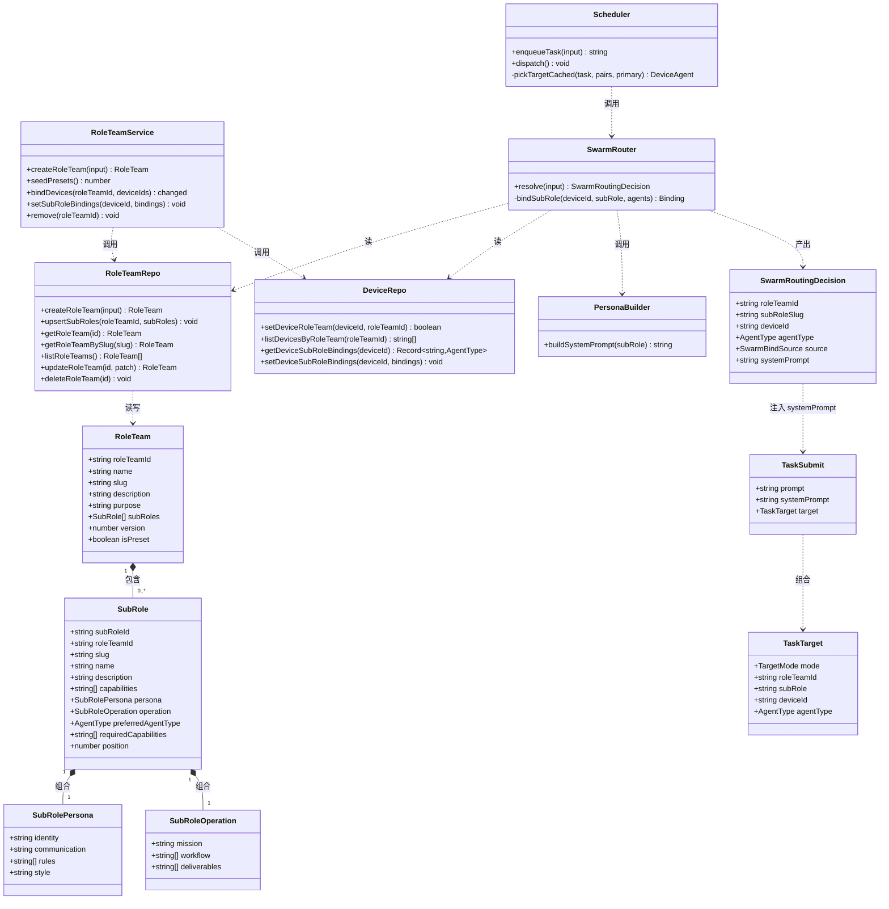
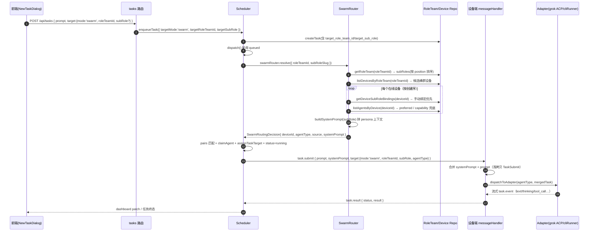
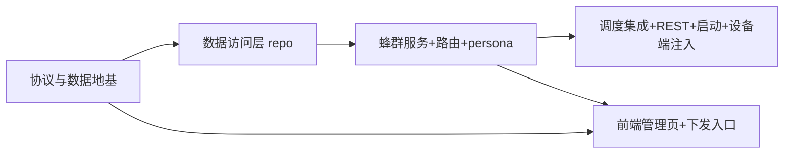

# AgentFleet「蜂群角色团队」系统设计与任务分解

> 作者：架构师（高见远） · 基于 PM 已确认 PRD 与现有 monorepo 代码
> 状态：待工程实现（本文为设计，不含实现代码）

---

## Part A：系统设计

### 1. 实现方案与框架选型

**核心挑战**

1. **新路由模式与既有五种模式并行**：现有 `TargetMode = 'auto' | 'device' | 'agent' | 'role' | 'team'`，本功能新增 `'swarm'`，需在不改造 `teams` 表、不复用 `role` 语义的前提下，为「蜂群（单设备多 agent 平台）」赋予「角色团队 → 子角色 → 平台」的新路由维度。
2. **子角色结构化定义**：frontmatter 元数据（slug/name/description/capabilities）+ Persona 层（identity/communication/rules/style）+ Operation 层（mission/workflow/deliverables），需以 JSON 持久化并能在调度时拼成 system 上下文。
3. **软绑定决策**：子角色与平台的绑定不是硬映射，需按 `手动 sub_role_bindings > preferred_agent_type > required_capabilities 动态兜底` 三级优先级解析到具体 `deviceId + agentType`。
4. **persona 注入端到端链路**：调度时拼 systemPrompt → 随 `TaskSubmit.systemPrompt` 下发 → 设备侧在派发 Adapter 前与用户 prompt 合并。
5. **存量库迁移**：SQLite `CREATE TABLE IF NOT EXISTS` 不改旧表，需在 `runMigrations` 里 `PRAGMA table_info` 补列，**补列后再建索引**。

**框架选型（沿用现有栈，不引新重依赖）**

| 层 | 选型 | 说明 |
|----|------|------|
| 共享协议 | `@agentfleet/shared`（TS 类型 + 枚举） | 新增 `swarm.ts`，枚举/接口单一事实源 |
| 后端 | Fastify + better-sqlite3（同步） | 复用现有 repo/service/router/scheduler 模式 |
| 设备端 | 现有 Adapter 注册表 + ACP/cliRunner | `systemPrompt` 在 `messageHandler` 统一合并，不新造通道 |
| 前端 | React + MUI + Tailwind | 新增 `SwarmTeamsPage`，复用 `http.ts`/`MainLayout` 模式 |
| 预设种子 | TS 常量 `presets.ts` | 对齐 `roleRouteStore.seedDefaults()` 的幂等播种范式 |

**架构模式**：延续现有分层（route → service → repo → db），路由决策复用 `roleRouter.decide` 的「决策器单例 + 调度器 pair 匹配」范式；蜂群路由单独成 `swarmRouter`，**不做网关降级**（蜂群语义即「单设备多平台」，目标必然落在本地 agent）。

---

### 2. 文件列表（新增 + 修改）

标注：🆕 新增 · ✏️ 修改

**shared（协议层）**

| 文件 | 变更 |
|------|------|
| `shared/src/status.ts` | ✏️ `TargetMode` 增 `'swarm'`；`TARGET_MODES` 增 `'swarm'` |
| `shared/src/task.ts` | ✏️ `TaskTarget` 增 `roleTeamId?`/`subRole?`；`TaskSubmit` 增 `systemPrompt?`；`TaskSnapshot` 增 `targetRoleTeamId?`/`targetSubRole?` |
| `shared/src/device.ts` | ✏️ `DeviceSnapshot` 增 `roleTeamId?`/`roleTeamName?` |
| `shared/src/swarm.ts` | 🆕 子角色/角色团队/软绑定决策/绑定视图 类型 |
| `shared/src/index.ts` | ✏️ `export * from './swarm.js'` |

**backend（数据 + 服务 + 路由）**

| 文件 | 变更 |
|------|------|
| `backend/src/db/schema.sql` | ✏️ 增 `role_teams`、`sub_roles` 表；`devices` 增 `role_team_id`/`sub_role_bindings`；`tasks` 增 `target_role_team_id`/`target_sub_role`；补索引 |
| `backend/src/db/database.ts` | ✏️ `runMigrations` 补列 + 列补齐后建索引 |
| `backend/src/db/repo/roleTeams.ts` | 🆕 `role_teams` + `sub_roles` CRUD（行↔类型映射、事务写入） |
| `backend/src/db/repo/devices.ts` | ✏️ `DeviceRow` 增列；增 `setDeviceRoleTeam*`/`listDevicesByRoleTeam`/`getDeviceSubRoleBindings`/`setDeviceSubRoleBindings`；`toDeviceSnapshot` 增 `roleTeamId/roleTeamName` |
| `backend/src/db/repo/tasks.ts` | ✏️ `TaskRow`/`TaskCreateInput`/`createTask`/`toTaskSnapshot` 增 `target_role_team_id`/`target_sub_role` |
| `backend/src/services/swarm/presets.ts` | 🆕 3 个内置预设种子数据（纯常量） |
| `backend/src/services/swarm/personaBuilder.ts` | 🆕 纯函数：`buildSystemPrompt(subRole)` |
| `backend/src/services/swarm/roleTeamService.ts` | 🆕 角色团队 CRUD 编排 + 设备绑定 + `seedPresets()` |
| `backend/src/services/swarm/swarmRouter.ts` | 🆕 软绑定三级决策 + `resolve()` 单例 |
| `backend/src/services/scheduler.ts` | ✏️ `SchedulerSubmitInput`/`enqueueTask`/`pickTargetCached` 增 swarm 分支；下发 payload 带 `systemPrompt`/`roleTeamId`/`subRole` |
| `backend/src/routes/swarm.ts` | 🆕 角色团队 REST + 设备绑定 + 子角色软绑定覆盖 |
| `backend/src/index.ts` | ✏️ 注册 `registerSwarmRoutes`；启动时 `roleTeamService.seedPresets()` |

**device-agent（执行端）**

| 文件 | 变更 |
|------|------|
| `device-agent/src/messageHandler.ts` | ✏️ `handleTaskSubmit` 中若 `task.systemPrompt` 存在则与 `prompt` 合并后再派发 Adapter |

**frontend（UI）**

| 文件 | 变更 |
|------|------|
| `frontend/src/api/http.ts` | ✏️ 增角色团队 CRUD/绑定接口；`createTask` target 增 `roleTeamId`/`subRole` |
| `frontend/src/pages/SwarmTeamsPage.tsx` | 🆕 角色团队管理页（列表/详情/子角色编辑/设备绑定/软绑定覆盖） |
| `frontend/src/App.tsx` | ✏️ 增 `/swarm` 路由 |
| `frontend/src/layouts/MainLayout.tsx` | ✏️ 导航增「蜂群角色」项 |
| `frontend/src/components/drawer/NewTaskDialog.tsx` | ✏️ 下发模式增 `swarm`（角色团队 + 可选子角色选择器） |

---

### 3. 数据结构与接口

#### 3.1 共享协议类型（`shared/src/swarm.ts`）

```ts
import type { AgentType } from './status.js';

export interface SubRolePersona {
  identity: string;          // 身份定位
  communication: string;     // 沟通风格
  rules: string[];           // 行为准则
  style: string;             // 表达风格
}

export interface SubRoleOperation {
  mission: string;           // 任务使命
  workflow: string[];        // 工作流程（有序）
  deliverables: string[];    // 交付物
}

export interface SubRole {
  subRoleId: string;
  roleTeamId: string;
  slug: string;
  name: string;
  description: string;
  capabilities: string[];
  persona: SubRolePersona;
  operation: SubRoleOperation;
  preferredAgentType: AgentType | null;   // 软绑定第 2 优先级
  requiredCapabilities: string[];         // 软绑定第 3 优先级（能力兜底）
  position: number;                       // 流水线顺序
  createdAt: number;
  updatedAt: number;
}

export interface RoleTeam {
  roleTeamId: string;
  name: string;
  slug: string;
  description: string;
  purpose: string;          // software/content/security/general
  subRoles: SubRole[];      // 按 position 升序
  version: number;
  isPreset: boolean;
  createdAt: number;
  updatedAt: number;
}

export type SwarmBindSource = 'manual' | 'preferred' | 'capability';

export interface SwarmRoutingDecision {
  roleTeamId: string;
  subRoleSlug: string;
  subRoleName: string;
  deviceId: string;
  agentType: AgentType;
  source: SwarmBindSource;
  systemPrompt: string;     // personaBuilder 拼装结果
}

export interface DeviceRoleTeamBinding {
  deviceId: string;
  roleTeamId: string;
  roleTeamName: string;
}
```

#### 3.2 DB DDL（`schema.sql` 增量）

```sql
-- devices 表新增
role_team_id      TEXT,                          -- 蜂群角色团队绑定
sub_role_bindings TEXT NOT NULL DEFAULT '{}',    -- JSON: { [subRoleSlug]: agentType } 手动软绑定

-- tasks 表新增
target_role_team_id TEXT,                        -- mode='swarm' 角色团队 id
target_sub_role      TEXT,                       -- mode='swarm' 子角色 slug

-- 新表
CREATE TABLE IF NOT EXISTS role_teams (
  role_team_id TEXT PRIMARY KEY,
  name         TEXT NOT NULL,
  slug         TEXT NOT NULL UNIQUE,
  description  TEXT NOT NULL DEFAULT '',
  purpose      TEXT NOT NULL DEFAULT 'general',
  sub_roles    TEXT NOT NULL DEFAULT '[]',   -- JSON: 子角色 slug 有序数组（流水线顺序缓存）
  version      INTEGER NOT NULL DEFAULT 1,
  is_preset    INTEGER NOT NULL DEFAULT 0,
  created_at   INTEGER NOT NULL,
  updated_at   INTEGER NOT NULL
);

CREATE TABLE IF NOT EXISTS sub_roles (
  sub_role_id           TEXT PRIMARY KEY,
  role_team_id          TEXT NOT NULL,
  slug                  TEXT NOT NULL,
  name                  TEXT NOT NULL,
  description           TEXT NOT NULL DEFAULT '',
  capabilities          TEXT NOT NULL DEFAULT '[]',        -- JSON string[]
  persona               TEXT NOT NULL DEFAULT '{}',        -- JSON SubRolePersona
  operation             TEXT NOT NULL DEFAULT '{}',        -- JSON SubRoleOperation
  preferred_agent_type  TEXT,                              -- AgentType | null
  required_capabilities TEXT NOT NULL DEFAULT '[]',        -- JSON string[]
  position              INTEGER NOT NULL DEFAULT 0,
  created_at            INTEGER NOT NULL,
  updated_at            INTEGER NOT NULL,
  UNIQUE (role_team_id, slug)
);

CREATE INDEX IF NOT EXISTS idx_sub_roles_team ON sub_roles (role_team_id);
-- 下列索引因列由 ALTER 补齐，须在 runMigrations 中「补列后」创建：
-- idx_devices_role_team ON devices (role_team_id)
-- idx_tasks_role_team ON tasks (target_role_team_id)
```

> 说明：`role_teams.sub_roles` 是「子角色 slug 有序数组」的冗余缓存，权威内容在 `sub_roles` 表（`position` 为准）。所有写操作经 `roleTeamService` 单事务保持两者一致。

#### 3.3 关键函数签名

```ts
// ---- repo/roleTeams.ts ----
rowToSubRole(row: SubRoleRow): SubRole
rowToRoleTeam(row: RoleTeamRow, subRoles: SubRoleRow[]): RoleTeam
createRoleTeam(input: { roleTeamId; name; slug; description?; purpose?; isPreset? }): RoleTeam
upsertSubRoles(roleTeamId: string, subRoles: SubRole[]): void      // 事务：delete + insert + 同步 role_teams.sub_roles
getRoleTeam(roleTeamId: string): RoleTeam | undefined
getRoleTeamBySlug(slug: string): RoleTeam | undefined
listRoleTeams(): RoleTeam[]
updateRoleTeam(roleTeamId: string, patch: {...}): RoleTeam | undefined
deleteRoleTeam(roleTeamId: string): void                           // 级联删 sub_roles

// ---- repo/devices.ts（增量） ----
setDeviceRoleTeam(deviceId: string, roleTeamId: string | null): boolean
setDeviceRoleTeams(deviceIds: string[], roleTeamId: string | null): number
listDevicesByRoleTeam(roleTeamId: string): string[]
listDeviceRoleTeams(): Map<string, string>
getDeviceRoleTeam(deviceId: string): string | null
getDeviceSubRoleBindings(deviceId: string): Record<string, AgentType>
setDeviceSubRoleBindings(deviceId: string, bindings: Record<string, AgentType>): void

// ---- services/swarm/personaBuilder.ts ----
buildSystemPrompt(subRole: SubRole): string

// ---- services/swarm/swarmRouter.ts ----
class SwarmRouter {
  resolve(input: { roleTeamId: string; subRoleSlug?: string; taskId?: string }): SwarmRoutingDecision | null;
}
export const swarmRouter = new SwarmRouter();

// ---- services/swarm/roleTeamService.ts ----
createRoleTeam(input: RoleTeamCreateInput): RoleTeam
get(roleTeamId: string): RoleTeam | undefined
list(): RoleTeam[]
update(roleTeamId: string, patch: RoleTeamUpdateInput): RoleTeam | undefined
remove(roleTeamId: string): void                                  // 先解绑设备再删
seedPresets(): number                                             // 幂等：按 slug 查重
bindDevice(roleTeamId: string, deviceId: string): boolean
bindDevices(roleTeamId: string, deviceIds: string[]): { changed: number; missing: string[] }
unbindDevice(deviceId: string, roleTeamId?: string): boolean
setSubRoleBindings(deviceId: string, bindings: Record<string, AgentType>): void
listBindings(): DeviceRoleTeamBinding[]

// ---- services/scheduler.ts（增量） ----
interface SchedulerSubmitInput { /* + */ targetRoleTeamId?: string; targetSubRole?: string; }
enqueueTask(input: SchedulerSubmitInput): string                  // createTask 透传新字段
// pickTargetCached 内部新增 swarm 分支：
//   swarmRouter.resolve → pairs.find(deviceId+agentType 匹配) → 返回 { deviceId, agent, systemPrompt }
```

#### 3.4 Mermaid classDiagram



---

### 4. 程序调用流程

#### 4.1 任务下发 → swarm 路由 → persona 注入 → 设备执行（Mermaid sequenceDiagram）



#### 4.2 关键 CRUD 流程（角色团队管理）

- **创建角色团队**：`POST /api/role-teams` → `roleTeamService.createRoleTeam` → 校验 name/slug → `randomId('rt')` + 事务写入 `role_teams` + `sub_roles`（同步 `role_teams.sub_roles` 有序 slug 数组）→ 返回完整 `RoleTeam`。
- **设备绑定**：`POST /api/role-teams/:id/devices` → 校验团队/设备存在 → `setDeviceRoleTeams` 批量写 `devices.role_team_id`。
- **手动软绑定覆盖**：`PUT /api/devices/:id/sub-role-bindings` → `setDeviceSubRoleBindings` 覆盖 `devices.sub_role_bindings` JSON。
- **预设播种**：`backend/index.ts` 启动时调用 `roleTeamService.seedPresets()`，按 slug 查重幂等插入（不覆盖用户已有修改）。

---

### 5. Anything UNCLEAR（待明确事项，含默认建议）

1. **`role_teams.sub_roles` 冗余字段**：PRD 数据模型同时给出 `role_teams.sub_roles(JSON)` 与独立 `sub_roles` 表。本设计将其解释为「slug 有序数组缓存（流水线顺序展示/兜底顺序）」，权威数据在 `sub_roles.position`。若 PM 希望彻底去冗余，可删该列——**默认建议：保留（便于列表页一次性返回顺序）**。
2. **swarm 无网关降级**：蜂群语义是「单设备多平台」，目标必然落在本地 agent，故 `resolveGatewayDecision` 不处理 swarm；设备离线则任务保持 `queued` 由调度循环重试。**默认建议：按此执行**。
3. **未指定 subRole 时的默认**：取 `position=0` 的子角色（流水线入口）。P1「顺序流水线」将扩展为跨子角色接力。**默认建议：取 position 最小者**。
4. **能力兜底命中多个 agent**：P0 取第一个匹配的在线可用 agent；调度器 claim 阶段已做负载择优，多候选的细粒度择优留 P1。**默认建议：先取首个，可后续优化**。
5. **persona 注入通道**：P0 在设备端 `messageHandler` 统一合并 `systemPrompt + prompt`（覆盖 ACP 与 cliRunner）；P1 再做「平台专属通道」（如 grok `session/new` 传 system 消息、cliRunner 独立 `--system` 参数）。**默认建议：P0 先合并**。
6. **预设内容**：3 预设（软件开发/内容创作/安全审计）的子角色 persona/operation 文案由工程填充示例值，可在实现时微调措辞，不影响数据契约。

---

## Part B：任务分解

### 6. Required Packages（依赖包）

**无新增依赖**。沿用现有：`fastify`/`@fastify/websocket`/`better-sqlite3`（backend）、`@agentfleet/shared`（workspace 内部）、React/MUI（`@mui/material` + `@mui/icons-material`，`GroupsIcon` 已可用）、Tailwind。确认无需安装任何新包。

### 7. Task List（按实现顺序，≤5）

| Task | 名称 | 优先级 | 依赖 |
|------|------|--------|------|
| T01 | 协议与数据地基（类型 + DDL + 迁移 + 预设种子数据） | P0 | — |
| T02 | 数据访问层 repo（roleTeams / devices / tasks） | P0 | T01 |
| T03 | 蜂群服务 + 路由决策 + persona 组装 | P0 | T02 |
| T04 | 调度集成 + REST + 启动装配 + 设备端 persona 注入 | P0 | T03 |
| T05 | 前端管理页 + 下发入口 | P0 | T01、T03 |

#### T01 协议与数据地基

- **源文件**：
  - `shared/src/status.ts`（改）
  - `shared/src/task.ts`（改）
  - `shared/src/device.ts`（改）
  - `shared/src/swarm.ts`（新）
  - `shared/src/index.ts`（改）
  - `backend/src/db/schema.sql`（改）
  - `backend/src/db/database.ts`（改）
  - `backend/src/services/swarm/presets.ts`（新）
- **依赖**：无
- **验收标准**：
  1. `shared` 编译通过；`TargetMode` 含 `'swarm'`，`TARGET_MODES` 同步。
  2. `TaskTarget/TaskSubmit/TaskSnapshot/DeviceSnapshot` 含新增字段（类型注释齐全）。
  3. `initDatabase()` 后：`role_teams`/`sub_roles` 表存在；老库经 `runMigrations` 补出 `devices.role_team_id`/`sub_role_bindings`、`tasks.target_role_team_id`/`target_sub_role` 列；`idx_devices_role_team`/`idx_tasks_role_team`/`idx_sub_roles_team` 索引存在。
  4. `presets.ts` 导出 `PRESET_ROLE_TEAMS`，含软件开发/内容创作/安全审计 3 个预设（含子角色 persona/operation）。

#### T02 数据访问层 repo

- **源文件**：
  - `backend/src/db/repo/roleTeams.ts`（新）
  - `backend/src/db/repo/devices.ts`（改）
  - `backend/src/db/repo/tasks.ts`（改）
- **依赖**：T01
- **验收标准**：
  1. `roleTeams` repo：CRUD + `getRoleTeamBySlug` + `upsertSubRoles`（事务内 delete+insert 且同步 `role_teams.sub_roles` 有序数组）正确。
  2. `devices` repo：`role_team_id`/`sub_role_bindings` 读写、批量绑定、`listDevicesByRoleTeam`、`getDeviceSubRoleBindings` 均正确；`toDeviceSnapshot` 输出 `roleTeamId/roleTeamName`。
  3. `tasks` repo：`createTask`/`toTaskSnapshot` 完整持久化并回读 `target_role_team_id`/`target_sub_role`。
  4. JSON 字段序列化/反序列化一致（`[]`/`{}` 兜底），无 `JSON.parse` 抛错。

#### T03 蜂群服务 + 路由决策 + persona 组装

- **源文件**：
  - `backend/src/services/swarm/personaBuilder.ts`（新）
  - `backend/src/services/swarm/roleTeamService.ts`（新）
  - `backend/src/services/swarm/swarmRouter.ts`（新）
- **依赖**：T02
- **验收标准**：
  1. `buildSystemPrompt` 输出稳定模板（身份/沟通/准则/风格/使命/流程/交付物），空字段不抛错。
  2. `roleTeamService`：创建校验 name/slug 唯一；`remove` 先解绑设备再级联删子角色；`seedPresets` 幂等（重复调用不重复插入）。
  3. `swarmRouter.resolve`：三级软绑定优先级 `manual > preferred > capability` 正确；能力兜底用设备已装 agent 的 `capabilities` 覆盖 `requiredCapabilities`；设备离线/agent error 跳过；未指定 subRole 取 `position=0`；返回含 `systemPrompt` 的 `SwarmRoutingDecision`。
  4. 单测/手动验证：构造「手动绑定→命中」「preferred→命中」「仅能力兜底→命中」「全不匹配→null」四类用例。

#### T04 调度集成 + REST + 启动装配 + 设备端 persona 注入

- **源文件**：
  - `backend/src/services/scheduler.ts`（改）
  - `backend/src/routes/swarm.ts`（新）
  - `backend/src/index.ts`（改）
  - `device-agent/src/messageHandler.ts`（改）
- **依赖**：T03
- **验收标准**：
  1. `enqueueTask` 接受并持久化 `targetRoleTeamId/targetSubRole`；`pickTargetCached` 处理 `mode='swarm'`（`swarmRouter.resolve` → `pairs` 匹配 → 返回带 `systemPrompt` 的目标）。
  2. 下发 `task.submit` payload 含 `systemPrompt` 与 `target.{mode:'swarm', roleTeamId, subRole}`。
  3. REST：`/api/role-teams` CRUD、`/api/role-teams/:id/devices` 绑定/解绑、`/api/device-role-teams` 总览、`/api/devices/:id/role-team`、`/api/devices/:id/sub-role-bindings` 均可用，错误码语义化（404/400）。
  4. `index.ts` 注册 swarm 路由并启动 `seedPresets()`（启动日志可见播种数）。
  5. 设备端：`systemPrompt` 存在时与 `prompt` 合并后派发 Adapter；不存在时行为不变（回归）。

#### T05 前端管理页 + 下发入口

- **源文件**：
  - `frontend/src/api/http.ts`（改）
  - `frontend/src/pages/SwarmTeamsPage.tsx`（新）
  - `frontend/src/App.tsx`（改）
  - `frontend/src/layouts/MainLayout.tsx`（改）
  - `frontend/src/components/drawer/NewTaskDialog.tsx`（改）
- **依赖**：T01、T03
- **验收标准**：
  1. `http.ts` 暴露角色团队 CRUD/绑定/软绑定接口，`createTask` target 支持 `roleTeamId/subRole`。
  2. `SwarmTeamsPage`：可列表（含预设标识）、新建/编辑角色团队（含子角色 persona/operation 编辑）、绑定设备、设置子角色→平台手动覆盖。
  3. 导航「蜂群角色」可进入页面；`NewTaskDialog` 支持 `swarm` 模式并选择角色团队（可选子角色）后成功下发任务。

### 8. Shared Knowledge（跨文件约定）

- **字段命名**：DB 用 snake_case（`role_team_id`/`sub_role_bindings`/`target_role_team_id`/`target_sub_role`）；TS 用 camelCase（`roleTeamId`/`subRoleBindings`/`targetRoleTeamId`/`targetSubRole`）。`slug` 全局唯一，建议 `[a-z0-9-]`。
- **JSON 序列化**：所有 JSON 列（`sub_roles`/`capabilities`/`persona`/`operation`/`required_capabilities`/`sub_role_bindings`）写入 `JSON.stringify`，读取 `JSON.parse(x || '[]'/'{}')` 兜底；`sub_role_bindings` 的 key 是子角色 **slug**、value 是 `AgentType`。
- **时间戳**：一律 epoch 毫秒（INTEGER），与现有表一致。
- **迁移顺序**：`schema.sql` 负责新表 + 新表索引；既有表的新列一律在 `database.ts runMigrations` 用 `PRAGMA table_info` 补列，**所有依赖新列的索引必须在补列语句之后** `CREATE INDEX IF NOT EXISTS`。
- **预设播种**：`presets.ts` 只放纯数据常量；`seedPresets()` 在 `index.ts` 启动时调用，按 `slug` 查重幂等（用户对预设副本的后续编辑不应被覆盖；删除后重启会按需重播，属预期行为）。
- **persona 合并格式**：设备端 `systemPrompt + '\n\n---\n\n任务指令：\n' + prompt`（P0 通用通道）。
- **软绑定优先级**：`manual（devices.sub_role_bindings[slug]）> preferred（sub_roles.preferred_agent_type）> capability（sub_roles.required_capabilities ⊇ agent.capabilities）`；能力约束为空且前两级未命中时，取该设备任一可用 agent。
- **swarm 不做网关降级**：`resolveGatewayDecision` 仅处理 role/team，swarm 无本地目标即保持 `queued`。
- **错误码**：REST 沿用 `{ ok:boolean, data?, error? }`；`error` 用 `role_team_not_found`/`device_not_found`/`slug_conflict` 等 snake_case 常量。

### 9. Task Dependency Graph



> 主链：T01 → T02 → T03 → T04；T05 仅依赖 T01（类型）+ T03（REST 可用），可与 T04 并行。
